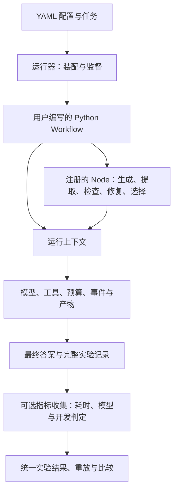

> **文档状态：归档设计讨论：含已实施和未实施设想。** 历史证据保留，当前框架用法与限制以[详细参考](../user-manual.md)为准。

# Agent 框架重设计方案

| 项 | 内容 |
| --- | --- |
| 状态 | 总体方向已审阅认可；前五阶段实施状态见独立进展记录，全量收益尚未验证 |
| 记录日期 | 2026-10-05 |
| 最后更新 | 2026-10-05：默认采用近似 baseline 的单次生成；各阶段仍先审阅计划 |
| 审查依据 | [Agent 框架审查记录](2026-10-05-agent-review.md) |
| 适用范围 | 正式单题 Agent 与开发实验入口 |
| 更新规则 | 本文只写设计；实施结果写入单独的进展记录与实验记录 |

## 1. 目标与边界

保留现有模型客户端、工具进程运行、接口解析、代码提取和原子落盘的可靠部分，重点建立运行器、上下文、Python Workflow、
实验配置与证据记录。运行框架负责可靠求解；统一开发入口负责任务调度、指标、重放和比较，两者共享运行链路与数据契约，
正式运行不依赖 `dev/`。

目标：

- 还原每次失败：模型看到什么、返回什么、提取了什么、检查与修复产生什么影响。
- 独立替换提示、技能、提取、验证、修复和选择，不修改框架核心。
- 支持指定单题、集合、重复采样、组件测试、历史重放与消融。
- 用同一截止时间控制所有阶段，异常和取消时保留已有较好候选。
- 保存实际配置、代码与组件版本，使实验可以解释和重复。

正式入口保持 `run.sh <input_dir> <output_dir>`，输出 `solution.v` 与 `trace.jsonl`。
官方 baseline 文件不改动；开发评测器可以读取参考答案，Agent 只能读取允许提供的题面与接口。
运行检查仍使用 Vivado，不引入比赛禁止的第三方仿真、综合或形式验证工具。

首版以用户编写的 Python Workflow 为核心，Node（可独立执行的动作）通过本地 Registry
（名称到实现类的注册表）扩展。运行器只负责装配、运行监督和清理，求解顺序不固定在框架核心。
默认 RTL 流程使用近似 baseline 的单次生成策略，也是一个使用公开接口的内置 Workflow。
多轮检查与修复作为可选 Workflow；官方 baseline 入口保持原样。

Python 定义流程和组件，YAML 选择流程与运行条件。首版不引入 YAML 流程图、动态插件发现或
多个自主 Agent；用户扩展通过显式导入本地模块注册，正式运行无需联网安装扩展。

## 2. 总体结构与依赖



| 层次 | 职责 | 用户扩展方式 |
| --- | --- | --- |
| Workflow | 顺序、条件、循环、重试、修复对象、候选选择与停止 | 编写 Python 类并注册 |
| Node | 封装值得独立执行、记录、测试或替换的动作 | 编写 Node 并注册 |
| 运行上下文 | 本题状态、模型与工具服务、预算、事件、产物和 Node 执行 | 默认复用统一能力 |
| 运行器与实验入口 | 配置校验、创建实例、超时监督、清理、最终落盘和汇总 | 通过配置选择实现 |

Workflow 可以使用普通 Python 函数、条件、循环和异常处理；不要求每段逻辑都注册为 Node。
Node 返回结果，不暗中安排下一步：lint 返回检查结果，是否修复由 Workflow 决定。
提示拼接、错误码解析等细节通常是 Node 内部辅助函数，不必拆成动作。

依赖方向：Node 和 Workflow 依赖共享契约与公开上下文；运行器依赖注册表和运行入口；
实验工具依赖公开运行入口与产物格式。基础服务不反向决定求解流程。

目标组织（主要目录已在第五阶段归位，实际接口和位置见 [目录说明](../design/layout-and-submission.md)；重放仍待实现）：

```text
43240-agent/
├── agent/
│   ├── main.py
│   ├── core/                  # 契约、Registry、运行器、上下文、配置、预算
│   ├── services/              # 模型客户端和工具进程管理
│   ├── nodes/                 # 内置及实验动作
│   ├── workflows/             # 所有 Workflow，配置选择具体实现
│   ├── recording/             # 事件、原始证据、产物及通用统计支持
│   └── prompts/
├── config/default.yaml        # 默认单题运行配置
├── skill/
├── serve/
├── model/
├── dev/
│   ├── tools/
│   │   ├── run.py             # 单题、批量、采样和可选指标的统一入口
│   │   ├── metrics/           # 开发判定与统计扩展
│   │   ├── replay.py
│   │   └── remote/            # 远端实例、隧道、权重与服务管理
│   ├── configs/               # 实验 YAML 与任务清单
│   ├── tests/                 # 单元、流程测试与小型样例
│   ├── runs/                  # 原始产物，不提交
│   └── docs/                  # 团队开发文档
└── 赛事要求的入口、声明和报告文件
```

不按正式／实验分开存放 Workflow：实验 Workflow 和 Node 也放在 agent/，由实验配置选择。
它们不能包含参考答案、读取开发判定信息或依赖 dev/。Git 中的版本管理范围和参赛打包范围需要
分别定义；注册不等于自动执行，具体启用的 Workflow 及版本在实验记录中保存。

dev/ 只保留 tools、configs、tests、runs、docs 五类职责。测评不再有独立求解主流程；
现有 eval/ 的执行与分析功能逐步并入统一入口及指标扩展，远端管理移到 tools/remote/。
共享能力按实际职责安排，暂不新增宽泛的 common/ 或 utils/。

路径是建议，不要求每个接口一个文件。迁移既有模块先保持行为，不同时改变算法。

## 3. 数据契约

| 对象 | 拟保存字段 | 约束 |
| --- | --- | --- |
| `TaskSpec` | 任务 ID、题面、目标模块、接口、来源、可信度、解析警告 | 不含参考实现；权威接口、题面推断和待修源码分开 |
| `ModelCall` | 调用 ID、阶段、messages、参数、响应、正文、耗时、错误、服务请求 ID | 保存实际发送与实际返回，不事后重建 |
| `Candidate` | ID、不可变代码、哈希、来源调用、父候选、提取结果 | 代码不可变，验证记录独立保存 |
| `CheckResult` | 检查 ID、候选 ID、检查类型、状态、诊断、命令、耗时、产物引用 | 未执行、不可用、失败与通过明确区分 |
| `RunState` | 候选集合、检查历史、当前修复对象、兜底选择、错误历史、调用计数、停止原因 | 供 Workflow 决策，通过上下文公开接口更新 |
| `MetricResult` | 样本、指标名称、值、状态、来源执行或判定、配置与产物引用 | 缺失、环境失败和代码未通过不能混为零分 |
| `NodeExecution` | 执行 ID、Node 类型、输入输出引用、父执行、配置、耗时、错误 | 自动记录每次动作；不要求 Workflow 返回 Action 才能执行 |

检查状态拟用 `passed`、`failed`、`timeout`、`unavailable`、`error`、`skipped`。
`error` 表示检查过程异常，`unavailable` 表示环境不具备条件，`skipped` 表示没有执行。
三者都不能当成检查通过。

诊断类别包括接口、语法、详细描述、综合、环境、输出截断、多草稿、模型传输及未知。
诊断附带阶段、错误码、对象、源码位置、可信度和日志引用；不确定就标为未知。

内部检查不命名成官方 L1/L2/L3；这些等级只由开发判定器产生。

## 4. Workflow、Node 与注册机制

拟以 Python Protocol 或等价的明确接口描述组件。使用 `WORKFLOW_REGISTRY` 和
`NODE_REGISTRY`，名称对应实现类；支持重复名称拒绝、未知名称提示和已注册实现查询。
注册时只登记类，不构造模型、工具或可变 Node 实例；运行时再创建实例。

Workflow 自行选择已注册 Node，直接在 Python 中显式传入组件参数，不需要 YAML 的全局
nodes 清单或 bindings（角色到实例的绑定表）。固定实现也可以直接构造；注册表用于查找和扩展，
不意味着每个内部辅助对象都必须注册。

以下代码仅示意接口形状，不是已有实现或经过验证的参数：

```python
@WORKFLOW_REGISTRY.register("repair_loop")
class RepairLoop(Workflow):
    def __init__(self):
        self.generate = build_node(
            "rtl_generate", temperature=0.2, max_tokens=4096,
        )
        self.extract = build_node("rtl_extract")
        self.validate = build_node("vivado_lint")
        self.repair = build_node("rtl_repair", temperature=0.1)
        self.max_repairs = 2

    def run(self, ctx):
        reply = ctx.execute(self.generate, task=ctx.task)
        candidate = ctx.execute(self.extract, reply=reply)
        # 验证、修复、选择和停止由该 Workflow 的 Python 逻辑定义。
```

自定义 Node 使用相同的公开上下文调用模型和工具，无需重复实现原始回复保存、预算和清理。
Node 的类型与参数不一定暴露给 YAML；确实需要批量扫描的参数，由 Workflow 作者主动开放，
并定义自己的参数校验。

运行时每题创建独立上下文和 Workflow／Node 实例。共享模型服务与本题可变状态分开；
不得因模块导入或类注册让不同题目共享候选、错误历史或调用计数。

## 5. 运行上下文与流程控制

| 接口 | 拟承担职责 |
| --- | --- |
| `ctx.task` | 允许提供的任务信息、接口来源和可信度 |
| `ctx.execute(node, ...)` | 执行动作，记录输入输出引用、执行关系、开始结束、耗时与异常 |
| `ctx.llm` | 请求、原始响应、分类错误和单次预算 |
| `ctx.tools` | 工具命令、日志、取消和进程回收 |
| `ctx.budget` | 剩余预算、动作预算及是否可启动 |
| `ctx.artifacts` | 不可变候选、检查证据、显式更新的兜底答案 |
| `ctx.events` | Workflow 的决策理由与自定义事件 |

Workflow 用普通 Python 定义顺序、分支、循环、重试和停止，不使用框架固定的动作选择主循环。
默认流程采用「单次生成 → 提取 → 选择」。可选修复 Workflow 组织接口、lint、综合与修复，
框架不限制其他流程。
修复、重试和选择策略可写成公共函数或 Node，供多个 Workflow 复用。

模型和工具操作经过统一服务接口；Workflow 通过 `ctx.execute()` 执行 Node，保证调用可以关联。
框架统一捕获和记录执行异常，但不自动将异常解释为需要修复 RTL。是否重试、换动作或结束，
由 Workflow 明确决定；未处理异常交给运行器保留已有答案并结束。

运行器建立上下文、执行 Workflow、监督整题截止时间、取消活动工作、清理并保存最终结果。
自由 Python 可能包含普通阻塞操作和长循环，仅靠上下文不能保证硬超时，因此需要外层监督。
Workflow 返回候选或明确的求解结果；中途兜底选择使用公开产物接口显式更新。

默认 Workflow 的错误处理建议如下，其他 Workflow 可提供不同策略并记录原因：

| 情况 | 建议动作 |
| --- | --- |
| 输出截断或只有未完成模块 | 预算允许时调整输出或要求简洁实现；保存原始回复 |
| 目标模块缺失 | 明确要求修正目标，不忽略诊断 |
| 多个完整冲突草稿 | 保存草稿及选择理由，长度不代表质量 |
| 可重试模型传输失败 | 有限重试，与 RTL 修复次数分开计数 |
| 请求配置或响应结构错误 | 明确分类，不盲目修改 RTL |
| 接口、语法等代码问题 | 修复相关候选 |
| 环境或授权问题 | 保留候选，停止或重试环境检查 |
| 完全重复的代码 | 条件一致时复用检查证据 |
| 重复错误且没有进展 | 换策略、重新生成或停止 |

## 6. 候选选择与修复

状态分别维护最新候选、修复对象和最终选择。新候选先保存，经过证据比较后才决定是否更新
`solution.v`。首份完整候选可以作为无其他答案时的兜底；存在较好候选后，未验证或检查失败的
新候选不能无条件覆盖它。

选择规则拟优先使用已取得的验证证据，同等证据使用固定的选择顺序。规则必须记录理由，不能
把综合通过等同于功能正确。加入行为检查后，需另行明确证据冲突的排序。

检查缓存仅在代码、任务条件、检查配置和工具版本一致时复用；超时与环境失败不直接当成稳定代码结论。
相同哈希仍保留不同模型调用的来源关系。

修复提供可替换的 `minimal_edit` 与 `patch`：前者要求只改必要部分并返回完整文件，后者由程序
应用局部修改。两者都记录父候选、目标诊断、差异、原错误是否消失及新错误。patch 的应用失败
必须显式记录，不改变旧候选。

重复错误按稳定的阶段、错误码和对象识别，不比较包含临时路径的整段日志。换策略阈值由 Workflow 指定，需要扫描时再主动开放为参数。

## 7. 时间预算与取消

整题使用单调时钟和一个绝对截止时间；预算覆盖初始化、模型、检查、重试、产物写入及最终返回。
预算提供剩余时间、是否能启动动作和动作超时上限。HTTP 传入的截止时间是硬上限。

外部运行配置提供总预算和输出预留；服务设置请求上限，Workflow 显式指定各阶段、模型调用、
修复及重试上限，需要扫描时再开放参数。这些是上限，不是必须用完的配额。Workflow 需要判断剩余时间是否足以完成一个有用动作，不能只判断大于零。

运行监督层登记活动子进程组并统一取消；工具独立 session、外层超时和 HTTP 取消都纳入同一机制。
要求停止后先取消活动工作、回收进程，再返回已有选择。清理时间必须计入预算。

HTTP 超时不保证模型服务停止推理，需针对实际后端验证连接关闭与请求取消行为。
短期行为保持策略与阶段耗时估计可以并存，实际预算参数需通过实验确定。

## 8. 证据记录与产物生命周期

开发完整记录拟使用以下布局：

```text
<sample>/
├── solution.v
├── trace.jsonl
├── run.json
├── config.json
├── task.json
├── selection.json
├── calls/m001/
│   ├── request.json
│   ├── response.json
│   ├── content.txt
│   └── call.json
├── candidates/c001/
│   ├── solution.v
│   ├── metadata.json
│   └── extraction.json
└── checks/k001/
    ├── result.json
    ├── command.json
    └── full.log
```

原始响应保存服务端实际返回内容，包括可用的 reasoning；未返回的信息无法获取。
非 JSON 响应、异常前可获得的内容和脱敏错误也保存。不得用标准化结果伪装原始响应。
完整 messages 保存实际发送版本，不能根据当前提示模板事后拼回。

trace 保存事件与产物引用，使用运行、调用、候选、检查 ID 关联，避免重复塞入大段正文。
记录包含动作开始、结束、错误、取消和选择；开始事件在调用前落盘，使中断时也知道卡在哪一步。

提供 `basic` 与 `full` 记录级别。凭据请求头不落盘，正文与配置由统一过滤器处理。
详细记录失败要显式报告，但不能破坏已保存的最终答案；输出文件写入失败不能伪装成成功。
产物格式带版本；现有分析器通过兼容层读取，迁移时不静默改变工具调用计数。

HTTP 开发模式把详细产物写入独立运行目录，按运行 ID 读取，不随请求临时目录删除。
设置清理周期和磁盘上限，活动运行不清理；正式响应保持赛事格式。最终答案仍使用原子替换。

## 9. 简化配置与版本追踪

Python 定义流程与组件，YAML 只选择 Workflow、扩展模块、外部服务和运行实验条件。
没有 YAML 流程图、全局 Node 装配清单或 bindings；组件类型、提示策略、生成参数和修复次数
可以全部写在 Workflow 中，不要求在 YAML 重复声明。

| 参数 | 默认归属 |
| --- | --- |
| Node 类型、提示策略、采样参数、修复次数、选择方式 | Python Workflow 中显式指定 |
| 模型地址、工具路径、凭据来源 | 外部服务配置 |
| 整题预算、记录目录和记录级别 | runtime |
| 任务集合、重复采样、并发与可选统计指标 | experiment，仅由统一开发入口消费 |
| 需要批量扫描的少量流程参数 | Workflow 作者主动开放并校验的可选 params |

示例仅表示配置形状，数值不是测得的推荐值：

```yaml
schema_version: 1

imports:
  - my_agent.workflows

workflow:
  type: repair_loop

runtime:
  deadline_s: 360
  recording:
    level: full

experiment:
  tasks:
    root: ../../tasks
    ids: [ex03_lfsr8]
  samples: 3
  solve_jobs: 1
  metrics:
    - runtime
    - model
    - judge
```

模型和工具的当前字段见[配置说明](../design/configuration-and-experiments.md)。外部配置不能覆盖 Workflow 中未开放的组件参数；
若需要替换固定 Node，修改 Python 或注册复用公共逻辑的 Workflow 变体。
框架基础字段由框架校验，开放的 Workflow 参数由对应 Workflow 校验。

YAML 已使用安全加载、拒绝重复键和别名，并在 requirements.txt 声明 PyYAML。首版不提供配置继承；具体覆盖规则与外部服务字段见配置说明。

运行覆盖顺序需固定并记录。HTTP 截止时间作为硬上限；已有环境变量可以在兼容入口转换，
有冲突时明确说明生效来源。路径相对于声明它的配置文件解析，避免依赖当前工作目录。
凭据通过明确的环境变量引用，不进入配置快照；不支持任意表达式执行。

因为组件参数在 Python 中，仅保存 YAML 不足以还原实验。必须保存：

- 原配置与最终生效运行配置，以及显式覆盖来源。
- 实际 Workflow、Node 类型、模块路径及构造参数；由统一构造接口或组件元数据获取。
- 源码版本和开发阶段的差异或快照，不能只有 dirty 标志。
- 提示与技能内容哈希、任务清单、工具版本、模型服务版本与实际请求参数。

Node 经统一构造入口登记可序列化参数；直接构造的组件应提供等价元数据。
无法获取的参数明确标为未知，不伪装成完整记录；脱敏不应删除影响结果的普通参数。

## 10. 统一实验入口、指标与重放

单题、集合、重复采样和测评共享同一条 Agent 执行链路：选择任务与 Workflow → 执行并保存产物
→ 收集选中指标 → 输出逐样本结果与汇总。测评是统一工具的可选统计能力，不再维护独立的求解流程。
统一统计接口不意味着所有指标都只读事件；开发判定指标需要调用已有官方判定器。

| 指标 | 来源 | 执行位置 |
| --- | --- | --- |
| 模型调用次数、token、耗时、重试 | 模型调用记录 | 通用运行统计 |
| Node 耗时、工具失败、预算使用 | Node、工具与预算事件 | 通用运行统计 |
| 官方编译、仿真、综合等级与题目系数 | 开发判定器及其完整日志 | dev/tools/metrics/ |
| 多题得分、等级分布和耗时分布 | 已取得的逐样本指标 | 统一开发入口汇总 |

开发判定在候选产出后执行，参考答案、测试台和结果不进入 Workflow 求解上下文。
Agent 的接口、lint、综合及题面行为检查仍是求解动作，与官方测评指标明确区分。
只有启用的指标才执行；未启用、跳过、超时、环境失败和实际未通过分别记录，不能统一写成零分。
环境失败的计分处理遵循官方规则，统计保存有效样本数和排除原因。

概念接口示例（尚未实现）：

```python
result = runner.run(workflow, task)
metrics = collect_metrics(
    result,
    collectors=[runtime_metrics, model_metrics, judge_metrics],
)
```

每个指标关联来源事件、候选、工具或判定产物，并记录状态与参数。耗时指标区分 Agent 求解、
开发判定及整个实验墙钟；HTTP 往返耗时另行记录，不能让判定耗时混入求解代价。

目标产物布局：

```text
runs/<run_id>/
├── config.json                # 生效配置和版本来源
├── samples/                   # 每次求解的完整产物、逐样本指标与判定证据
├── metrics.json               # 逐样本指标及汇总或其引用
└── summary.md                 # 可重生成的结果摘要
```

可提交的人工假设与结论另存 dev/docs/experiments/，不把大量原始产物提交到 Git。

从现有 dev/tools/run_eval.py 迁移统一入口，复用官方 judge.py 和 score.py，不重写评分口径。
拟增加 --task 与 --config，保留任务清单、模式、采样与并发能力。选择结果保存为冻结清单；
默认排除项与实际排除结果明确记录。只求解模式仍生成运行记录及无需判定的指标和摘要。
官方 baseline 独立调用原版入口，不因共用实验运行器而加入 Node、提示或工具。

| 粒度 | 输入 | 输出 |
| --- | --- | --- |
| 单题完整求解 | 任务、配置、选中指标 | 完整产物与指标 |
| 集合重复采样 | 冻结清单、配置、采样次数 | 逐样本结果与汇总 |
| 模块测试 | 固定输入与假依赖 | 输出和断言 |
| 提取重放 | 历史原始回复 | 新旧提取差异 |
| 候选验证或测评 | 已保存候选与选中检查 | 新检查证据与指标 |
| 选择重放 | 固定候选和已有证据 | 选择差异 |
| 流程重放 | 可匹配的历史请求与回复 | 动作及状态比较 |
| 消融比较 | Workflow 变体或主动开放的参数 | 行为、耗时和测评差异 |

重放客户端必须核对请求内容和相关参数；Workflow 发出历史中不存在的请求时标记不完整，不能
顺序消费下一条回复冒充匹配结果。更换提示、技能注入和生成策略需要实际调用模型。

从候选继续验证时保存来源与新配置。历史流程重放和真实重新运行的结果分别统计，避免混为模型收益。

## 11. 消融与实验口径

消融主要通过注册不同 Python Workflow、复用公共构造方法和辅助函数实现；需要扫描的参数
可由 Workflow 主动开放。变体包括关闭技能、关闭综合、单次生成、关闭修复和不同候选选择。
不复制整套框架，也不假定每个固定 Node 都能被 YAML 替换。

关闭 Node 不能简单返回 None：Workflow 必须显式跳过、提供兼容替代或改变后续逻辑，
以保持数据契约。单次 Agent 生成不等同于官方 baseline。

分别支持：

- 固定其他调用和步骤，移除组件，观察该组件的贡献。
- 固定总预算，允许重新利用节省资源，比较实际求解效果。

记录任务清单及哈希、实际配置、源码快照、模板和技能、模型服务、请求参数、采样、并发与预算。
若服务支持 seed 则记录，但不宣称 seed 保证不同运行完全一致。

分析既看总分，也看同一次运行内候选是否退化、错误是否消失、重复调用和停止原因。
基线与 Agent 最终结果差异不能单独归因于修复；第三轮的低最终正确率不能单独证明没有边际收益。

## 12. 功能验证扩展

先把现有验证器接入新契约，再实验从题面建立有限行为检查：规格条件 → 激励与断言 → Vivado
仿真 → 结果与覆盖范围。测试优先依据题面，避免只根据候选写测试而复述同一错误。

组合逻辑从边界输入开始，时序逻辑检查复位、保持、优先级和短序列。
多候选差分仿真只记录行为一致性，不能把多数答案当参考答案。自生成测试通过不能标为官方 L2。
测试台与最终 RTL 分开保存，不读取参考实现，不把公开题答案变成技能。

是否采用 patch、多候选或题型技能，由固定预算实验决定，不在重设计首版承诺收益。

## 13. 实施阶段与验收

| 阶段 | 拟实施工作 | 验收条件 |
| --- | --- | --- |
| 观测 | 请求、回复、候选、日志和决策证据 | 失败样本可以还原完整过程 |
| 拆分 | 契约、上下文、Registry、默认单次生成与可选修复 Workflow | 默认只生成一次；可选修复流程在固定输入下保持拆分前策略 |
| 策略修正 | 候选保护、预算、取消和错误路由 | 后续失败不覆盖较好候选，超时有效回收 |
| 实验 | 统一运行入口、指标收集、重放与 Workflow 消融 | 单题与测评共用求解链路，不改核心即可比较组件与流程 |
| 能力扩展 | 行为检查、修复与多候选策略 | 固定实验条件下验证收益 |

扩展性验收包含默认单次生成 Workflow、可选修复 Workflow 和一个自定义 Node；不要求兼容旧内部接口。
新增这些实现不得修改框架核心，仍自动获得调用记录、预算监督、产物与实验支持。

阶段分别提交；行为保持重构与求解策略变化分开评估。改变方案结构或行为时同一 commit 更新
`../../README.md`，模型服务配置改变时同步模型声明，官方 baseline 保持不变。当前开发规范见 [conventions.md](../conventions.md)。

必要测试覆盖：原始回复提取失败仍可分析；重复候选不重复检查；后续失败保留旧答案；暂时性故障
有限重试；环境问题不触发 RTL 修复；预算不足不启动无用动作；外层取消回收独立子进程组；
重放不匹配明确失败；单题和排除规则可追溯；正式 Agent 不依赖开发文件和参考答案，实验 Workflow 同样遵守此边界。

## 14. 待评审问题

- 首版候选证据排序，以及未知检查和证据冲突的处理。
- 各阶段时间上限、最低启动预算、重试和重复错误阈值。
- 详细产物的默认级别、HTTP 开发获取方式与保存期限。
- 重放采用完整请求匹配的字段集合，以及模型服务不支持取消时的限制。
- 行为检查从哪些题型开始，如何减少测试与实现共享误解。
- 提示与技能版本快照方式，以及未提交代码快照的大小控制。
- 配置和 trace 的兼容迁移，如何保持已有分析工具可用。
- 外部服务配置字段、可选配置继承与覆盖规则、Workflow 开放参数的校验方式。
- 直接构造 Node 时的元数据接口，以及上下文公开接口的最终签名。
- 指标收集器接口、开发判定并发及指标版本，以及旧运行目录的兼容读取。

上述事项需要评审或实验，不因本文记录而视为已经决定或实现。

## 15. 文档集中与开发规范调整

团队开发文档拟统一放到 dev/docs/，只保留 design、notes、experiments 三类：

```text
dev/docs/
├── README.md                  # 唯一团队开发文档索引
├── conventions.md             # 开发规范
├── design/                    # 长期维护的架构、配置和产物说明
├── notes/                     # 审查、进展、失败分析和决策记录
└── experiments/               # 每次实验的假设、结果与结论
```

长期设计和有效选择理由放 design/，阶段记录与失败分析放 notes/，跑分总结放 experiments/。
类型、状态、日期及来源在文档头部注明；不再分别维护 decisions、failures、generated 和 archive
目录及多套索引。历史依靠 Git；结果生成块与人工正文分开，重跑只更新生成块。

主办方原始文档保持位置和只读规则；赛事要求的 README.md、REPORT.md、MODEL.md 及技能说明等
固定文件保留，只承担必要的入口和提交说明，不复制整套开发文档。文档集中不意味着移动这些文件。
AGENTS.md 保留为仓库协作入口，后续引用集中存放的规范。

上述目标已在[第五阶段](2026-10-05-stage5-progress.md)实施主要迁移；脚本、链接、AGENTS.md、规范和索引同步更新。用户未提交笔记保留原位，具体例外和验证边界见进展记录。

开发规范建议围绕下列约定收敛，具体文字随迁移另行修改：

- 可执行 Workflow 和 Node 放 agent/，实验选择与参数放 dev/configs/，工具放 dev/tools/。
- 正式运行不得依赖 dev/；参考答案和开发判定信息不能进入求解组件。
- 注册只登记类，每题独立实例；Node 经上下文执行，模型与工具调用统一记录。
- 内部异常分类并记录；边界保留已有候选，无候选才输出空文件，输出失败不能伪装成功。
- 测试按改动选择：组件测试、假依赖流程测试、重放、超时回收、单题 smoke 和固定条件实验。
- 指标标明来源、状态和计分范围；实验数字引用运行，静态审查引用版本与命令，示例标明示意。
- 原始产物进入 dev/runs/；自动结果与人工结论使用明确的生成块，不要求同时禁止和允许手改全文。
- 打包范围使用明确清单，独立于 Git 忽略规则；检查必需文件、开发依赖、秘密和参考答案。
- 独立分支和 PR 规则保留；文件迁移与行为修改分开评估，已有未提交内容先保护。
