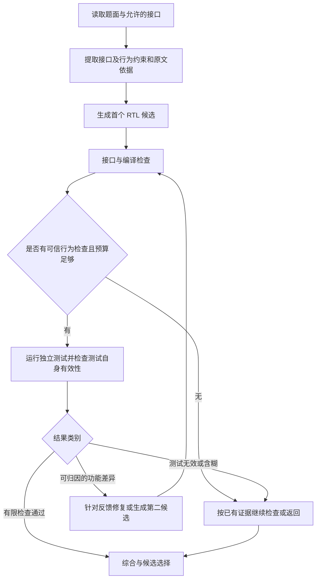

# RTL Agent 下一阶段开发 proposal

| 项目 | 内容 |
| --- | --- |
| 类型 | 开发提案与现状分析 |
| 状态 | 已归档；保留 2026-10-10 提案，部分前置工作已被后续实现和实验覆盖 |
| 日期 | 2026-10-10 |
| 工作区依据 | `d4ca06e`，以及工作区已有的两份未跟踪实验记录 |
| 官方总仓库依据 | `Vickyiii/fpgachina26-amd`，`e47e4a81c2a6a35dbd0b25dcaa4d2edef9daf643` |
| 官方 RTL 仓库依据 | `Vickyiii/rtlagent2026`，`afd135e7ba5f6ec4c6d77e7c927c894327537801` |
| 本次验证 | 文档通读、关键实现核对、任务数量核对、候选选择的内存最小复现；补充尝试云端分配，资源不足，未新增真实模型或 Vivado 跑分 |
| 用户补充 | 初赛仅提供 48GB 测试卡；`repair_loop` 是占位流程，不代表已选定路线；下一阶段限定在 Qwen3 系列探索 |

本文已按上述补充重新安排优先级。初赛实验首先研究 Qwen3 在 48GB 环境中的表现，再据此选择 Agent 路线；32GB 是后续迁移问题，不作为当前实验的准入门槛。

## 归档说明（2026-10-11）

以下编号章节和附录保留 10 月 10 日的方案、观察与待办，文中的“当前”“尚未执行”“下一次”均指当时。它不是已批准的新一轮实施计划，也不代表下面列出的历史风险已经全部复核或解决。

- 后续已完成 `single_generate` 与 baseline 的模型请求和代码提取对齐；等价范围与例外见[方案 README](../../../README.md)。下文“single_generate 不能代替官方 baseline”应按原版本背景阅读，不能用来否认现有等价实现；官方 baseline 文件仍保留不变。
- 已在 AutoDL 完成 Qwen3 模型筛选、四款模型的 155 题测试及思考截断补测，见[实测汇总](2026-10-11-autodl-qwen3-results.md)和[输出额度补测](2026-10-11-qwen3-output-budget.md)。因此“先做小批生成诊断”“未新增模型跑分”等不再作为当前进展描述；原方案的分阶段验收也不能据此全部标记为完成。
- 48GB 是提案当时的初赛环境前提。本轮 AutoDL 实验遵循用户随后指定的 32GB 显存限额；这不表示赛事硬件要求变化，也不等同于目标 AMD 环境或完整离线部署已验证。
- 规格整理、自查、行为检查可靠性、候选保底及交付验证等设计仍可作为后续路线讨论的输入，尚未因本轮模型测试而获准实施；`repair_loop` 未改。
- 下文引用的 10 月 4 日与 10 月 7 日实验文档在本次整理中纳入版本管理，原路径、历史测量和日志保留。正文“尚未跟踪”仅记录提案撰写时状态。

## 1. 建议审核的结论

建议保留现有框架，下一阶段以“在 48GB 环境中探索 Qwen3，并找到有证据支持的 Agent 路线”为主线。
框架已具备可替换 Workflow（求解流程）、候选与证据管理、预算监督、完整模型记录、统一实验入口和开发区判定。
继续大规模重构的收益，目前小于补齐真实评测、功能反馈和最终交付验证。

推荐按以下顺序推进：

1. **先测清 Qwen3 的生成能力与失败来源。** 分开示例题和评测题，冻结服务条件，对比官方 baseline 与单次生成，并研究思考模式、截断、提示和题型差异。占位 `repair_loop` 不是这一步必须优化的对象。
2. **比较少量明确的 Agent 假设，再选择主线。** 候选方向包括规格整理后生成、生成后进行有针对性的自查、题面驱动的有限行为检查。行为检查值得优先研究，但是否成为主路线由 Qwen3 的实测错误分布与测试可靠性决定。
3. **在 Qwen3 系列内收敛模型与服务。** 以已跑通的 Qwen3-8B 为校准点，分阶段研究其他 Qwen3 尺寸/变体；结合能力、增益、时间和 48GB 实际资源选择，不扩展到其他模型家族。
4. **把初赛交付与决赛迁移分开。** 当前完成 48GB 环境的离线、协议和连续运行验证；记录资源数据并保留迁移余地，后续再做 32GB 配置和目标卡验证。

第一阶段建议单独审核和实施。后续阶段以实际收益和测试可靠性为进入条件，不一次性承诺完整功能清单。
本 proposal 不预言最终分数，也不把历史小样本优势当成当前版本已获得的收益。

## 2. 赛事要求对技术路线的约束

### 2.1 优化目标是能力、增益、耗时和工程的组合

依据 [SCORING.md](../../../../SCORING.md)，单个有效样本的系数为：L0 = 0、L1 = 0.2、L2 = 0.7、L3 = 1。
先在每题的有效样本间平均，再对题目平均得到能力分数 S。这里的 pass@1 是这套加权口径，不能直接等同于“完全正确题目比例”。
pass@5 取每题多次采样中的最好结果，是诊断指标；samples=1 时两者相同，不能据此论证稳定性。

总分的四个部分是：

| 部分 | 规则含义 | 对本项目的影响 |
| --- | --- | --- |
| 能力，30 分 | 与 Agent 的 S 成正比 | 要保住部分得分，也要提高功能正确率 |
| 增益，40 分 | 比较同模型的 Agent 与原始 baseline；比例为 Sa/Sb，按对数映射并截断 | 不能只按 Agent 绝对分选模型，也不能故意削弱 baseline |
| 耗时，10 分 | 按参考耗时与实际耗时的比例计分，上限 10 分 | 多次生成、仿真和综合都必须用收益证明额外时间值得 |
| 工程与报告，20 分 | 架构、复现、消融、失败分析与交付质量 | 当前框架已有基础，但正式报告和复现证据尚未完成 |

当 Sb > 0 时，能力与增益部分可写为：

`30 × Sa + clip(40 × ln(Sa / Sb) / ln(M), 0, 40)`。

M、耗时参考值以及最终预算需以主办方最终口径为准。历史表格中的 M=2.5 只能用于情景比较，不能作为已知正式参数。
Sb=0 的处理也不能自行定义。分析工具应同时保留原始 Sa、Sb、增益和耗时，参数公布后再计算正式总分。

### 2.2 功能验证决定可提升空间

内部 DUT（被测设计）单独编译通过，不等于官方测试台可以成功连接；综合通过也不等于功能符合题意。
L2 依赖功能仿真，L3 还要求综合通过。由此可见，继续只优化“编译错误修复”很可能较快遇到上限。
官方当前要求也没有把资源占用最小化或时序收敛单列为目标，不应提前投入大量 PPA（功耗、性能、面积）优化。

### 2.3 公平性与输入边界

- 原始 `baseline.py` 和 `run_baseline.sh` 保持不变；Agent 与 baseline 使用同一模型及可比的服务环境。记录模型文件、量化、上下文、服务参数和原始 baseline 文件哈希。
- baseline 固定的采样与请求参数照原实现执行；Agent 的参数属于方案变量，必须披露。当前 `single_generate` 不能代替官方 baseline。
- 正式 RTL 投题不能依赖本地参考答案或官方测试台，`interface` 也可能为空。运行时证据来源只能是题面、允许的接口输入、模型输出和自有工具结果。
- 允许通用检查和模板，不把参考答案、题号映射、官方测试内容或确定性代写整题的规则塞入提交目录。
- 开发时可以用官方判定衡量候选与自生成测试的可靠性，但判定结果不得回流该次求解。参考答案及相关分析只留在开发区。

### 2.4 环境与协议要求

**按用户补充，初赛阶段主办方只提供 48GB 显卡测试。** 本 proposal 的近期运行与选型据此以 48GB 环境为基础，不强制把实验显存限制到 32GB，也不因某配置超过 32GB 就将其排除。
仓库所述云端 W7900 为 48GB，决赛 R9700 为 32GB，两者 GPU 架构不同。初赛环境可运行与后续决赛可迁移是两个独立结论。
在 48GB 卡上人为收紧显存只是一项可选迁移实验，不能代替目标卡验证，也不应影响首轮对 Qwen3 的正常能力测量。
文档中若存在阶段不清的单卡 32GB 表述，应记录其适用阶段并在正式提交前核实，不能据此覆盖用户明确的初赛测试条件。

[API 契约](../../../../docs/API_CONTRACT.md)要求健康检查反映模型与 Agent 的实际准备状态；服务需连续处理请求，遵守认证、任务标识和截止时间约定。
耗时应从外部 HTTP 请求观测，并分别记录首次请求和预热后请求。开发配置中的 360 秒不是本 proposal 认定的正式预算。

主办方文档关于公开题与最终题分布的描述存在差异：API 文档提到 VerilogEval，评分说明及总指南强调未公开测试。
本方案按“可能出现未见题”设计，不以熟悉公开题为前提。
总指南中 10 月 9 日提交 proposal、10 月 13 日结果等节点属于具身智能赛道，不应套用到本 RTL 项目。

## 3. 当前工程到达了什么阶段

### 3.1 已具备的基础

当前行为以 [方案 README](../../../README.md)、[User Manual](../user-manual.md) 和实现为准，不能把 10 月 5 日旧审查的问题列表直接当作当前缺陷清单。

| 能力 | 当前状态 | 后续用途 |
| --- | --- | --- |
| Python Workflow、Node 与 Registry | 已实现；流程策略留在 Python，YAML 选择流程与运行环境 | 增加小范围实验变体，无须再设计一套配置语言 |
| 候选、来源与检查证据 | 已实现；能保留候选、选择记录与中断前结果 | 做逐候选评估和真实修复归因 |
| 预算与独立监督 | 已有硬截止、受管理子进程回收和原子结果保存 | 在已有机制上改进动作是否值得启动的判断 |
| 模型与工具记录 | 已记录完整请求、响应、reasoning、工具日志和配置来源 | 区分模型没答、正文提取失败、截断和工具失败 |
| 统一实验入口 | 已支持单题、多次采样、并发、runtime/model/judge 指标 | 补充比较汇总即可，不重建实验平台 |
| 官方判定隔离 | 在开发区作为指标执行 | 保持求解和评测之间的边界 |
| 日志查看器与提交暂存 | 已具备 | 为失败分析、独立目录运行提供基础 |

10 月 9 日清理记录报告了 119 项测试，其中 117 项通过、2 项因缺少 FastAPI 跳过。
这是当时的验证记录，不是本次重新执行的结果；HTTP 相关跳过项仍应在正式服务环境补跑。

### 3.2 当前是路线探索起点，不是既定修复路线的优化阶段

默认 `single_generate` 是一次生成和提取，不执行验证、技能调用或修复。
可选 `repair_loop` 执行生成、接口检查、内部编译、综合，综合通过后立即结束。
**用户明确其主要用于占位，象征性代表 Agent 流程，并未经过完整路线推敲。** 因此其缺少行为反馈、策略较粗等现象，应作为设计新路线时的参考，不能当成必须围绕它持续打补丁的理由。
后续可以复用 Node、模型和工具服务、候选记录与监督机制，但不预设新流程继承 `RepairLoop`，也不要求保留它的检查顺序与停止条件。

两条流程默认的提示词、温度、输出上限和超时不同：单次生成使用 8192 输出上限、温度 0，修复流程默认 4096、温度 0.2。
直接比较两者只能评价两份具体实现，不能单独证明“修复”这一机制的作用，更不能代表已经认真设计的 Agent 路线的潜力。

技能目前主要是复制自示例的接口修复技能，按反馈字符串匹配，并且只有出现反馈后才会注入。
这既不足以覆盖功能错误，也不能证明增加很多技能文档就会提高分数。技能应由可复现错误类别驱动。

### 3.3 本次确认的具体问题和待核实风险

| 项目 | 本次证据 | 建议 |
| --- | --- | --- |
| 占位流程的候选可能被取消 | `RepairLoop.choose()` 排除任何存在 `classify() == 'code'` 结果的候选；内存复现中，唯一候选 lint 通过、综合代码失败后返回 `candidate_id=None` | 记录为新路线需避免的损失路径；仅在复用或正式对比该流程时修正，不列为独立主线 |
| 占位流程综合通过即停止 | `repair_loop.py` 中明确以 `synth_passed` 返回 | 说明该占位流程不提供功能反馈；新路线是否使用仿真由实验决定 |
| 健康检查过早宣布 ready | `serve_api.py` 只验证配置可解析便返回 `ready=True` | 验证实际推理服务、目标模型和入口可用性；避免每次 health 做昂贵生成 |
| baseline 与 Agent 配置可能不一致 | HTTP 层给两条脚本同一环境，但 Agent 还读取 YAML，baseline 读取原有环境变量 | 服务启动时校验二者实际模型、地址及关键服务条件；不要改原 baseline |
| 显存报告缺少可靠依据 | `_vram_gb()` 取 `rocm-smi --showmemuse --csv` 最后一个数字并当作字节；失败返回 0 | 用实际目标环境输出核对字段与单位；区分未知、当前占用和测得峰值 |
| 非法 mode 被默认为 agent | 当前除 `baseline` 外都走 Agent | 显式校验允许值，协议错误与求解失败分开 |
| 真实部署配置尚未固定 | 模型声明、manifest、镜像及依赖还有占位或未锁定项；远端试验曾调整服务启动参数 | 最后验证的启动方式必须回到提交文件，防止只在远端手工配置中可运行 |
| 详细记录没有保留策略 | 当前手册明确说明没有自动清理 | 估算数百次请求的磁盘增长，设计容量限制与归档方式 |

候选最小复现只证明选择规则的行为，不证明真实题中发生频率，也不证明该候选必得 L1/L2。
内部编译成功仍可能在官方测试台连接时失败；修改保底策略后需要逐候选官方判定支持收益结论。

## 4. 现有实验能够支持哪些判断

### 4.1 关键证据汇总

| 记录 | 观察 | 可以支持 | 不能支持 |
| --- | --- | --- | --- |
| [9 月 23 日参考链路](../experiments/20260923-203605-ref-full.md) | 158 题中 155 个 L3、3 个 L1；三题参考实现失配数为 0，但测试台报 TIMEOUT | 本地题集有需要单列说明的测试台问题 | 修改官方判定或把异常题算成自己通过 |
| [9 月 25 日 4B BF16 联合实验](../experiments/20260925-182514-joint-A6-4b-bf16-quick.md) | 34 题，Sb=0.3706，Sa=0.5176，增益约 1.3968 | 较小模型有过较大相对收益，值得保留复测席位 | 当前框架已复现此收益，或完整题集也有同等增益 |
| [9 月 25 日 30B A3B AWQ 联合实验](../experiments/20260925-183849-joint-A5-30b-2507-awq4-quick.md) | 34 题，Sb 约 0.594，Sa=0.700，增益约 1.178 | 较强模型的绝对能力与小模型增益存在权衡 | 只看 Sa 就能确定最终优胜模型 |
| [10 月 4 日 Qwen3-8B 联合实验](../../experiments/20261004-212040-joint-cur-qwen3-8b-quick.md) | 旧实现 34 题，Sb=0.5706，Sa=0.6588；6 题改善、3 题变差；Agent 平均约 1.97 次调用 | 存在收益也存在退化；截断值得专项分析 | baseline 正确而 Agent 错误就一定是修复改坏 |
| [10 月 5 日远端验证](2026-10-05-stage3-remote-validation.md) | 真实模型、工具与 HTTP 路径有小样本运行；repair 的 ex03 在首轮即 L3 | 新框架关键链路可以运行 | 真正发生多轮修复时有效，或完整评测有增益 |
| [10 月 7 日单题记录](../experiments/20261007-221221-cloud-single-review-691f4b83.md) | ex03，baseline 与单次生成均 L3，耗时约 55.31 / 53.90 秒 | 该次模型服务与单题判定链路可运行 | Agent 能力超过 baseline，或 1.41 秒差异有统计意义 |

10 月 4 日和 10 月 7 日记录在本工作区存在，但尚未跟踪；本 proposal 引用其内容，不移动、修改或纳入提交这些原始文件。
上述不同日期结果的模型、框架与配置不完全一致，不应合并成一张“当前排名表”。

例如，4B BF16 历史全量 baseline 的 S 约 0.3935，34 题联合实验的 baseline 则约 0.3706。
联合实验的增益必须用后者计算，不能把全量分母与小集合 Agent 分子拼接。
在 M=2.5 的假设下，该 34 题实验的能力加增益约为 30.12/70；这只是历史数据的情景值，不是项目正式得分。

### 4.2 先修正题集口径

本次直接核对目录和排除表：本地有 159 个带 `prompt.txt` 的任务，当前排除 4 个，剩余 155 个。
其中 **152 个是 VerilogEval 任务，3 个是示例题**。当前 `joint-full.yaml` 枚举整个任务根目录，因此“155 题全量”实际包含示例题。

建议冻结两个显式清单：152 题主评测清单、3 题运行检查清单。主评测报告不混入示例题。
另保留异常题诊断清单，逐题解释排除理由，并报告若保留异常题时的结果；不得因某模型做不好而新增排除项。
参考答案链路若在新版工具中变化，应新建记录，不能覆盖原历史结论。

### 4.3 现阶段仍不知道的事情

- Qwen3 在当前 48GB 服务条件下的可靠能力、思考开销和错误分布，以及哪些 Agent 机制能够带来收益。
- 收益来自首轮提示、提取、采样参数、工具修复还是候选选择，各占多少。
- 最终错误中功能理解、接口遗漏、截断、预算不足和环境问题的比例。
- Qwen3 不同尺寸/变体在初赛 48GB 条件下的实际速度、稳定性与得分排序；后续收紧到 32GB 会损失多少。
- 增加行为测试或第二候选后，正确率提升能否抵消耗时损失。

这些问题应通过下面的实验回答，而不是用新一轮框架设计代替。

## 5. 推进方向与优先级

| 方向 | 优先级 | 预期价值 | 主要风险 | 进入或停止条件 |
| --- | --- | --- | --- | --- |
| Qwen3 生成诊断与路线对照 | P0 | 为模型条件和 Agent 设计建立依据 | 把占位流程的表现当成研究结论 | 产出固定服务条件下的生成结果、错误分类与路线假设 |
| 协议与配置一致性 | P0，按实际测试需要处理 | 提升交付可信度 | 工程整理挤占路线探索 | 修正实际阻塞；其余进入交付清单 |
| 新路线的候选保底 | 新路线实现时必需 | 避免已有有效答案被丢弃 | 围绕占位流程作无收益修补 | 在选定流程中验证，不单独扩展旧流程 |
| 提示与技能的小范围改进 | P1 | 低成本减少重复错误 | 增长上下文、引入与题面冲突的规则 | 单变量消融，无收益就撤回 |
| 规格整理、自查与题面行为检查 | P1，待比较的研究方向 | 改善规格理解或提供功能反馈 | 多次调用重复同一误解，或测试错误 | 先小规模比较，再选择一种主线 |
| 根据剩余时间安排动作 | P1 | 把预算花在最有希望的生成或检查上 | 过早停止或错估工具耗时 | 有真实耗时分布后再优化 |
| 两候选与针对性再生成 | P2 | 修复不适合时提供另一解法 | 额外开销、候选共同犯错 | 行为证据可信且预算足够再试 |
| 模型与服务定型 | P1，与上述交替推进 | 同时影响能力、增益、时间及显存 | 再次陷入大规模扫模型 | 最多三条主候选路线，按门槛淘汰 |
| 初赛 48GB 离线与长跑验证 | P0 开始准备，末期完成 | 决定初赛能否实际交付 | 把远端推理跑通当成整包跑通 | 在可用初赛环境做完整验证 |
| 决赛 32GB 迁移 | 后续阶段 | 降低跨显卡与容量迁移风险 | 过早压缩初赛探索范围 | 先记数据；选定方案后做配置收紧和目标卡复测 |

暂缓：多智能体辩论、大规模并行候选、通用历史重放平台、复杂技能检索系统、面向公开题号的规则库、提前进行面积/频率优化。
历史重放有价值，但当前只需“从现有候选产物做开发区离线判定和比较”，不必先建设完整重放框架。

## 6. 阶段 A：Qwen3 生成诊断与路线设计

预计 2—3 个开发人日，不含排队、完整模型运行及硬件等待。该估计用于安排工作，不是完成承诺。

### 6.1 交付内容

1. 冻结任务清单、排除理由、源码、模型和服务配置。补充按题与按候选比较的开发区汇总。
2. 在 48GB 环境先获得 Qwen3-8B 的官方 baseline 与当前单次生成结果。3 道示例用于运行检查，预先固定的约 24 道分层题用于诊断；不把占位修复流程的全量复测设为必需任务。
3. 先固定权重研究思考模式、输出截断、正文提取和提示影响。校验模型一致性；只有阻塞本次测试的服务问题立即修正，其余列入交付阶段。
4. 输出错误分类和两三种候选路线的具体流程、接口、预算与可证伪假设，交由审核后实现。确认最有希望的方案再扩到 152 题。

### 6.2 区分整体效果与机制效果

第一层比较原始 baseline 与当前 single_generate，回答“当前输入输出链路和提示有什么影响”。
第二层在固定 Qwen3 权重与服务条件下比较候选机制，回答“额外步骤是否值得”。建议先研究下列假设：

| 候选路线 | 假设 | 最小对照与停止条件 |
| --- | --- | --- |
| 规格整理后生成 | 显式整理接口、优先级和逐拍行为可减少理解遗漏 | 与直接生成比较，记录额外 token/时间；整理引入错误或无收益则停止 |
| 生成后有针对性自查 | Qwen3 在给定具体检查点后能够发现自己的错误 | 冻结相同首轮候选，对比停止与继续自查；不能只比较两次独立生成 |
| 题面驱动行为检查 | 可执行的反例比纯文本自查更可靠 | 先衡量测试可靠性，再对比主动修复；错误测试过多则维持旁路 |

占位 `repair_loop` 可选作低成本参照，但结果只代表该占位实现；不以修好它作为启动新路线的前置条件。
对需要继续检查/修复的候选机制，建立共享首次生成条件的最小消融。
如果比较同一份已生成首轮候选的后续分支，应在开发实验中明确标为候选条件实验，不能冒充完整端到端投题得分。

逐候选开发判定可以回答：第一版是否已经正确、哪次修改改善/破坏功能、选择器是否丢掉更好的版本。
只比较官方 baseline 与 Agent 的最终答案，回答不了上述因果问题。
对“第三轮是否有用”的研究也必须比较同一批符合继续条件的题，而不能只看进入第三轮后的低通过率。

### 6.3 候选保底的建议契约

区分以下情况，而不是将所有代码错误一票否决：

- 已确认顶层或权威接口错误、语法不成立：不可当作已编译候选。
- 内部编译通过但综合失败：仍保留身份、代码和已有证据，可能具有部分得分价值。
- 工具不可用、超时或未知：保留此前证据，不冒充通过，也不因缺少新证据清空答案。
- 自生成行为测试失败：先看测试可靠性；即使功能确实错误，也不代表返回空文件更好。

这些是新路线的设计约束，不要求现在单独改造占位 `repair_loop`。选择应在选定 Workflow 内实现，不恢复已删除的通用 policy 层。对应回归覆盖唯一候选、多个候选、检查失败后中断、同等级保持原选择等情形。
真实收益以修改前后逐题官方判定为准，不能把内存复现当作得分提升证明。

### 6.4 验收条件

- 每个比较结果能定位到任务清单哈希、模型和服务配置、源码及运行编号。
- baseline 原始文件与官方副本一致；环境失败、缺失判定、模型错误和真正 L0 分开列出。有效分母与排除数量公开，环境失败不静默丢弃。
- 示例题不混入主评测；对完成的诊断集报告 L0/L1/L2/L3、S、逐题变化、外部耗时和模型调用数，不冒充已完成 152 题全量。
- 区分规格理解错误、生成不完整、提取失败和工具问题，给出适合 Qwen3 的候选机制及其预期收益来源。
- 形成一份可复核的当前生成对照和新路线设计，再决定阶段 B；若引入选择器，必须满足上述候选保底约束。

## 7. 阶段 B：候选路线原型——以有限行为检查为详细备选

先按阶段 A 的结果选一条主路线实现，其他路线保留最小对照，不同时建三套完整系统。
本节详细展开风险和接口较多的行为检查路线，作为审核备选；它不代表已经选定最终 Agent 架构。
若选择这一方向，预计 4—6 个开发人日完成最小版本，再按实测决定是否扩大范围；规格整理或针对性自查可先用更小原型验证。

### 7.1 先解决测试是否可信

设计与测试若由同一模型根据同一份误解生成，会相互印证错误。增加测试本身不保证提高正确率。
因此测试计划要先独立提取题面约束，再看候选；每条断言或期望行为保留对应的题面片段及假设。
题面缺失或冲突的内容标为未知，不靠通用口号补成硬要求。

首版建议覆盖题意较明确的组合逻辑、寄存器/使能/复位、定长计数与简单移位等少数类型。
这只是待阶段 A 数据确认的起点，不按题号识别，也不针对已知参考答案写规则。
复杂协议、含糊时序或无法可靠建立期望值的题，允许明确跳过。

### 7.2 拟议执行流程

这是待实现的流程，不描述当前代码行为。是否将综合放在行为检查之前，按阶段 A 的耗时与失败分布决定。

### 7.3 测试有效性检查

测试至少应确认：测试台能编译、实际执行了检查、仿真到达完成标志、没有用超时冒充完成、比较没有因 X/Z 或采样时序而失效。
重点检查复位极性与同步/异步、使能与复位优先级、边界计数、位宽与有符号性、输出延迟及初始状态的题面约束。
没有题面依据的约定不得成为淘汰候选的条件。

生成的测试台放在受管理的独立工具工作目录，由现有进程与预算服务执行。首版不让模型输出任意 Python 并直接执行。
测试台自身的编译错误、连接错误和断言设计错误，必须与 RTL 编译错误分开归因，不能统一标成 `failure_kind=code`。

### 7.4 先旁路观察，再参与修复

第一步仅保存测试计划、测试代码、日志和差异，不改变最终候选。
开发区使用参考实现及官方判定评估测试：参考实现能否通过；对人为引入的复位、位宽、边界、延迟等典型错误能否检出。
变异样本及参考实现仅存在开发区，运行时生成测试不得访问这些材料。

建议预先冻结至少 30 个有明确规格依据的检查案例；若可用题数不足，应降低结论强度而不是宣称验证完成。
初始工程门槛可定为：测试有效执行率至少 90%，已确认正确实现的错误拒绝率不超过 5%，且每类支持的行为都覆盖正常与边界输入。
这些是提议的进入门槛，不是赛事要求；小样本必须同时报告“错了几个/共几个”和不确定性。
变异检出率作为能力描述单列，不能把人为错误检出率当成真实题目提升率。

通过门槛后，仅让具备明确题面依据且测试有效的失败反馈参与修复；仍然保留原候选。
再通过同模型成对实验确认 S 的改善，并检查误导修复、超时和耗时增加。
若测试可靠性不足，保留其分析价值，回退到不参与选择的模式，不继续堆叠复杂策略。

### 7.5 拟议模块和接口

以下名称是设计草案，审核后按现有契约细化；不另建 Agent 循环。

| 位置/接口 | 输入 | 输出与约束 |
| --- | --- | --- |
| `agent/core/` 中的规格证据数据结构 | 题面、接口 | 约束、原文依据、未知项；显式接口与题面推断分开 |
| `agent/nodes/` 中的测试计划动作 | 规格证据 | 支持范围、检查点、假设、预计成本；可返回不支持 |
| `agent/nodes/` 中的行为检查动作 | 候选、冻结测试计划 | 测试有效性、行为差异、证据路径和耗时 |
| `agent/services/vivado.py` 的仿真能力 | 独立 DUT、测试台、预算 | 完整工具结果，沿用现有进程监督与日志 |
| 新实验 Workflow | 候选及各类证据 | 下一动作、修复目标、最终选择及原因 |
| `dev/tools/` 的比较汇总 | 运行产物与开发判定 | 逐题/逐候选收益、退化、耗时、测试可靠性 |

可沿用 `CheckResult` 的公共字段，在 `details` 中明确 `test_invalid`、`environment`、`dut_failure` 等归因。
但是否增加公共类型、如何与现有 `classify()` 配合，应先确定兼容方案。
自生成测试通过的记录统一称“内部行为检查通过”，不写成 L2，也不与官方 judge 指标混用。

## 8. 阶段 C：提示、技能、预算和有限候选

这些都是可独立消融的实验项，不应同时全部开启后只报告一个总提升。

### 8.1 提示与技能

先核对现有提示中的通用约束是否会覆盖题面，例如默认复位方式、单模块要求、技能要求分析表而主提示要求只返回代码等。
首要原则是题面优先，合法辅助模块不能仅因存在而被拒绝。

优先把阶段 A 中高频、可复现的失误整理为少量技能，每个技能包含触发证据、适用范围、检查步骤和避免误用的边界。
接口、复位/使能优先级、位宽与符号、时序延迟可作为候选主题，但只有数据支持才纳入。
首轮技能选择需要根据题面结构；修复技能同时使用错误类别和工具诊断，不能只依赖某个日志字符串。
限制注入长度，比较“无技能/只加该技能”，避免让技能正文挤占代码输出预算。

### 8.2 截断与模型输出

区分响应正文为空、reasoning 未结束、输出达到长度上限、提取器选错草稿及最终模块不完整。
历史 Qwen3-8B 的截断现象使这一方向值得优先检查，但不预先断定关闭思考一定更好。

在服务支持范围内比较思考模式和输出预算，记录实际 prompt、completion、reasoning、finish_reason 及可用代码。
服务端如何分离正文与 reasoning 必须固定到交付配置；不能靠开发阶段手动处理响应才能得到代码。
不得为了降低 baseline 成绩而给其设置不合理的模型服务条件。

### 8.3 根据剩余时间安排动作

已有硬监督解决了“什么时候必须停”，下一步解决“剩余时间够不够做一件有用的事”。
当前很小的 `minimum_action_s` 只能证明还能启动，不足以判断一次生成或综合是否值得开始。

从实际日志得到各模型与工具的耗时分布，用保守分位数估计下一动作的成本，并预留清理和写回时间。
预算不足时返回已有最佳候选；环境失败、重复代码、相同错误反复出现时停止无效修复。
固定保留 20 秒是否合理也需要随请求预算和实测调整，不能把开发默认值当成所有请求的最优值。
所有动作仍受原有硬截止约束，估算不能替代监督。

### 8.4 第二候选与局部修复

首版最多比较两个候选，优先顺序执行，并在同一题预算内计入全部生成和工具耗时。
选择第二候选的场景包括：首个候选缺少有效代码、同一错误修复无进展，或行为证据指出更可能是整体理解错误。
生成提示可强调另一种时序解释检查或结构分解，但不能仅靠多份答案互相投票决定正确。

候选共享同一套已冻结、有效的行为测试，比较完整证据；同等证据保留已有选择。
内部多候选属于一次 Agent 求解，不能拿内部最优成绩冒充官方多次采样的 pass@5。

对于小模块，返回完整 RTL 未必是问题。先用候选差异证明修改范围导致退化，再决定是否引入局部 patch。
若采用 patch，必须验证应用成功、结果完整、候选可恢复；不优先建设通用补丁语言。

## 9. 模型与推理服务的收敛方案

探索范围限定 **Qwen3 系列**。先固定一份权重研究服务和生成策略，再逐步比较尺寸/变体，避免把模型差异与 Agent 机制差异混在一起。
近期以初赛 48GB 卡为实测环境；建议分批研究以下三条路线，不要求第一轮全部下载和跑分：

| 路线 | 用途 | 必须补充的验证 |
| --- | --- | --- |
| Qwen3-8B，固定已跑通的具体版本 | 第一轮校准，并在同一权重下研究生成策略 | 48GB 下的思考/非思考、截断、有效代码与真实功能表现 |
| Qwen3-4B-Instruct-2507 BF16 | 检验历史相对增益较大的小模型路线 | 当前框架完整配对结果；绝对能力与最终得分权衡 |
| Qwen3-30B-A3B-Instruct-2507 AWQ | 在小规模探索后检验较强绝对能力的路线 | 确切量化仓库/修订、48GB 实际速度、能力与增益；随后才评估 32GB 迁移 |

名称仅标识历史路线，正式实验必须填入实际模型仓库、revision、量化格式和权重哈希。
4B AWQ8 或 Qwen3 的其他尺寸/变体可作为条件备选，只有现有路线暴露具体瓶颈时再加入；本计划不纳入 Qwen2.5、CodeV 或其他家族。
8B 的思考/非思考属于固定权重的服务与生成对照，而 4B/30B Instruct-2507 是不同模型变体，不能混称为单纯“关闭思考”。
48GB 条件下不必一律量化小模型；量化是否有必要，应由速度、可用上下文、精度和部署便利性决定。
30B AWQ 的历史约 30.08GiB 峰值可以作为资源估计线索，但不能代替本次测量，也不能直接证明满足后续 32GB 条件。

每条路线先通过：在初赛 48GB 环境能加载、请求正文正确、峰值显存可控、预设诊断预算内可以输出完整代码。离线整包作为交付验收；开发实例首次下载权重与提交时断网运行分开记录。
随后再比较得分。显存统计记录原始字节，同时展示 GB 与 GiB，并说明权重、KV cache（注意力键值缓存）、运行时及峰值口径。
当前不要把 W7900 的显存比例强制改成模拟 32GB 的数值；使用合理的 48GB 配置并记录实际占用。后续迁移时再研究 KV cache、上下文、量化和并发的取舍，最终仍需 R9700/官方镜像验证。

模型排名至少同时呈现 Sa、Sb、增益、L3 比例、外部耗时、超时比例、峰值显存和部署风险。
在 M 与耗时参考值未确定前，做多组合理参数的敏感性分析，不能只给一个假设下的“冠军”。
不得故意选择异常弱的 baseline 服务设置来制造增益；保留小模型是因为它可能有更好的综合表现，而不是因为分母越低越好。

## 10. 评测安排与资源控制

### 10.1 三层题集

| 层次 | 建议规模 | 用途 |
| --- | --- | --- |
| 运行检查 | 现有 3 个示例 | 验证服务、工具、记录与返回；不计主结果 |
| 固定诊断集 | 约 24 道，按组合/时序/接口/边界分层 | 快速排除无效方案；结果不能外推全量 |
| 主评测集 | 当前正常的 152 道 VerilogEval 题 | 方案和模型的完整比较 |

公开题已经被反复分析，重新随机切分并不能把它们变成真正未见数据。
建议另准备约 20—30 道独立规格的新题或保留此前未用于调参的外部题，开发区独立验证其判定可靠性。
变体题只能衡量局部泛化，不应宣称等同于官方隐藏集。

### 10.2 控制实验数量

先用 Qwen3-8B 完成生成诊断和少量路线原型实验，确认有价值再扩到其他 Qwen3 模型。
例如，3 个模型 × 152 题 × agent/baseline 两模式 × 1 次采样，就是 912 次求解，尚未计入其他 Workflow 和判定成本。
一个最终方案按 152 题、两模式、5 次采样执行，则需要 1520 次求解。
因此不能把每次小改动都升级为三模型全量五次采样。

建议探索阶段 samples=1，进入决选的少数配置先做重复采样检查，再为最终组合做更完整的重复实验。
温度为 0 也可能存在服务端非确定性，不能因此省略稳定性评估。
同一已冻结 baseline 结果可用于内部探索参考；模型、服务或题集变化就重新测量，最终联合验证应重新成对执行。

### 10.3 指标与判定方式

每次报告至少包括：

- 任务与有效样本数量、缺失和环境失败明细，四个等级的分布及 S。
- 同题改善/退化数量与幅度；首轮、修复后和最终选择的开发区判定。
- 外部总耗时、每题 p50/p90/p95、超时、模型调用次数与 token；并发实验的单题延迟和批次墙钟时间分开。
- 峰值显存、工具耗时、测试台有效率、错误拒绝正确答案的数量。
- 以题为单位的成对差异与不确定性；可用配对 bootstrap（按题重复抽样）估计区间。区间覆盖零时标为结果不确定，不急于定论。

记录官方判定原值；环境失败不是普通零分，也不能静默从报告消失。对公平可比子集的分析必须说明分母，并补充完整失败情况。

### 10.4 资源管理

本次修订已按用户授权尝试申请一台实例：凭据有效，但启动任务因 `resource_capacity_insufficient` 失败，清理后状态为 `not_found`；未进入模型下载或测试阶段，详见[分配检查记录](2026-10-10-cloud-allocation-check.md)。
没有把这次分配失败当作模型或框架失败，也没有据此新增任何分数。后续可用时先做有明确时间上限的小批诊断，再按结果确定完整实验所需 GPU 小时和费用上限。
GPU 与 Vivado 判定并发分别设置，避免把机器资源争用误认为模型退化。
每批保存必要证据并确认实例销毁；长任务按现有远端规范防休眠、设置看门狗并处理认证过期。
具体费用以实际平台价格和实例规格计算，本 proposal 不虚构预算金额。

### 10.5 下一次资源可用时的小批诊断

本次因分配失败没有执行下列测试。为避免下次拿到实例后临时扩大范围，建议预先固定最小批次：

1. 使用 Qwen3-8B 的已知固定 revision，记录实际权重和推理服务；按 48GB 环境设置合理显存比例，不先模拟 32GB。
2. 选择 `ex03_lfsr8` 检查运行链路，再用 `Prob038_count15`、`Prob043_vector5`、`Prob131_mt2015_q4` 做针对性诊断。这三题来自既有失败线索，属于有意选择的诊断样本，不是代表性基准。
3. 对默认思考设置执行原始 baseline 与 single_generate，各题各一次、顺序求解，共 8 次。保存原始响应、reasoning、有效代码、官方判定和完整耗时。
4. 若下载与首批运行后仍有充足预算，使用服务实际支持的非思考设置，在同一权重上重复这 8 次；两种设置各自包含公平的 baseline/Agent 配对。若不够时间，只完成首批，不突破会话上限。
5. 不修改 baseline，不运行占位 repair_loop，不据 3 道诊断题推断全量收益。最终只回答截断、输出提取、规格理解和思考成本是否值得进一步研究。

建议保持单次会话最多 45 分钟，并在准备、测试或留档任何阶段发现剩余时间不足时收尾。保存必要证据后立即销毁并确认无实例，再写实验结论。

## 11. 交付与报告：从现在开始准备

交付工作与算法研究交替推进，不能留到所有实验结束后才开始。

| 交付项 | 验证内容 |
| --- | --- |
| 固定模型与服务 | 精确权重/量化版本、依赖、ROCm/vLLM 组合、启动参数、正文与 reasoning 行为一致 |
| 初赛环境 | 在可用的官方 48GB 环境上验证加载、生成、编译、仿真、综合和峰值显存；远端仅推理、本机判定的开发实验不能冒充整包部署 |
| 后续决赛迁移 | 另行验证 32GB 配置、不同 GPU 架构与官方决赛镜像，不把这项完成作为当前探索的前置条件 |
| 离线启动 | 权重、依赖、必要缓存与扩展预置；断网启动后完成真实求解 |
| HTTP 协议 | 认证、health、mode、task_id、短截止时间、异常请求、模型不可用；请求标识可追踪 |
| 连续运行 | 建议至少 200 次混合请求作为工程门槛，观察显存/内存/磁盘增长、残留子进程、超时后恢复与请求隔离 |
| 推理取消 | Agent 进程结束不代表共享模型服务已停止计算；测量取消后后端负载和下一请求延迟 |
| 提交目录 | 无 dev、答案、测试台、密钥和运行垃圾；明确外置权重如何预置；独立目录真实模型运行 |
| 报告与声明 | 用真实实验替换示例报告，更新 MODEL、manifest 和方案 README；按官方匿名和篇幅要求检查 |

200 次是建议的工程验收规模，不是文档明确规定的官方次数。
健康检查即时显存不能替代峰值测量，暂存 smoke 也不能替代完整镜像验证。
记录保留策略要先明确哪些信息必须保存、何时归档，避免简单删除掉证明失败原因的证据。

报告应覆盖问题定义、流程与接口、技能来源、模型/量化/服务选择、能力与增益、消融、耗时、失败案例和复现步骤。
正文符合不超过 40 页及匿名要求；按 FAQ 留存大模型协作过程。可以先建立报告提纲与证据索引，不提前填入未经实测的结论。

## 12. 阶段计划、验收与退出条件

| 阶段 | 预计开发量 | 主要交付 | 进入下一阶段的条件 |
| --- | --- | --- | --- |
| A：Qwen3 诊断与路线设计 | 2—3 人日 | 48GB 固定服务、生成对照、错误分布、候选路线设计 | 实测支持下一步的机制假设；不要求完成占位流程优化 |
| B：选定路线原型 | 4—6 人日为行为检查路线估计 | 实现一个主原型及最小对照；若使用测试，完成可靠性评估 | 机制有效且额外成本合理；测试路线还需通过可靠性门槛 |
| C：收益验证与 Qwen3 收敛 | 3—5 人日 | 少量提示/技能/预算/候选消融、Qwen3 决选 | 完整题集及重复实验支持净收益，初赛时间/显存可接受 |
| D：初赛环境与正式交付 | 3—4 人日，部分工作提前 | 48GB 离线整包、连续请求、正式报告和复现资料 | 初赛环境通过，协议与资源问题关闭 |
| E：决赛迁移准备 | 硬件与最终要求确认后估算 | 32GB 配置、目标 GPU 兼容与复测 | 单独完成迁移验证，不沿用初赛通过结论 |

阶段 A—D 在采用行为检查主线时合计约 12—18 个开发人日，另加真实跑分与平台排队；阶段 E 单独估算。若选择更小的原型路线，阶段 B 重新估算，不机械沿用本表。多人工作也不能直接按人数等比例缩短。
实施顺序可按实际比赛截止日期压缩，但不把其他赛道时间节点当作本赛道工期。

若阶段 B 的行为测试不可信，退出该机制的自动决策部分，保留旁路分析，并回到已验证的规格整理、自查或单次生成路线；不默认退回未经设计的占位 `repair_loop`。
若某模型在初赛 48GB 环境不稳定，先淘汰配置；只有合理配置均不达标时才淘汰模型路线。后续 32GB 迁移困难单列风险，不追溯为初赛配置无效。
若复杂流程的提升不确定或被耗时抵消，最终允许选择更简单的已验证方案。

## 13. 希望审核时明确的决策

已确认的前提不再请用户重复批准：初赛以 48GB 环境测试、`repair_loop` 为占位、探索限定 Qwen3、允许本次适量远端测试。后续需审核的是具体实施路线和规模：

1. **先做阶段 A 的 Qwen3 生成诊断。** 推荐以固定 Qwen3-8B 为起点，形成思考开销、截断、功能错误和提示影响的证据，再设计 Agent。
2. **新路线选哪一个机制作为首个原型。** 规格整理、针对性自查、有限行为检查三者先提出可验证假设，不默认把现有 repair_loop 继续扩建。
3. **何时扩到其他 Qwen3 模型。** 推荐先完成 8B 的机制诊断，再引入 4B BF16 与 30B AWQ 的有限对照，不同时扩展模型与机制两个维度。
4. **接受能力、增益、时间和初赛可部署性的联合验收。** 32GB 迁移单列后续阶段，不阻塞当前 48GB 探索。
5. **后续大批实验的资源上限。** 本次小规模尝试已经授权；完整 152 题、多模型和重复采样另根据小批实测估算资源，再决定投入。

需要向主办方核实、但不阻塞阶段 A 的事项：最终 M 与耗时参考口径、正式请求预算和时间安排、隐藏题与公开题的关系、初赛计分时的资源约束细节、后续决赛 32GB 的测量口径，以及各阶段镜像与验证渠道。
本次未向主办方发送消息。

## 附录 A：阅读与证据范围

本次按“官方文档和非实验文档连续阅读，实验记录按问题选取证据”的方式进行。
先阅读本地官方副本，再只读取得上游仓库核对；RTL 配套仓库中的全部 16 份 Markdown 与本地对应文件逐字节一致。
因此下列本地官方链接可代表本次取得的上游版本，不代表未来主办方不会更新。

| 类别 | 阅读范围与用途 |
| --- | --- |
| [官方总仓库](https://gitee.com/Vickyiii/fpgachina26-amd) | 根 README、总指南 TRACK_GUIDE_2026.md、RTL/HLS 子目录 README 与 GUIDE；确认赛道边界、环境、提交与时间信息 |
| [官方 RTL 仓库](https://gitee.com/Vickyiii/rtlagent2026) | README、SCORING、REPORT_TEMPLATE、API_CONTRACT、FAQ、selftest README 与 PROVENANCE、tasks README，以及 example 的 README、REPORT、MODEL、服务、提示和技能说明 |
| 当前本地说明 | AGENTS、开发规范、方案 README、dev README、文档索引、Quickstart、完整 User Manual、默认注释配置、模型和提交声明 |
| 当前专题 | trace-schema、log-viewer、remote-tools、historical-analysis |
| 非实验历史讨论 | 推理后端、模型选型、9 月计划审查与模型筛选计划、10 月框架重设计与审查，以及 agent-repair、sim-mismatch、l0-error-codes、thinking-in-content、serving-stack 等分析；连续阅读并区分历史/现状 |
| 实验与类似记录 | 重点选取参考链路、同模型联合实验、显存与服务记录、10 月框架远端验证、10 月 7 日单题记录和 10 月 9 日清理验证；不宣称重新复现这些历史实测 |
| 实现核对 | 当前两条 Workflow、候选与检查结果、提示与技能调用、HTTP 服务、服务启动、开发判定适配、实验配置与提交文件 |

本次新增验证包括：159/155/152+3 任务数量核对；一个 lint 通过、综合代码失败的唯一候选被取消选择的内存复现；更新后的云端凭据检查、一次实例分配尝试与失败后无实例确认。
没有更改主办方文件、baseline、方案代码、remote.env 或用户已有实验记录。实例没有分配成功，未运行新的模型测试或评分实验。

## 附录 B：后续阶段应提交的证据清单

- 任务清单、排除依据、源码与模型版本、服务参数、环境和原始 baseline 哈希。
- 每题最终结果、逐候选证据、完整错误归因、成对比较和有效分母。
- 行为检查的题面来源、测试代码、测试有效性和误拒绝统计。
- 每项消融的唯一变化、测量范围、成本和是否继续采用的结论。
- 目标环境的离线启动、峰值显存、连续投题与超时恢复记录。
- 正式报告中每个实测结论对应的运行编号和证据位置。
