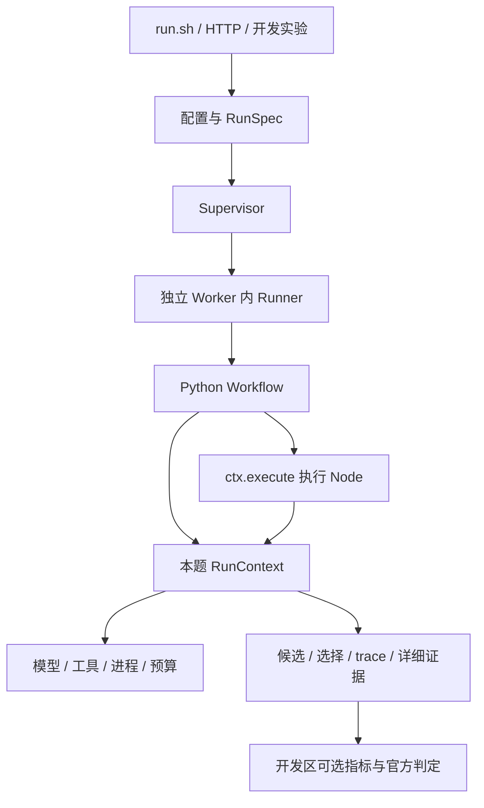

# Agent 框架详细参考

本文描述已实现接口与行为，核对代码版本为 `6700ded`（2026-10-05）。
快速操作见[使用手册](guide.md)，协作规则见[开发规范](conventions.md)。历史设计和实验只作为来源，
不表示全部设想已实现；未来扩展集中列在末尾。

- [架构与运行生命周期](#1-架构与运行生命周期)
- [数据契约](#2-数据契约)
- [Python 组件与扩展](#3-python-组件与扩展)
- [上下文与服务](#4-上下文与服务)
- [配置、命令与 HTTP](#5-配置命令与-http)
- [内置流程与策略](#6-内置流程与策略)
- [证据记录](#7-证据记录)
- [开发实验与指标](#8-开发实验与指标)
- [测试、打包与限制](#9-测试打包与限制)

## 1. 架构与运行生命周期



| 位置 | 职责与边界 |
| --- | --- |
| agent/main.py、core/configuration.py | 解析输入与配置、记录覆盖来源、构造运行描述 |
| core/supervision.py | 启动 Worker，管理绝对截止时间、受管理进程组、中断和选择恢复 |
| core/runner.py | 每题建立上下文与记录器，构造 Workflow，校验结果，处理普通异常并关闭记录 |
| core/context.py | Node 执行关系、本题候选和检查历史、显式选择与事件 |
| workflows/、nodes/、policies/ | 求解顺序、具体动作及复用决策；框架不固定用户的 Python 控制流 |
| services/ | 模型单次调用、按需初始化的工具链、检查复用及进程执行 |
| prompts/ | 模板、提示构造和可选技能选择 |
| recording/ | 原子产物、记录、脱敏及 runtime/model 指标 |
| dev/tools/ | 统一实验、官方 judge 指标、打包检查、远端管理与历史分析 |

正式求解不依赖 dev。所有 Workflow，包括实验变体，都放在 agent 中，由配置决定启用哪个。
参考实现、测试台和官方判定结果不进入 TaskSpec 或求解上下文。

运行顺序：入口解析 → Supervisor 建立输出与恢复信息 → Worker 构造本题 Workflow → Runner 执行
→ 显式选择时更新答案 → Worker 停止 → Supervisor 清理和必要恢复。Node 失败记下证据再抛给 Workflow；
Runner 对未处理的普通异常保留已有选择。必要记录或输出故障不能当作成功求解。
正式入口的退出码不是功能判定；使用最终状态、答案和官方 judge 结果判断。

```text
# agent.core.runner
Runner(model_config=None, *, backend_factory=make_backend,
       toolchain_factory=RtlToolchain, process_executor=None,
       tool_config=None, configuration=None)
Runner.run(task, workflow, *, options, started_at=None) -> WorkflowResult

# agent.core.supervision
Supervisor.run(spec: RunSpec) -> WorkflowResult
```

RunOptions 包含 output_dir、deadline_s、reserve_s、RecordingConfig 和 save_candidates。
RunSpec 还包含 task、workflow_name、workflow_parameters、import_modules、started_at、model_config、
tool_config、configuration。生产入口传可序列化的运行描述，在 Worker 内重建组件，不传闭包或实例。

直接调用 Runner 可传 Workflow 工厂或本题独立实例，适合依赖注入与测试。它不提供自由 Python 阻塞的
硬停止。正式入口使用 Supervisor 提供 Linux 进程监督。

## 2. 数据契约

| 对象 | 主要内容 | 约束 |
| --- | --- | --- |
| TaskSpec | id、prompt、interface、top、expected_interface | 只读题面和接口；显式 top 优先，否则接口推断，再退回 TopModule |
| ComponentSpec | name、module、implementation、parameters | 不可变元数据；不可描述参数为 unknown，不调用任意对象的 repr |
| ModelRequest | messages、max_tokens、temperature、timeout_s、purpose | 请求容器从调用者分离；数值合法性检查 |
| ModelReply | call_id、content、model、request_id、finish_reason、usage、elapsed_s、response_artifact | 标准正文与原始 HTTP 响应分开；用量可以未知 |
| ModelCallError | kind、retryable、status_code、call_id、elapsed_s、evidence | 传输、HTTP、JSON、协议或后端错误，不等同于 RTL 错误 |
| Candidate | id、code、code_hash、source_call_id、parent_id、source_stage、round、extraction_status | 不可变代码与来源；检查记录独立保存 |
| CheckResult | id、candidate_id、kind、status、blocking、summary、command、details、日志位置 | 必须关联已登记候选；证据 ID 不重复 |
| NodeExecution | id、parent_id、component、status、elapsed_s、输入输出摘要、错误 | 自动记录嵌套执行关系 |
| RunStateView | candidates、checks、executions、selected_candidate_id、stop_reason | 上下文提供只读快照，通过公开方法更新状态 |
| WorkflowResult | run_id、selected_candidate、stop_reason、status | 由 ctx.finish 返回，必须与已写答案和当前状态一致 |

WorkflowResult.status 为 completed、stopped、error。CheckResult.status 为 passed、failed、timeout、
unavailable、error、skipped。这些状态与官方 L0/L1/L2/L3 等级不是同一概念。
接口推断提供的 advisory 可以是非阻断 failed；不能因 blocking=false 就记成通过。

主要定义见 [task.py](../../agent/core/task.py)、[model.py](../../agent/core/model.py)、
[state.py](../../agent/core/state.py)、[candidate.py](../../agent/core/candidate.py)。

## 3. Python 组件与扩展

```python
class Node(Protocol[InputT, OutputT]):
    def run(self, ctx: RunContext, input: InputT) -> OutputT: ...
    def describe(self) -> ComponentSpec: ...

class Workflow(Protocol):
    def run(self, ctx: RunContext) -> WorkflowResult: ...
    def describe(self) -> ComponentSpec: ...
```

可继承 Component 获得默认 describe。注册名匹配 `[a-z][a-z0-9_-]*`，重复或未知名称报错；注册只存类，
不构造实例、不初始化模型或 Vivado。内部辅助函数无需全部注册为 Node。

```python
NODE_REGISTRY.register(name)(node_class)
WORKFLOW_REGISTRY.register(name)(workflow_class)
load_builtin_components()
load_extensions(module_names)
build_node(name, **params)
build_workflow(name, **params)
registry.get(name)
registry.names()
```

build_node/build_workflow 自动加载内置组件，并捕获构造参数及默认值；直接构造 Component 时从同名属性
取得参数，取不到则记 unknown。用户扩展显式导入，不自动扫描目录。YAML/CLI 的扩展列表只接受本地
模块名，并拒绝 dev/selftest 顶层模块；用户代码本身仍需遵守依赖与参考答案隔离要求。

完整示例可保存为 `agent/workflows/custom_example.py`：

```python
from agent.core.components import Component
from agent.core.registry import NODE_REGISTRY, WORKFLOW_REGISTRY, build_node
from agent.nodes.generate import GenerateInput
from agent.nodes.extract import ExtractInput


@NODE_REGISTRY.register("prompt_length")
class PromptLength(Component):
    def run(self, ctx, input: str) -> int:
        return len(input.encode("utf-8"))


@WORKFLOW_REGISTRY.register("count_then_generate")
class CountThenGenerate(Component):
    def __init__(self):
        self.count = build_node("prompt_length")
        self.generate = build_node("rtl_generate", max_tokens=4096, temperature=0.0)
        self.extract = build_node("rtl_extract")

    def run(self, ctx):
        size = ctx.execute(self.count, ctx.task.prompt)
        ctx.emit("prompt_length", bytes=size)
        reply = ctx.execute(self.generate, GenerateInput(ctx.task))
        result = ctx.execute(self.extract, ExtractInput(reply))
        if result.candidate is None:
            return ctx.finish(reason="no_candidate", status="stopped")
        ctx.select_candidate(result.candidate.id, reason="custom_single_generation")
        return ctx.finish(reason="completed")
```

在方案目录运行：

```bash
LLM_BACKEND=mock ./run.sh ../tasks/ex03_lfsr8 /tmp/custom-out \
  --import-module agent.workflows.custom_example --workflow count_then_generate
```

条件、循环、异常处理都直接写 Python。替换 Node 或调整参数时修改 Workflow 构造，或注册新的变体，
不需要修改 Runner。Node 内应使用 ctx 提供的服务；直接调用 node.run 会绕过 Node 执行记录。

内置 Node：

| 注册名 | 输入 → 输出 | Python 构造参数 |
| --- | --- | --- |
| rtl_generate | GenerateInput → ModelReply | max_tokens=8192、temperature=0.0、timeout_s=300、prompt_style=direct、use_skills=false、minimum_s=0 |
| rtl_extract | ExtractInput → ExtractionOutput | 无 |
| interface_check | CheckInput → CheckResult | 无 |
| vivado_lint | CheckInput → CheckResult | timeout_s=300、minimum_s=0 |
| vivado_synth | CheckInput → CheckResult | timeout_s=900、minimum_s=0 |

GenerateInput 包含 task、feedback、parent、round。ExtractInput 包含 reply、round、parent_id、source_stage。
ExtractionOutput 包含 extraction 和可空 candidate。CheckInput 包含 candidate。
提取登记候选但不选择答案，检查 Node 返回证据而不决定修复。

## 4. 上下文与服务

| 接口 | 行为 |
| --- | --- |
| ctx.task、state | 本题任务、只读状态快照 |
| execute(node, input) | 记录开始、结束、错误、耗时、父执行和输入输出摘要 |
| create_candidate(code, *, reply, round, parent_id=None, source_stage='generate', extraction_status='complete') | 分配候选 ID 并登记来源 |
| register_candidate(candidate) | 拒绝重复 ID 和未登记父候选 |
| record_extraction(call_id, extraction, candidate_id=None) | 即使没有候选也记录提取结果 |
| new_check_id()、record_check(result) | 分配检查 ID 并保存关联证据 |
| select_candidate(id, *, reason) | 原子写入恢复检查点与最终答案，记录来源 |
| apply_selection(decision) | 更新或保留选择，必要时明确清除已确认无效的选择 |
| emit(event, **fields) | 写 workflow 事件 |
| finish(*, reason, status='completed') | 设置停止原因并返回一致的 WorkflowResult |

候选登记和最终选择分开。检查前可登记多份候选，但不能靠修改 state 或覆盖 solution.v 绕过选择接口。
答案检查点保存实际代码和哈希，Supervisor 在 Worker 停止后核对并完成必要恢复。

模型服务 `ctx.llm.chat(ModelRequest)` 单次调用，不自动重试。保存响应文本之后才解析协议，
因此非 JSON 或错误状态响应仍可诊断。标准正文来自第一条 choice.message.content；完整响应中其他
choices、reasoning 和供应方字段另存，不自动拼接到提取输入。

自定义 Node 直接发模型请求时，**必须显式使用** `ctx.budget.timeout_s(...)` 取得剩余预算允许的上限；
ModelService 自身只裁剪服务请求上限。内置 GenerateNode 已完成这一步。Supervisor 仍管理整题硬截止时间。

工具服务 `ctx.tools.check_interface(task, candidate)`、`lint/synth(candidate, top, timeout_s=...)` 自动登记
证据；实际使用 lint/synth 时才初始化 Vivado。检查缓存只在本题内使用，键包含任务、代码、检查配置
和工具身份；没有工具指纹时不复用相应工具检查。只缓存通过或已确认代码失败，不把超时和环境失败当作
稳定结论。复用分配新 check ID，并记录 executed=false 和 reused_from_check_id。

自定义进程使用：

```python
from agent.services.processes import ProcessRequest

result = ctx.processes.run(ProcessRequest(
    command=("python3", "my_tool.py"),
    cwd="/tmp/my-work", timeout_s=30,
))
```

自行准备 cwd 与文件；使用参数数组，不依赖隐式 shell。ProcessResult.status 为 ok、failed 或 timeout；
它与 Workflow 的 completed 状态不同。ProcessService 裁剪剩余预算、记录事件，生产入口的进程由
Supervisor 管理；env 可显式传入，不进入公开命令记录。

预算基于单调时钟：remaining_s() 默认扣除清理预留，remaining_s(include_reserve=True) 包含预留；
can_start(minimum_s) 必须有超过最低窗口的时间；timeout_s(limit_s, minimum_s) 不足时抛 BudgetExhausted。
ctx.cancellation 提供进程内合作式取消。自由 Python 阻塞靠外层监督停止，不应把它当作可随处暂停的调度器。

## 5. 配置、命令与 HTTP

入口共享：

```text
load_config(path=None) -> ConfigDocument
resolve_config(document, *, env=None, overrides=None) -> ResolvedConfig
build_run_spec(task, config, *, output_dir, started_at, hard_deadline_s=None) -> RunSpec
```

load_config 默认读取 config/default.yaml。使用安全 YAML，拒绝重复键、别名、未知字段、错误类型及
非整数版本号，文件上限 1 MiB；没有继承、表达式、Node 参数或 bindings。运行条件与 Python 组件参数
分开：以下默认值指配置解析的内置值，具体 YAML、环境与 CLI 可以覆盖。

| 字段 | 默认 / 要求 |
| --- | --- |
| schema_version | 1 |
| imports | []，本地 Python 模块列表 |
| workflow.type | single_generate |
| services.model.backend | mock；可选 openai，表示兼容接口，不表示使用商用模型 |
| services.model.model | mock-model；openai 时填写服务实际模型名 |
| services.model.base_url | 空；openai 时必填绝对 HTTP(S) 地址，不允许凭据、查询参数或 fragment |
| services.model.api_key_env | LLM_API_KEY，只填环境变量名 |
| services.model.timeout_s | 180，正数 |
| services.tools.part | xczu3eg-sbva484-1-e |
| services.tools.bin_dir | null，使用 PATH |
| services.tools.temp_dir | /tmp |
| services.tools.keep_work | false |
| runtime.deadline_s | 360，整题上限 |
| runtime.reserve_s | 20，非负；超过预算时可以不启动求解 |
| runtime.save_candidates | false，控制额外候选副本，不关闭 full 记录或恢复检查点 |
| runtime.recording.level | full；可选 basic |
| runtime.recording.root | null，默认输出目录下 records/ |
| experiment.tasks.root | 统一实验必填，任务目录 |
| experiment.tasks.ids / list | 指定题名或清单文件，两者互斥；均省略时枚举题目 |
| experiment.tasks.exclude | 默认 dev/configs/exclude.txt |
| experiment.modes | [agent]；可选 baseline，mock 不允许 baseline |
| experiment.samples | 1，每题每模式采样次数 |
| experiment.solve_jobs / metric_jobs | 各为 1，正整数 |
| experiment.metrics | [runtime, model]；可选 judge，可用 [] 关闭 |
| experiment.output_root | dev/runs 的绝对默认路径 |
| experiment.tag | experiment，名称匹配小写注册名规则 |
| experiment.judge_timeout_s | 1800，正数 |

实验配置保存为 `dev/configs/my-experiment.yaml` 时的可用示例：

```yaml
schema_version: 1
imports: []
workflow:
  type: single_generate
services:
  model:
    backend: mock
runtime:
  deadline_s: 360
  reserve_s: 20
  recording:
    level: full
experiment:
  tasks:
    root: ../../../tasks
    ids: [ex03_lfsr8]
    exclude: exclude.txt
  modes: [agent]
  samples: 1
  metrics: [runtime, model]
  tag: my-experiment
```

覆盖顺序为内置值 → YAML → 支持的环境变量 → CLI。YAML 相对路径按文件位置解析；run.sh 的输入、输出、
CLI 路径和环境路径按调用者目录解析。config.json 包含原配置、生效配置和字段来源，凭据值不落盘。
HTTP 的 hard_deadline_s 对有效预算只取较小值。

| 环境变量 | 对应配置 |
| --- | --- |
| AGENT_CONFIG | 配置文件选择 |
| LLM_BACKEND、LLM_MODEL、LLM_BASE_URL、LLM_TIMEOUT_S | services.model 对应字段 |
| AGENT_WORKFLOW | workflow.type |
| AGENT_DEADLINE_S、AGENT_RESERVE_S | runtime 对应预算 |
| AGENT_RECORD_LEVEL、AGENT_RECORD_ROOT | runtime.recording |
| AGENT_SAVE_CANDIDATES | runtime.save_candidates，0/1 |
| RTL_PART、VIVADO_BIN、AGENT_KEEP_WORK | tools.part、bin_dir、keep_work；开关用 0/1 |
| AGENT_TMP、EDA_TMP、TRACK_TMP | tools.temp_dir，按此顺序取首个非空值 |
| api_key_env 指定的变量 | 只在模型服务中读取凭据，默认 LLM_API_KEY |

RTL_TOP 额外指定顶层，AGENT_TASK_ID 额外指定题目 ID。AGENT_GIT_COMMIT/DIRTY 可提供镜像版本元数据。
旧 LLM_MAX_TOKENS、LLM_TEMPERATURE、AGENT_MAX_ROUNDS 不读取；采样与修复参数写在 Python 中。

正式 CLI 为 `run.sh <input_dir> <output_dir> [参数]`，附加参数：
`--config`、`--workflow`、可重复的 `--import-module`、`--top`、`--deadline-s`、`--reserve-s`、
`--record-root`、`--record-level basic|full`、`--save-candidates`。
`--hard-deadline-s` 和 `--config-parent` 用于 HTTP/实验内部限制和来源引用，通常无需手动传入。

实验 CLI 为 `python3 dev/tools/run.py --config <yaml>`，支持 `--task`、`--workflow`、
`--modes agent baseline`、`--metrics runtime model judge`、`--samples`、`--solve-jobs`、`--metric-jobs`、
`--tag`。参数使用空格分隔，模式不写成 agent,baseline；`--metrics` 后不给值表示关闭全部指标。

HTTP 在方案目录启动 `uvicorn serve.serve_api:app --host 127.0.0.1 --port 7860`，启动前设置
FPGACHINA_TOKEN，使用 Bearer 认证。请求与响应字段：

| 接口 | 内容 |
| --- | --- |
| GET /v1/health | ready、track、model、vram_gb；无令牌拒绝，Agent 配置无效返回 503 |
| POST /v1/solve 输入 | task_id、prompt、interface（可空）、mode（使用 agent/baseline）、deadline_s（正整数，默认 360）、nonce（可空） |
| POST /v1/solve 输出 | task_id、solution、trace、elapsed_s |

每次 solve 写临时任务目录并调用正式入口。HTTP Agent 使用共享配置；HTTP baseline 直接调用原始脚本，
需要 LLM_BASE_URL/LLM_MODEL，不读取 Agent YAML。实验运行器会把有效模型地址与名称传给 baseline。
原始 baseline 不携带 Authorization，请与 Agent 使用同一兼容服务并确认认证条件。
健康检查不是实际推理、工具可用性或提交准备情况的保证。MODEL_NAME 可覆盖健康检查展示名。
详细记录需要设独立 AGENT_RECORD_ROOT，避免请求临时目录删除时丢失。
官方约定见 [API_CONTRACT.md](../../../docs/API_CONTRACT.md)。

## 6. 内置流程与策略

| Workflow | 默认 Python 参数 | 行为 |
| --- | --- | --- |
| single_generate | max_tokens=8192、temperature=0.0、timeout_s=300 | 一次直接生成、提取、显式选择；不注入技能、运行工具或自动重试 |
| repair_loop | max_rounds=3、max_tokens=4096、temperature=0.2、timeout_s=180、use_skills=true、max_request_retries=1 | 按接口 → lint → synth 检查，反馈修复、候选保护与有限请求重试 |

单次 Node 上限还受服务默认 180 秒和剩余整题预算约束，不是总能使用 300 秒。
repair_loop 可以注入 selection_policy 和 failure_policy，max_model_calls 默认 max_rounds+max_request_retries。
它遇到综合通过停止，但综合通过不证明行为正确；完整文件修复尚无程序化 patch 应用。

SelectionPolicy.choose(candidates, checks, current_id) 根据真实内部证据排除已确认代码失败，按 synth、lint、
interface 通过的优先级比较候选，同等证据保留当前选择，再按创建顺序选。完整未验证候选可以作为兜底。
未知检查和环境失败不当作通过；选择理由和证据 ID 会记录。

FailurePolicy.decide(diagnostics, attempts, budget) 将请求重试与代码修复分别计数；可重试传输错误允许
有限重试，明确代码或提取问题可以修复，环境与未知诊断停止。工具服务本身不自动重试。
当前诊断只识别有限明确错误，不承诺覆盖全部 Vivado 日志形式。

更多细节见[可靠运行专题](design/runtime-reliability.md)与 [policies/](../../agent/policies)。

## 7. 证据记录

输出至少包含 solution.v、trace.jsonl；Agent 还写 config.json、selection.json、run_locator.json 等。
trace 当前 schema_version=4，公共字段包含 run_id、seq、ts、tool、event。baseline 保持官方格式。

| ID | 用途 |
| --- | --- |
| run_id | 一次运行 |
| m001 | 模型调用，开始/结束共用 ID |
| e001 | Node 执行，包含父执行 ID |
| c001 | 候选，关联模型调用和父候选 |
| k001 | 检查，关联候选及复用来源 |

详细目录默认为 `<output>/records/<run_id>/`，或配置的 `<recording.root>/<run_id>/`。
输出的 run_locator.json 定位本次详细记录，不要通过“最新目录”猜测并发样本的来源。

```text
<recording_dir>/
├── run.json、task.json、selection.json、supervision.json
├── calls/m001/
│   ├── request.json、response.txt、response.json
│   └── content.txt、result.json、extraction.json
├── nodes/e001/execution.json
├── candidates/c001/solution.v、metadata.json
├── checks/k001/result.json
├── tool_logs/
└── process_logs/
```

run.json 保存运行、调用与动作状态及 recording_incomplete；task.json 只有允许提供的题面和接口。
原始响应保留服务实际返回字段，包括服务返回的 reasoning，无法获取服务未返回的内部过程。
mock 只生成标准正文；超时或连接失败没有收到响应时，不制造 response 文件。

详细证据是脱敏副本，正文和候选副本也可能被遮盖。实际发给模型的请求、提取用的内存正文以及
最终答案与恢复检查点不被证据脱敏改写。详细记录不能据此保证逐字节重放。
请求认证头不落盘；已知秘密、敏感字段和 URL 凭据等统一过滤。

full 开启详细记录，basic 保留必要 trace。详细文件不可写时发警告并标记不完整，模型结果不因此
改变；必要 trace 不可写则视为基础设施故障。中断可只有 started，没有结束事件；监督不补造结束。
trace 末行被打断时原片段另存 trace_partial.txt，正常返回文件保持可解析 JSONL。
格式细节见[记录专题](design/trace-schema.md)。

## 8. 开发实验与指标

任务清单显式指定 ids 或 list，均省略时枚举有 prompt.txt 的目录。缺失、重复、越出根目录或全部排除报错，
不退回全题集。默认排除清单不会被 --task 绕过。启动前固定实际顺序及 prompt/interface 哈希，每个样本
启动前再次核对输入；参考答案和判定文件不进入这些求解输入。

每题每模式每次采样独立输出，并启动正式入口。求解与指标各自使用线程池调度独立进程或读取产物，
不在线程中共享 Supervisor。TERM/INT 停止后续启动、取消受管理的求解与 judge 进程，保存样本及汇总。

```text
select_tasks(selection: TaskSelection) -> TaskManifest
build_sample_plan(manifest, config: ExperimentConfig) -> tuple[SampleSpec, ...]
ExperimentRunner.run(plan, config: ResolvedExperiment) -> ExperimentResult

class MetricCollector(Protocol):
    name: str
    version: int
    def collect(self, sample: CompletedSample) -> MetricResult: ...

collect_metrics(sample, collectors) -> tuple[MetricResult, ...]
```

CompletedSample 包含 task_id、mode、index、output_dir、solve。
MetricResult 包含 name、version、status、values、evidence；状态为 ok、partial、unavailable、error、skipped。
Python 可直接给 collect_metrics 传自定义 collector；当前实验 YAML/CLI 和 ExperimentRunner 只选择
三个内置指标，尚无自定义 collector 的配置注册机制。

| 指标 | 来源与语义 |
| --- | --- |
| runtime | 求解墙钟、Node/检查次数、复用、停止与清理；结束节点耗时之和可能包含嵌套重叠 |
| model | 按 call_id 合并生命周期，调用成功/失败/未完成、截断、明确请求重试、已知用量和未知调用数 |
| judge | 开发区调用官方 judge，保留原始结果与完整日志；仅启用时执行 |

未知 token 是 null，不是零；失败或中断调用不能推算用量。指标异常标为 error，不修改答案。
工具环境失败标为 unavailable，官方聚合继续按原有 tool_error 规则排除，不能冒充有效零分。
汇总复用 selftest/score.py；Agent/baseline 有效样本覆盖一致时才给出配对增益，不能单凭增益判断
某个组件贡献。默认服务上限与原始 baseline 的 300 秒不同，remote-smoke 示例显式对齐为 300 秒。

```text
dev/runs/<experiment_id>/
├── config.json、resolved.yaml、experiment.json、tasks.json
├── source/manifest.json 与源码快照
├── samples/<mode>/<task>/s<index>/
│   ├── solution.v、trace.jsonl、config.json、solve.json
│   ├── records/ 或指向外部详细目录的 locator
│   ├── process_logs/、run.log、metrics.json
│   └── judge/（仅启用判定时）
└── metrics.json、summary.json、summary.md
```

实验内部 resolved.yaml 固定有效运行条件，子进程移除已处理的环境覆盖项；样本 parent_config 指回
实验 config.json。源码快照采用明确范围，不复制环境文件、参考答案或权重，记录原始与快照哈希；
扩展来源缺失或源码因脱敏改变时标不完整。它不锁定依赖包、模型权重或 GPU 推理确定性。
笔记自动生成到 dev/docs/experiments，人工假设与结论在生成块外补写。

历史 tools/analysis 继续服务旧实验格式，不能用于宣称支持新实验的自动比较。
完整配置与实验专题见[配置专题](design/configuration-and-experiments.md)。

## 9. 测试、打包与限制

在方案目录可运行：

```bash
python3 -m unittest discover -s dev/tests -v
python3 dev/tools/submission.py
```

先准备 requirements.txt 依赖。模块测试可以注入假模型与工具：

```python
from pathlib import Path
from agent.core.config import ModelConfig
from agent.core.registry import build_workflow
from agent.core.runner import Runner, RunOptions
from agent.core.task import TaskSpec

result = Runner(ModelConfig()).run(
    TaskSpec.from_text("demo", "按题面实现模块。",
                       "module TopModule(input wire a, output wire y);"),
    lambda: build_workflow("single_generate"),
    options=RunOptions(output_dir=Path("/tmp/agent-component-test")),
)
```

这个示例只验证执行，不判断 RTL 功能；组件级测试根据输入断言真实职责，完整生产预算测试使用 Supervisor。

submission 工具检查必需文件、名称、符号链接、直接 dev/selftest 导入和当前简单 Docker COPY。
暂存复制 agent/config/skill/serve/model 与规定入口和声明，拒绝覆盖或复制到源码树内，保存哈希清单；
不复制开发区、任务或外置模型权重。独立 smoke 清除继承的运行覆盖和 PYTHONPATH，使用默认 mock。
Dockerfile 已复制 config/ 与 baseline.py；官方基础镜像仍是占位项，真实构建尚未验收。
详见[提交专题](design/layout-and-submission.md)。

当前限制：

- 没有历史提取/选择/完整流程重放、新实验自动比较和自动批量消融。
- 没有行为检查、程序化 patch 修复和多候选搜索；内置 lint/synth 不证明功能正确。
- 没有记录保存期限、磁盘上限和自动清理策略；中断可能留下工具临时目录。
- 自定义 Python 指标没有独立进程硬监督；用户自行脱离进程组的后代不受保证。
- 客户端结束不证明共享服务推理取消，backend_inference_cancelled 记录 unknown。
- 最终模型、依赖与服务版本未锁定；模型声明、manifest 和 REPORT 仍有占位内容。
- 当前框架做过小规模真实验证；最后一次目录迁移只作本地验证，不能代表最终比赛 GPU 或全题集收益。

验收来源见[第五阶段记录](notes/2026-10-05-stage5-progress.md)与[真实模型单题实验](experiments/20261005-193024-stage4-real-single-ff1050ad.md)。
