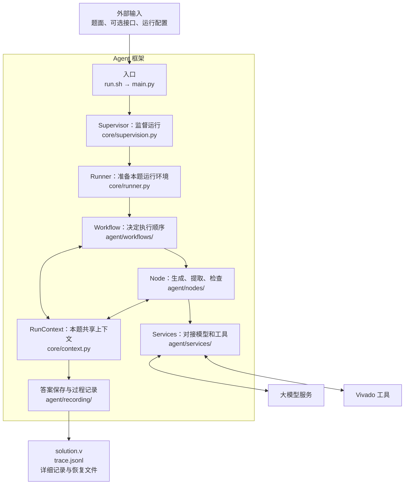
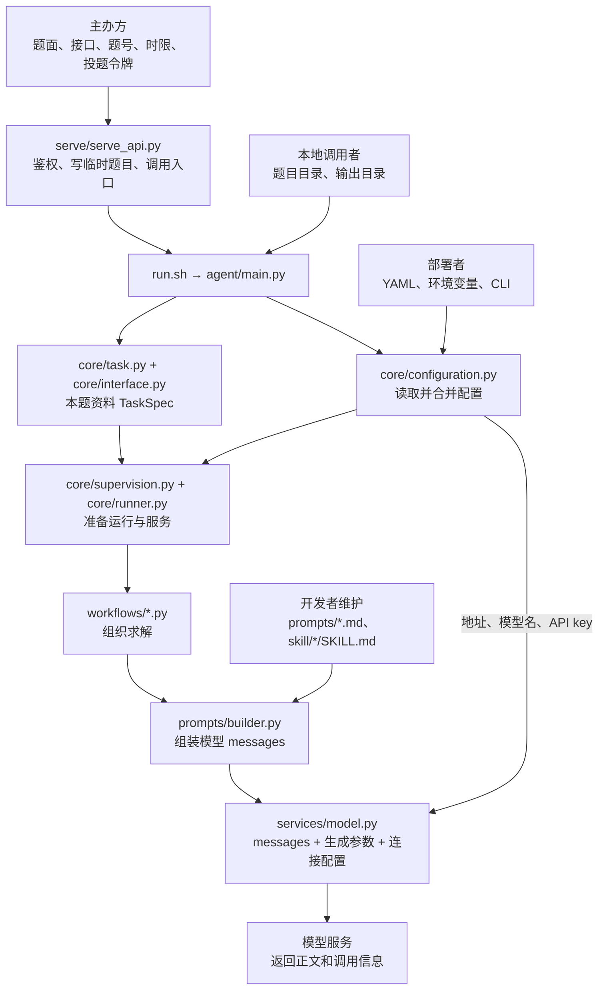
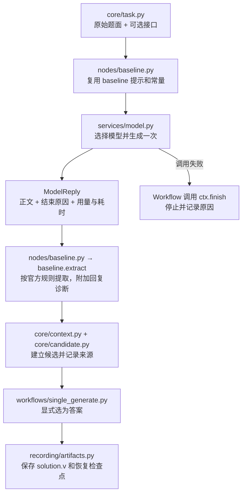
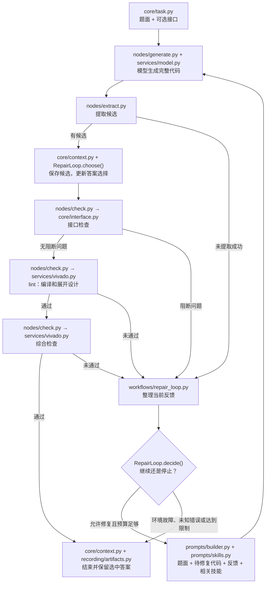

# Agent User Manual：配置、运行、输入输出与扩展

本文是当前 Agent 框架的完整使用手册，按 2026-10-09 工作区实现核对。首次使用先读
[Quickstart](quickstart.md)，配置可直接参照 [example.yaml](../../config/example.yaml)。
[开发规范](conventions.md)单独维护协作要求；历史笔记和实验保留当时结论，不代替当前用法。

除特别说明外，命令在 `43240-agent/` 下执行，模块路径相对于该目录。
图中 `core/`、`nodes/` 等简写指 `agent/` 下对应目录。Mermaid 图可在支持它的 Markdown 预览器中查看。
文档只说明配置读取位置，不展示实际凭据。

框架接收题目，调用模型生成 RTL（描述硬件逻辑的代码），提取候选，按 Workflow（求解流程）决定
是否检查和修复，最后输出选中的代码和过程记录。当前默认是 mock 假模型与单次生成；真实求解需配置已启动的模型服务。

## 阅读导航

| 需要了解什么 | 章节 |
| --- | --- |
| 谁负责什么、一次运行怎样启动 | [1. 框架与模块职责](#1-框架与模块职责) |
| 题目、API key、配置、提示和模型权重从哪里来 | [2. 输入内容、来源与配置](#2-输入内容来源与配置) |
| 默认流程里每一步的输入和输出 | [3. 默认单次生成的信息流](#3-默认单次生成的信息流) |
| 模型收到哪些消息、返回哪些字段 | [4. 模型请求、回复与提示](#4-模型请求回复与提示) |
| 检查由谁执行、错误如何进入修复 | [5. 检查、反馈与修复流程](#5-检查反馈与修复流程) |
| 多轮候选如何选择最终答案 | [6. 候选与答案选择](#6-候选与答案选择) |
| 答案、配置、模型原始回复在哪里 | [7. 输出文件与记录](#7-输出文件与记录) |
| 单题命令、HTTP 服务和配置迁移 | [8. 命令行与 HTTP 使用](#8-命令行与-http-使用) |
| 内部对象包含什么、状态是什么意思 | [9. 数据契约](#9-数据契约) |
| 自定义 Workflow 和 Node | [10. Python 组件与扩展](#10-python-组件与扩展) |
| 上下文、模型、工具、预算和监督接口 | [11. 上下文、服务与运行监督](#11-上下文服务与运行监督) |
| 重复采样、并发、指标和正式判定 | [12. 开发实验与指标](#12-开发实验与指标) |
| 测试、独立打包和功能边界 | [13. 测试、打包与限制](#13-测试打包与限制) |
| 按现象排查 | [14. 常见问题与排查顺序](#14-常见问题与排查顺序) |

## 1. 框架与模块职责



可以把它理解成一个分工明确的小组：

| 部分 | 通俗理解 | 负责模块 | 主要输入 → 输出 |
|---|---|---|---|
| 入口与配置装配 | 收齐本题资料和运行条件 | `run.sh`、`agent/main.py`、`agent/core/configuration.py` | 文件路径、YAML、环境变量、命令行参数 → 本题运行描述 |
| Workflow | 决定下一步做什么的人 | `agent/workflows/single_generate.py`、`repair_loop.py` | 当前结果 → 下一步动作、继续或停止 |
| Node | 做一件具体工作的工位 | `agent/nodes/generate.py`、`extract.py`、`check.py` | 题目、回复或代码 → 本次动作结果 |
| RunContext | 本题的工作台和档案夹 | `agent/core/context.py` | 各步结果 → 可查询的本题状态 |
| Services | 模型和工具的统一接口 | `agent/services/model.py`、`tools.py`、`vivado.py`、`processes.py` | 调用请求 → 模型回复或工具结果 |
| Supervisor / Runner | 看时间、安排运行、处理意外的人 | `agent/core/supervision.py`、`runner.py` | 本题运行描述 → 执行、清理和恢复 |
| Recording / Artifacts | 记录过程、保存答案的人 | `agent/recording/recorder.py`、`artifacts.py` | 事件和选中代码 → 文件 |

**执行哪个工具、是否重试、何时停止，由 Python Workflow 决定。** 当前模型主要负责生成代码和按反馈修改代码。

源码入口：[runner.py](../../agent/core/runner.py)、[context.py](../../agent/core/context.py)。

正式入口运行顺序是：`run.sh` 固定路径 → `main.py` 读取题目与配置 → `supervision.py` 建立输出并启动
独立 Worker（求解子进程）→ `runner.py` 建立上下文并构造本题 Workflow → 执行 Node 和显式选择答案
→ Worker 停止 → Supervisor 清理进程并校验恢复检查点。

每题都构造新的 Workflow、Node 和上下文，不共享跨题候选状态。Node 出错会先记录再抛给 Workflow；
未处理的普通异常由 Runner 捕获，并保留已经选中的答案。必要输出或 trace 写入失败属于基础设施错误。
正式求解不导入 `dev/`，开发侧判定与参考答案不会回传求解上下文。


## 2. 输入内容、来源与配置

输入有五类来源：**主办方投题、部署者配置、开发者编写的提示与策略、模型返回、工具检查返回**。后两类是运行过程中产生、再交给下一步的信息。

### 2.1 主办方投递的题目与请求信息

正式 HTTP 请求由 `serve/serve_api.py` 接收；本地运行则由调用者准备题目目录，直接调用 `run.sh`。

| 信息 | 具体内容与来源 | 读取、转换和使用它的模块 | 是否进入模型提示 |
|---|---|---|---|
| 题目 `prompt` | 主办方请求正文；含功能要求、时钟和复位要求、端口说明，修改题可能含已有代码。本地对应 `prompt.txt` | `serve/serve_api.py` 写成文件；`agent/core/task.py` 读取；`agent/prompts/builder.py` 加入提示 | 是，题面文本 |
| 接口约束 `interface` | 请求可带模块声明；本地对应可选的 `interface.txt`。**正式 RTL 评测题集此字段为空，接口约束位于题面内** | `serve/serve_api.py` 写文件；`task.py` 读取；`core/interface.py` 解析；`prompts/builder.py` 组装提示 | 非空时加入；题面中的接口随题面一起进入 |
| 题目编号 `task_id` | 主办方请求必填。本地优先使用环境变量 `AGENT_TASK_ID`，否则用题目目录名 | `serve/serve_api.py` 将编号写入子进程环境；`main.py` 传给 `task.py`；记录模块用于关联本题 | 不单独加入 |
| 运行模式 `mode` | 主办方请求，默认 `agent`；`baseline` 表示走原始基线 | `serve/serve_api.py` 选择 `run.sh` 或 `run_baseline.sh` | 否，只决定入口 |
| 单题时限 `deadline_s` | 主办方请求，默认 360 秒，覆盖请求准备、执行、清理和结果读取 | `serve/serve_api.py` 扣除已用时间和返回预留，经 `--hard-deadline-s` 传入；`configuration.py` 缩小运行预算；`supervision.py` 执行监督 | 否 |
| 请求标识 `nonce` | 主办方提供的一次性字符串，接口默认空字符串 | `serve/serve_api.py` 的请求对象接受该字段，但当前求解实现没有继续使用、传给模型或返回它 | 否 |
| 请求鉴权头 `Authorization` | 主办方发送 `Bearer <投题令牌>` | `serve/serve_api.py` 与部署环境中的 `FPGACHINA_TOKEN` 比较，验证是否允许投题 | 否 |

**接口内容与接口检查结论需要区分。** `agent/core/interface.py` 优先解析非空的独立接口文本；没有时尝试解析题面的端口列表。独立接口声明不匹配可阻断后续检查；题面端口列表不匹配目前作为提示，不直接阻断。没有解析出预期接口时会记录跳过，不能当作通过。修改题中嵌入的旧代码也不会自动被当成权威接口声明。

顶层模块名的取值顺序是：**命令行 `--top` → 环境变量 `RTL_TOP` → 从接口信息解析得到的名称 → `TopModule`**。入口处理显式覆盖，`task.py` 负责后面的推断与默认值。题面解析器只能识别所支持的格式，并非对任意自然语言都能推断成功。

最终由 `agent/core/task.py` 整理成 `TaskSpec`：题目 ID、完整题面、接口文本、顶层模块名、解析出的接口及其来源。标准任务读取只取 `prompt.txt` 和 `interface.txt`；参考答案、测试台和官方判定结果不在这份任务资料中。

### 2.2 模型连接信息与两种凭据

下表中的 YAML 字段位于 `services.model` 下，环境变量由启动进程的 shell、容器或外层部署脚本提供。

| 信息 | 配置文件 / 环境变量来源 | 默认值或约束 | 负责模块与用途 |
|---|---|---|---|
| 模型后端 | YAML `backend` / `LLM_BACKEND` | `mock`；真实服务使用 `openai`，表示采用兼容接口格式 | `core/configuration.py` 读取；`services/model.py` 选择假模型或 HTTP 后端 |
| 模型服务地址 | YAML `base_url` / `LLM_BASE_URL` | 默认空；HTTP 后端必须提供，例如本地服务的 `/v1` 地址 | `core/config.py` 校验；`services/model.py` 在其后追加 `/chat/completions` 并发出请求 |
| 请求模型名 | single_generate：`MODEL_NAME` → `/models` 第一项 → `default`；其他流程：YAML `model` / `LLM_MODEL` | 普通模型配置默认 `mock-model`；统一实验将配置模型名传给两个模式的 `MODEL_NAME` | `services/model.py` 解析并记录实际请求模型 |
| **模型 API key 的环境变量名** | YAML `api_key_env` | 默认 `LLM_API_KEY`，允许改为其他合法环境变量名 | `core/configuration.py` 根据这个名字去环境中读取实际密钥 |
| **模型 API key 的实际值** | 上一行指定的环境变量，例如 `LLM_API_KEY` | 未设置时为空；single_generate 与 baseline 一样不发送认证头 | `core/configuration.py` 放入 `ModelConfig`；普通请求在非空时加入 `Authorization: Bearer ...` |
| 模型服务调用超时 | YAML `timeout_s` / `LLM_TIMEOUT_S` | 省略或 null 时 single_generate、evidence_repair 为 300 秒，其余为 180 秒；显式值及剩余预算仍限制调用 | `services/model.py` 限制 HTTP 调用时间 |
| **投题令牌的预期值** | 环境变量 `FPGACHINA_TOKEN`，部署者按主办方提供的令牌设置 | HTTP 服务必须配置；与模型 API key 是两项独立凭据 | `serve/serve_api.py` 启动加载模块时读取，用于验证入站投题请求 |

**准确地说，当前 YAML 不支持直接填写 API key 值。** 它保存的是 `api_key_env`，实际值来自环境变量；核心配置读取器也不会自动加载 `.env` 或 `remote.env`。如果外层脚本读取这些文件，需要由该脚本把值导出到环境后再启动 Agent。

API key 用于连接模型服务，投题令牌用于接收主办方请求；两者都不会由提示构造器加入模型的 `messages`。`agent/recording/redaction.py` 对记录副本隐藏已知密钥，公开模型配置也排除实际 API key。

对应实现：[configuration.py](../../agent/core/configuration.py)、[config.py](../../agent/core/config.py)、[model.py](../../agent/services/model.py)、[serve_api.py](../../serve/serve_api.py)。

### 2.3 运行方式、工具和记录设置

| 信息 | 具体来源 | 默认值 / 作用 | 负责模块 |
|---|---|---|---|
| 输入、输出目录 | `run.sh` 的两个位置参数，转成 Python 的 `--input`、`--output`；HTTP 模式由服务创建临时目录 | 决定从哪里读取题目、在哪里保存结果 | `run.sh` 固定路径；`main.py` 接收；`task.py` 与 `recording/artifacts.py` 使用 |
| 配置文件路径 | CLI（命令行参数）`--config`，其次 `AGENT_CONFIG` | 均未提供时为 `config/example.yaml` | `main.py`、`core/configuration.py` |
| Workflow 名称 | YAML `workflow.type` / `AGENT_WORKFLOW` / CLI `--workflow` | `single_generate`；可选 `repair_loop`、`evidence_repair` | `configuration.py` 解析；`supervision.py` 的 Worker（求解子进程）通过 `core/registry.py` 构造实例 |
| 扩展模块 | YAML `imports` / CLI `--import-module` | 默认无；用于注册自定义 Workflow 或 Node | `core/registry.py` 导入模块，登记实现 |
| 本地单题预算 | YAML `runtime.deadline_s` / `AGENT_DEADLINE_S` / CLI `--deadline-s` | 360 秒；还受 HTTP 请求剩余时限的上限约束 | `core/budget.py` 计算可用时间，`core/supervision.py` 强制停止 |
| 清理预留时间 | YAML `runtime.reserve_s` / `AGENT_RESERVE_S` / CLI `--reserve-s` | 20 秒；从可供求解的时间中扣除 | `core/budget.py`、`core/supervision.py` |
| Vivado 可执行文件位置 | YAML `services.tools.bin_dir` / `VIVADO_BIN`；未指定时查找 `PATH` | 查找 `xvlog`、`xelab`、`vivado` | `services/vivado.py`；环境初始化脚本需事先设置可用路径 |
| FPGA 器件型号 | YAML `services.tools.part` / `RTL_PART` | `xczu3eg-sbva484-1-e`；作为实际综合命令的器件参数 | `core/configuration.py`、`services/vivado.py` |
| Vivado 临时目录 | YAML `services.tools.temp_dir`；环境依次优先取 `AGENT_TMP`、`EDA_TMP`、`TRACK_TMP` | 内置默认 `/tmp`；每次工具调用创建独立工作目录 | `configuration.py` 解析；`services/vivado.py` 创建目录 |
| 保留工具工作目录 | YAML `services.tools.keep_work` / `AGENT_KEEP_WORK` | 默认关闭；环境变量用 `0` / `1` | `services/vivado.py` 决定是否清理临时目录 |
| 详细记录等级 | YAML `runtime.recording.level` / `AGENT_RECORD_LEVEL` / CLI `--record-level` | `full`；`basic` 不保存完整请求回复等详细文件 | `recording/recorder.py` |
| 详细记录根目录 | YAML `runtime.recording.root` / `AGENT_RECORD_ROOT` / CLI `--record-root` | 默认 `<输出目录>/records/`，每次运行再建独立编号目录 | `recording/recorder.py` |
| 代码版本信息 | `AGENT_GIT_COMMIT`、`AGENT_GIT_DIRTY`，或读取本地 Git 元数据 | 记录 7 位短 commit，用于追溯实验使用的源码，不进入提示 | `core/metadata.py`、`core/runner.py` |

HTTP 服务自己的请求临时目录只读取 `AGENT_TMP`，未设置时用 `/tmp`；它和 Vivado 工具临时目录的解析逻辑不同。

标准入口中，**同一配置字段的生效顺序是：内置默认值 → YAML → 支持的非空环境变量 → 已提供的 CLI 参数，后者覆盖前者**。只有入口实际提供的 CLI 选项才能覆盖；例如模型名和地址没有对应的专用 CLI 参数。顶层模块名、题目编号和 HTTP 硬时限按前文各自的逻辑处理。

YAML 中相对路径按配置文件所在目录解析；环境变量中的相对路径按调用者当前目录解析。最终值和来源由 `configuration.py` 整理，写入 trace 中 `run/metadata` 事件的 `configuration` 字段，便于查清某个值到底来自哪里。

### 2.4 开发者提供的提示、技能和生成策略

这部分也会影响模型输入，但来源是方案自身。

| 信息 | 来源与具体内容 | 负责模块与传递方式 |
|---|---|---|
| 单次生成要求 | 官方 `baseline.py` 的 `SYS['rtl']`，固定 TopModule | `nodes/baseline.py` 复用提示，按原始题面和接口拼接 user 消息；原 direct 提示仍供自定义节点使用 |
| 修复流程的总体要求 | `agent/prompts/system.md`：接口、复位、赋值方式、可综合性和输出格式等 | `prompts/builder.py` 在修复流程中作为 system 消息 |
| 修复说明模板 | `agent/prompts/repair.md`：上一版代码、错误反馈和修改要求 | `prompts/builder.py` 填入当前反馈及待修复代码，附在 user 消息中 |
| 技能资料 | `skill/*/SKILL.md`：技能正文、名称、日志匹配特征等 | `prompts/skills.py` 加载；有反馈且启用技能时，按题面和反馈中的特征字符串匹配，默认最多选 2 条；`builder.py` 加入额外 system 消息 |
| 温度和输出长度上限 | single_generate 和 evidence_repair 默认使用 baseline 的温度 `0.0`、top_p `1.0`、上限 `8192`；repair_loop 默认为 `0.2`、`4096` | single_generate 不接受采样覆盖；其他 Workflow 通过 Python 构造参数控制 |
| 轮数、重试数和调用总数 | `workflows/repair_loop.py` 的构造参数，默认 3 轮、每个请求最多重试 1 次、总调用最多 4 次 | `RepairLoop.decide()` 根据已用次数、错误类型和剩余时间决定继续或停止 |
| 候选选择规则 | 由各 Workflow 自己定义：`single_generate` 直接选择，`repair_loop` 用 `RepairLoop.choose()` | 比较候选和检查证据，输出选择决定；`core/context.py` 执行保存或清空 |

**当前 YAML 不定义采样参数、轮数或流程图。** 这些由 Python Workflow 决定；旧的 `LLM_TEMPERATURE`、`LLM_MAX_TOKENS`、`AGENT_MAX_ROUNDS` 也不被当前配置读取器使用。

修复提示模板中的目标器件等文字目前是静态内容。改变 `RTL_PART` 会影响工具综合参数，但提示构造器不会自动同步修改模板中的器件描述。

### 2.5 模型服务自身的输入

Agent 通过 HTTP 调用已经启动的模型服务。若使用仓库中的示例启动脚本，下列配置由 `serve/vllm.sh` 消费：

| 信息 | 来源和默认值 | 用途 |
|---|---|---|
| 本地模型权重路径 | 环境变量 `MODEL`，默认 `/models/Qwen3-8B` | vLLM 加载事先准备的权重；默认对外模型名取该路径的最后一段 |
| 监听端口 | `PORT`，默认 `8000` | 决定模型服务端口；Agent 的 `LLM_BASE_URL` 需与之对应 |
| 上下文长度上限 | `MAX_LEN`，默认 `32768` | 模型服务的上下文容量，与 Agent 的单次输出 token 上限是不同参数 |
| 显存比例与设备 | `GPU_UTIL` 默认 `0.90`；`HIP_VISIBLE_DEVICES` 默认 `0` | 控制模型服务使用的显存比例和可见设备 |
| 额外服务参数 | `VLLM_EXTRA_ARGS`，默认空 | 例如指定 reasoning 解析方式，影响响应中正文与思考内容的分离 |

这些是模型服务的启动输入，`run.sh` 不负责加载权重或启动 vLLM。健康检查中的 `MODEL_NAME` 只覆盖返回给调用者的模型显示名；真正发给模型服务的请求模型名由 `services.model.model` / `LLM_MODEL` 决定。

### 2.6 输入从哪里进入：汇总图



图中 API key 走模型服务的鉴权请求头，不进入 `messages`；`FPGACHINA_TOKEN` 只在 HTTP 接收端验证。实际调用参数、模型回复和工具结果的后续流向见下文。

### 2.7 配置文件格式与校验

`agent/core/configuration.py` 的 `load_config()` 使用安全 YAML，文件上限为 1 MiB，`schema_version`
必须为整数 `1`。拒绝重复键、YAML 别名、未知字段及不合法类型；不支持配置继承、表达式或 `${变量}` 展开。
`resolve_config()` 合并字段并检查预算、模型地址、注册名和路径，`build_run_spec()` 装配传给 Supervisor 的运行描述。

时间上限必须为有限正数，清理预留可为零；YAML 开关使用布尔值 `true/false`，支持的环境开关使用 `0/1`。
配置路径无效或配置内容错误时，入口记录 `configuration_or_entry_error` 并输出空答案。
ResolvedConfig 保存 AgentConfig、原始配置与逐字段来源，公开快照不包含凭据值。
CLI、HTTP 子进程和实验样本共用配置解析接口；RunSpec 将模型、工具及公开配置快照传给 Worker。
只有运行已经开始后的异常恢复才可能保留本次已选答案；输出目录不是自动续跑目录。

提供自定义 YAML 时，未填写的字段由 Python 内置默认值补齐，不是继续叠加 `example.yaml`。
`example.yaml` 与内置默认运行值保持一致，但修改示例文件不会改变自定义配置的缺省来源。


## 3. 默认单次生成的信息流

当前默认 Workflow 是 `single_generate`。



这里有三种东西需要分清：

| 信息 | 是什么 | 为什么分开 |
|---|---|---|
| 模型回复 | 模型返回的整段正文，可能有代码块、解释、多份草稿 | 还需要解析 |
| 候选代码 | 从回复中提取出的代码，附带编号、来源调用、轮次、哈希等 | 便于检查、比较和追溯 |
| 最终答案 | Workflow 明确选中的候选 | 决定 `solution.v` 保存哪一份 |

默认流程直接调用官方 `baseline.extract()`，选择第一个匹配代码块，再提取 `TopModule`；找不到时回退保留文本。残缺代码、纯说明和空内容都不被额外过滤，空内容写出一个换行；模型调用失败才写空文件。结构化提取器仅对原始回复提供诊断，不能改写或拒绝 baseline 的提取结果。`repair_loop` 继续按目标模块和代码长度选择完整候选。

默认流程在候选产生后直接选择它，**不执行接口检查、Vivado 检查或修复重试**。因此，默认流程也不会仅因提取器报告“目标模块缺失”就自动纠正代码。

另外，仓库默认配置使用的是 `mock` 假模型，主要生成输出恒为零的模块来检查流程；真实求解需要切换到实际模型服务。

对应实现：[single_generate.py](../../agent/workflows/single_generate.py)、[baseline 节点](../../agent/nodes/baseline.py)、[example.yaml](../../config/example.yaml)。

在相同 RTL 输入、模型服务和充足预算下，single_generate 与 baseline 的生成请求 JSON 和最终文件逐字节对齐。模型发现查询单独记录，不算生成调用；不复制 baseline 的冗余查询。Agent 的预算、中断和错误分类仍生效，`completed` 只表示流程完成。HTTP 请求记录的 `request` 字段保存实际出站 JSON，外层保存实际超时、用途和请求类型；日志查看器兼容这一格式。

默认流程由 `agent/workflows/single_generate.py` 调度，各步通过 `agent/core/context.py` 的 `execute()` 执行，以便统一记录节点输入输出摘要、执行状态和耗时。具体交接如下：

| 步骤 | 输入来自哪里、包含什么 | 负责模块 | 输出交给谁 |
|---|---|---|---|
| 准备本题 | `TaskSpec`、有效配置、输出目录、起始时间 | `core/configuration.py` 装配 `RunSpec`；`core/supervision.py` 启动 Worker；`core/runner.py` 建立上下文和服务 | Workflow 得到 `RunContext`，可读取本题和调用公共服务 |
| 生成 | Workflow 传入 `GenerateInput`：本题与轮次 | `nodes/baseline.py` 复用官方提示，再调用 `services/model.py` | 返回 `ModelReply` 给 Workflow |
| 提取 | `ModelReply.content`，以及轮次和来源信息 | `nodes/baseline.py` 调用官方提取函数，并用结构化提取器诊断原始回复 | 返回官方提取结果对应的候选与诊断 |
| 建立候选 | 提取出的代码、来源模型调用编号、轮次、父候选编号 | `core/context.py` 调用 `core/candidate.py` 分配编号、计算代码哈希；记录模块保存证据 | 候选注册进本题状态，供 Workflow 检查和选择 |
| 选择并保存 | Workflow 指定的候选编号及选择原因 | `core/context.py` 调用 `recording/artifacts.py` 和 `recording/recorder.py` | 更新答案、恢复检查点和选择记录 |
| 结束 | 选中的候选或空值、停止原因、运行状态 | Workflow 调用 `core/context.py` 的 `finish()`；`core/runner.py` 核对并记录 | 内部返回 `WorkflowResult`；HTTP 入口最终读取文件返回结果 |

## 4. 模型请求、回复与提示

模型输入主要由提示构造器整理：

| 调用阶段 | 模型看到的内容 | 内容来源与负责模块 |
|---|---|---|
| 默认单次生成 | 固定 TopModule 要求、保留首尾空白的题面、可选接口 | `nodes/baseline.py` 使用官方 `SYS['rtl']` 与原始文本 |
| 修复流程的首次生成 | 更详细的 RTL 编写要求、题面、可选接口 | `prompts/builder.py` 使用 `system.md` 与 `TaskSpec`，此时没有反馈，不注入技能 |
| 后续修复 | 上述内容，加上待修复代码、检查反馈摘要，以及匹配到的技能内容 | `workflows/repair_loop.py` 提供父候选和反馈；`prompts/builder.py` 填充 `repair.md`，调用 `prompts/skills.py` 选择技能 |

请求还带有输出长度上限、温度等生成参数。超时时间由框架控制，受节点上限、模型服务上限和本题剩余时间共同限制。

模型返回后，框架整理出：

- **正文 `content`**：交给代码提取器。
- **结束原因**：例如正常结束或达到输出长度限制。
- **调用编号、耗时和 token 用量**：用于追踪；未知用量保留为空。
- **原始响应记录**：供后续排查，详细记录模式下保存。

以上转换由 `agent/services/model.py` 完成，统一的数据格式定义在 `agent/core/model.py`。HTTP 后端读取响应中第一项 `choices` 的 `message.content` 和 `finish_reason`，用量读取 `usage`；调用编号由 `recording/recorder.py` 分配，耗时由本地调用计时。mock 后端直接给出正文，不伪造 HTTP 响应或 token 用量。

模型连接失败、超时、HTTP 错误、JSON 解析失败和响应格式错误由 `services/model.py` 转成带分类信息的 `ModelCallError`。它交回 Workflow 决定是否重试；模型服务模块自身不自动重试。

两个细节尤其影响对框架的理解：

**修复时每轮都会重新组装提示。** 当前实现把本题、待修复代码和当前反馈放进去，没有自动累积所有历史对话。

**单独的 reasoning 字段不参与代码提取。** 提取器读取的是回复正文；原始响应中的额外字段可以保存在详细记录里。

对应实现：[builder.py](../../agent/prompts/builder.py)、[model.py](../../agent/services/model.py)。

## 5. 检查、反馈与修复流程

选择 `repair_loop` 后，框架会在生成代码后增加检查和反馈。



工具返回的是一份结构化检查结果，而不仅是一句“失败”：

| 检查结果中的信息 | 用处 |
|---|---|
| 对应的候选编号 | 确定检查的是哪份代码 |
| 检查类型 | 接口、lint 或综合 |
| 状态 | 通过、失败、超时、工具不可用、异常、跳过 |
| 反馈摘要 | 帮助判断失败原因；需要修复时放进提示 |
| 是否阻断、错误分类 | 决定是否继续检查或修复 |
| 日志路径、退出码、耗时 | 供开发时排查 |

图中省略了共同经过的 `agent/services/tools.py`。完整的检查交接是：

| 功能 | 输入与来源 | 负责模块 | 输出及后续使用者 |
|---|---|---|---|
| 接口检查 | 当前候选代码、原始接口文本、题面 | `nodes/check.py` 发起；`services/tools.py` 调用 `core/interface.py` | 模块和端口差异、是否阻断、摘要；由 `services/tools.py` 统一为 `CheckResult` |
| lint | 当前候选代码、顶层模块名、允许耗时 | `nodes/check.py` 发起；`services/tools.py` 调用 `services/vivado.py`；`services/processes.py` 管理外部执行 | `xvlog` 和 `xelab` 的状态、退出码、日志、耗时，再统一为 `CheckResult` |
| 综合 | 当前候选代码、顶层模块名、配置中的器件、允许耗时 | 同上，由 `services/vivado.py` 准备源码和 Tcl 并执行 Vivado | 综合状态、退出码、日志、耗时，再统一为 `CheckResult` |
| 检查复用 | 源码哈希、本题信息、检查类型、工具和配置身份 | `services/tools.py`、`services/check_cache.py` | 本题内匹配的可复用结果；带上旧检查编号，不再次启动工具 |
| 错误分类 | 当前检查结果，或模型调用错误 | `CheckResult.classify()`（`core/state.py`）；模型错误由 `repair_loop.py` 的 `classify_model_error()` 分类 | 代码错误、环境问题、超时、未知或可重试模型错误等分类 |
| 继续、重试或修复 | 诊断、已用调用次数、重试次数、修复次数和剩余时间 | `RepairLoop.decide()` 作出并执行决定 | 重新请求、进入下一轮修复或结束 |
| 形成修复反馈 | 未通过检查的摘要；若提取失败则使用提取诊断 | `workflows/repair_loop.py` | 反馈字符串和待修复候选交给 `nodes/generate.py`，再由 `prompts/builder.py` 组装下一次输入 |

检查通过或失败后，`repair_loop.py` 都会更新答案选择。完整工具日志主要供记录和排查；下一轮模型直接收到的是 Workflow 整理的摘要，并非自动读取全部日志文件。

其中，lint 使用 `xvlog` 和 `xelab` 编译、展开设计；综合使用 Vivado 尝试生成硬件结构。**这条流程没有用测试台验证题目功能，综合通过也不能证明答案功能正确。**

修复决策有几个边界：

- 明确的代码错误或代码提取失败，可以触发下一轮修改。
- 模型连接、超时等允许重试的错误，可以在限额内重新发送相同请求。
- 工具缺失、工具超时和未知故障默认停止。
- 技能在出现反馈时按相关性选择，再加入模型提示。

普通非零退出不能单独证明 RTL 有错，必须有明确的编译器诊断或阻断接口差异。
模型配置、认证、JSON 和响应字段错误默认终止；只有分类为可重试的连接、超时或 HTTP 错误才重发相同请求。
选择和失败决定分别写入 `workflow/selection_decision` 与 `workflow/failure_decision` 事件。

默认最多生成 3 轮，每个请求最多重试 1 次，模型调用总数最多 4 次，同时受整题时间预算约束。

对应实现：[repair_loop.py](../../agent/workflows/repair_loop.py)。

### 5.1 内置 Workflow 默认参数

| Workflow | 默认 Python 参数 | 行为 |
| --- | --- | --- |
| single_generate | 无构造参数；固定复用 baseline 的 max_tokens=8192、temperature=0.0、top_p=1.0、timeout_s=300 | 一次生成和官方提取、显式选择；不注入技能、运行工具或自动重试 |
| repair_loop | max_rounds=3、max_tokens=4096、temperature=0.2、timeout_s=180、use_skills=true、max_request_retries=1 | 按接口 → lint → synth 检查，反馈修复、候选保护与有限请求重试 |
| evidence_repair | max_tokens=8192、temperature=0、top_p=1、timeout_s=300、max_request_retries=1、max_feedback_chars=1600 | 方案 A；相同分层检查，结构化有限反馈，不用技能，最多修复一次；失败修复保留完整旧候选 |

单次 Node 上限还受服务上限和剩余整题预算约束，不是总能使用 300 秒。直接注入 `ModelConfig()` 时其上限仍为 180 秒；标准配置入口根据 Workflow 决定默认值。
repair_loop 的 max_model_calls 默认 max_rounds+max_request_retries。要换选择或失败策略，继承 `RepairLoop` 覆盖 `choose()` 或 `decide()`，注册为新的 Workflow 名称。
它遇到综合通过停止，但综合通过不证明行为正确；完整文件修复尚无程序化 patch 应用。
`evidence_repair` 复用分层检查与失败处理，但所有候选都失败时仍保留完整候选，记录为
`failed_check_fallback`；检查失败证据保持不变。反馈构造作为独立 Node 留痕。它目前不加入 ICL、规划、
RAG、Reflexion、波形或 testbench，供后续一次只改变一个变量的消融实验使用。

## 6. 候选与答案选择

修复流程把三个角色分开管理：

> **最新候选**：刚生成的版本。  
> **修复对象**：下一轮提示中放进去修改的版本。  
> **选中答案**：当前准备对外输出的版本。

每次获得新候选或新的检查结果，都会重新评估答案选择：

1. 排除不符合提取状态要求，或已确认有代码错误的候选。
2. 按综合通过、lint 通过、接口通过的证据依次比较。
3. 证据相同时，优先保留已经选中的答案；没有已有选择时保留较早候选。
4. 没有可选候选时，清空答案。

这里由 `RepairLoop.choose()` 接收全部候选、已有检查结果和当前答案编号，返回“选谁、是否变化、为什么选、依据哪些检查”。`agent/core/context.py` 应用决定，`agent/recording/artifacts.py` 执行实际文件更新。选择策略属于 Workflow：默认单次生成不经过这套比较，直接选择提取出的候选；自定义 Workflow 可以定义自己的规则。

所以，第二轮产生了新代码，也不一定替换第一轮答案。如果第二轮确认存在代码错误，而第一轮仍符合选择条件，框架可以继续保留第一轮。

对应实现：[repair_loop.py](../../agent/workflows/repair_loop.py)。

## 7. 输出文件与记录

以下路径默认相对于输出目录。`run_id` 是本次 Agent 运行的独立编号，由 Supervisor 生成后交给 Worker，与主办方的 `task_id` 不同。

| 输出 | 内容来源与具体内容 | 负责写入的模块 | 使用者 / 用途 |
|---|---|---|---|
| `solution.v` | Workflow 当前选中的候选代码；没有答案时为空 | `recording/artifacts.py`；中断恢复由 `core/supervision.py` 处理 | HTTP 入口或外部评测读取，作为提交答案 |
| `trace.jsonl` | 节点、模型和工具真实发生的事件，含编号、状态、摘要、选择、停止原因，以及生效配置和每个字段的来源 | `recording/recorder.py`；Worker 停止后 `core/supervision.py` 追加监督结果 | 主办方核查、开发分析；代码和长正文主要在详细记录中 |
| `selection.json` | 选中候选的实际代码、来源、哈希、选择原因和时间 | `recording/artifacts.py` | `core/supervision.py` 校验并恢复答案 |
| `records/<run_id>/` | trace 装不下的正文：任务、模型请求与回复、候选代码和完整进程日志 | `recording/recorder.py`，监督模块保存进程日志 | 开发排查；记录根目录可改，只在 `full` 模式写入 |

详细记录内最有用的输入输出文件如下。表中路径相对于该次记录目录：

| 文件 | 信息来源与内容 | 负责模块 |
|---|---|---|
| `task.json` | `TaskSpec`：本次读取的题面、接口、题号和接口解析信息 | `recording/recorder.py` |
| `calls/m001/request.json` | 本次调用实际组装的 messages、输出上限、温度、超时、用途和公开服务配置 | `services/model.py` 调用 `recording/recorder.py` |
| `calls/m001/response.json` | 返回内容是合法 JSON 时保存的完整响应，包括 reasoning 和服务扩展字段，保存前脱敏 | `services/model.py`、`recording/recorder.py` |
| `calls/m001/response.txt` | 返回内容不是合法 JSON 时代替 `response.json`；mock 用它保存生成的正文。没有响应时不伪造 | `services/model.py`、`recording/recorder.py` |
| `candidates/c001.v` | 候选代码的脱敏证据副本；来源调用、轮次、父候选和哈希在 trace 的 `candidate/create` 事件中 | `core/context.py` 经记录模块保存 |
| `process_logs/` | 监督器保存的完整工具与进程输出；检查事件的 `log_paths` 指向这里 | `services/processes.py`、`core/supervision.py` |

调用状态、代码提取结论、Node 执行、检查结果、选择和监督结果只写在 trace 中，详细记录目录不再另存一份。
恢复检查点 `selection.json` 只在输出目录中，带实际代码，不属于脱敏证据。

### 7.1 HTTP 对外返回什么

`serve/serve_api.py` 不直接序列化内部的 `WorkflowResult`。它等待子进程结束，读取输出文件，返回以下信息：

| 返回字段 | 内容来源 | 用途 |
|---|---|---|
| `task_id` | 原请求的题目编号 | 与主办方请求对应 |
| `solution` | `solution.v` 的文件内容 | 提交代码；没有答案时为空字符串 |
| `trace` | `trace.jsonl` 的文件内容，是 JSONL 文本字符串 | 返回调用与运行记录 |
| `elapsed_s` | HTTP 服务本地计时 | 耗时参考；正式计时由主办方完成 |

HTTP 请求结束后临时目录会被删除。默认位于该目录内的详细记录也会随之消失；配置到外部 `AGENT_RECORD_ROOT` 的详细记录可以保留。详细记录目录不会随 HTTP 响应自动返回。

### 7.2 保存与恢复由谁负责

保存答案时，框架先写恢复检查点，再原子替换 `solution.v`，避免写到一半留下残缺文件。超时或中断后，Supervisor 会停止受管理的进程，并尝试恢复已经选中的答案。

因此，阅读一次运行结果时，最有用的顺序是：**先看 `solution.v` 有什么，再从 `trace.jsonl` 看为什么选它、为什么停止，最后按需打开详细记录查看模型原始输入输出。** 脚本退出码为 0 本身不代表题目做对。

对应实现：[artifacts.py](../../agent/recording/artifacts.py)、[supervision.py](../../agent/core/supervision.py)。

### 7.3 事件关联与缺失记录

Agent 的 trace 不记录格式版本，代码版本看 `run/metadata` 中的 7 位短 commit。每个事件带有 `run_id`、递增的 `seq`、时间戳 `ts`、
来源 `tool` 和事件 `event`。原始 baseline 保持官方格式。按编号追踪一条信息的来源：

| 编号 | 来源与关联 |
| --- | --- |
| `run_id` | Supervisor 为一次运行生成；不是题号 |
| `m001` | 模型调用编号，开始与结束共用；候选保留 `source_call_id` |
| `e001` | Node 执行编号；嵌套动作保留父执行编号 |
| `c001` | 候选编号；修复候选可保留 `parent_id` |
| `k001` | 检查编号；关联候选，复用检查注明旧检查编号 |

详细目录由 trace 中 `run/recording` 事件的 `record_dir` 给出，不通过最新文件夹猜测并发样本来源。
调用状态和最终结果都以 trace 为准。原始响应只能保留服务实际返回的字段，无法获取服务未返回的内部思考过程。

详细记录使用脱敏副本；实际请求、提取器内存正文、输出目录中的答案和恢复检查点不被记录脱敏改写。
因此详细记录不能保证逐字节重放。详细文件写入失败只发出 `recording/warning`，不替换原本模型结果；必要 trace
写入失败则是基础设施错误。中断时可能只有 started，没有结束事件，监督器不会伪造调用完成。
trace 末行被打断时，原片段保存为 `trace_partial.txt`。

浏览器可打开 [日志查看器](../tools/log_viewer.html)，导入完整单题或实验目录。
若详细记录在外部目录，可追加导入含相应 `run_id` 的根目录；只导入 trace 看不到未包含的模型正文。
字段格式见[记录专题](design/trace-schema.md)，交互说明见[日志查看器专题](design/log-viewer.md)。


## 8. 命令行与 HTTP 使用

### 8.1 运行环境与单题入口

正式入口使用 Linux 进程监督；Python 语法要求 3.10 或以上，依赖由 `requirements.txt` 列出。
模型权重、Python 包和工具需在离线正式运行前准备好。mock 和默认单次生成不需要 Vivado；修复检查需要初始化工具环境与授权。

```bash
# 以下命令均在 43240-agent/ 下执行。
LLM_BACKEND=mock ./run.sh ../tasks/ex03_lfsr8 /tmp/agent-single

# 显式选择配置与 Workflow。
./run.sh ../tasks/ex03_lfsr8 /tmp/agent-repair \
  --config config/example.yaml --workflow repair_loop

# 可直接调用 Python 入口；同样经过 Supervisor。
python3 -m agent.main --input ../tasks/ex03_lfsr8 --output /tmp/agent-python \
  --config config/example.yaml --workflow single_generate
```

输入目录中的 `prompt.txt` 是题面，`interface.txt` 可选。读取器对缺失文件按空文本处理，
所以意外指错目录不一定立即报“文件不存在”；排查空输入时应查看题面路径和详细记录中的 `task.json`。

每次用新的输出目录。初始化会重建当前答案、trace 和恢复信息，**再次运行同一个输出目录不会自动续接上一轮求解**。
进程内中断恢复用于保存本次已经提交的选择，与跨运行续跑不同。

| 单题参数 | 含义 |
| --- | --- |
| `--config` | 选择 YAML，未给定时取 `AGENT_CONFIG` 或 `config/example.yaml` |
| `--workflow` | 已注册 Workflow 名称 |
| `--import-module` | 导入扩展模块；可重复提供，整体覆盖 YAML 的导入列表 |
| `--top` | 显式顶层模块名，优先于 `RTL_TOP` 与题目推断 |
| `--deadline-s` / `--reserve-s` | 整题上限 / 清理预留，单位秒 |
| `--record-root` / `--record-level basic\|full` | 详细记录根目录 / 记录等级 |
| `--hard-deadline-s` | HTTP 内部使用的更小硬时限，通常不手动指定 |
| `--config-parent` | 开发实验记录父配置来源，通常不手动指定 |

### 8.2 选择配置、路径与旧文件名迁移

```bash
# 从示例复制一份开发配置；-n 避免覆盖已经存在的个人配置。
cp -n config/example.yaml dev/configs/my-agent.yaml
./run.sh ../tasks/ex03_lfsr8 /tmp/agent-personal --config dev/configs/my-agent.yaml

# 也可以通过环境变量选择；后续命令会继续继承该设置。
export AGENT_CONFIG=dev/configs/my-agent.yaml
./run.sh ../tasks/ex03_lfsr8 /tmp/agent-env-config
```

`config/default.yaml` 已改名为 `config/example.yaml`。省略配置参数的默认运行已同步使用新路径；
已有脚本若显式引用旧路径，或设置了旧的 `AGENT_CONFIG`，需要改成新路径。旧路径不保留文件别名。
打包检查要求存在 `config/example.yaml`，Docker 的 `COPY config/ config/` 会包含它。

例如，在 `dev/configs/my-agent.yaml` 中写 `root: ../runs` 表示 `dev/runs`；
在 `config/example.yaml` 中写同样的相对路径则表示方案根目录下的 `runs`。
YAML 文件挪动后需重新核对相对路径。`AGENT_RECORD_ROOT` 等环境路径按启动命令的当前目录解析。

### 8.3 HTTP 服务与两个鉴权方向

先配置实际模型服务，再设置 `FPGACHINA_TOKEN` 和需要保留的记录路径，启动：

```bash
export FPGACHINA_TOKEN='替换为主办方令牌或本地测试令牌'
export AGENT_RECORD_ROOT=/tmp/agent-http-records
uvicorn serve.serve_api:app --host 127.0.0.1 --port 7860
```

`serve/serve_api.py` 读取入站请求的 Bearer 令牌，与 `FPGACHINA_TOKEN` 比较。
模型客户端读取的是 `api_key_env` 指定的模型密钥，用于出站模型请求。修改投题令牌后应重启 HTTP 服务，
因为该令牌在模块加载时读取；模型连接配置则在求解入口装配。

同一测试终端已有上述令牌变量时，可请求健康检查：

```bash
curl --fail-with-body http://127.0.0.1:7860/v1/health \
  -H "Authorization: Bearer ${FPGACHINA_TOKEN}"
```

健康响应包含 `ready`、`track`、`model`、`vram_gb`。当前健康检查验证 Agent 配置能解析，
不实际执行推理或 Vivado，因此 `ready: true` 不能代替完整单题验证。

可在本地保存如下投题请求为 `/tmp/agent-solve-request.json`，内容是演示题而非参考答案：

```json
{
  "task_id": "local-demo",
  "nonce": "local-demo-1",
  "mode": "agent",
  "prompt": "Implement a module named TopModule with input a and output y. Assign y the value of a.",
  "interface": "module TopModule(input a, output y);",
  "deadline_s": 360
}
```

```bash
curl --fail-with-body http://127.0.0.1:7860/v1/solve \
  -H "Authorization: Bearer ${FPGACHINA_TOKEN}" \
  -H 'Content-Type: application/json' \
  --data-binary @/tmp/agent-solve-request.json
```

正式 RTL 投题的 `interface` 为空，接口位于题面；本地演示使用显式接口是为了容易看清字段含义。
请求与响应字段来源分别见第 2、7 章；完整外部契约见 [API_CONTRACT.md](../../../docs/API_CONTRACT.md)。
鉴权失败、请求字段校验失败与正常求解后返回空答案是不同情况。

HTTP 时间预算从请求处理开始，涵盖输入准备、执行、清理和结果读取，不提供额外的最小 5 秒执行窗口。
HTTP 时限只能缩小配置预算。请求结束清理临时目录，需保留详细记录时使用外部记录根目录。
共享模型服务收到客户端断开后是否仍在推理无法由进程退出证明，记录中的取消状态可能为 unknown。

### 8.4 原始 baseline 与 Agent 配置边界

HTTP `mode=baseline` 调用未改动的 `run_baseline.sh` 和 `baseline.py`，只增加外部进程组监督。
它不读取 Agent YAML，不执行 Agent Workflow 或技能；通过环境变量设置 `LLM_BASE_URL` 与可选的 `MODEL_NAME`，后者未设时查询 `/models`。
原始 baseline 不携带模型 Authorization 头，服务认证条件需与该入口兼容。
开发实验运行器会把解析后的模型地址和名称传给 baseline，详见第 12 章。

Agent 与 baseline 必须使用同一模型服务；标准入口的 single_generate 默认请求上限与 baseline 均为 300 秒，repair_loop 保持 180 秒。
`dev/configs/remote-smoke.yaml` 将 Agent 服务上限显式设为 300 秒；这仍受整题预算和生成 Node 上限影响。

## 9. 数据契约

| 对象 | 主要内容 | 约束 |
| --- | --- | --- |
| TaskSpec | id、prompt、interface、top、expected_interface、raw_prompt、raw_interface | 原始字段保留目录输入的首尾空白供 baseline 节点使用；原字段和 top 推断供其他流程使用 |
| ComponentSpec | name、module、implementation、parameters | 不可变元数据；不可描述参数为 unknown，不调用任意对象的 repr |
| ModelRequest | messages、max_tokens、temperature、timeout_s、purpose、model、top_p、stream、profile | 容器从调用者分离；top_p 为 None 时不发送，stream 为 None 时不发送；baseline_rtl 请求不发送认证头 |
| ModelReply | call_id、content、model、request_id、finish_reason、usage、elapsed_s、response_artifact | 标准正文与原始 HTTP 响应分开；用量可以未知 |
| ModelCallError | kind、retryable、status_code、call_id、elapsed_s、evidence | 传输、HTTP、JSON、协议或后端错误，不等同于 RTL 错误 |
| Candidate | id、code、code_hash、source_call_id、parent_id、source_stage、round、extraction_status | 不可变代码与来源；检查记录独立保存 |
| CheckResult | id、candidate_id、kind、status、blocking、summary、command、details、日志位置 | 必须关联已登记候选；证据 ID 不重复 |
| NodeExecution | id、parent_id、component、status、elapsed_s、输入输出摘要、错误 | 自动记录嵌套执行关系 |
| RunStateView | candidates、checks、executions、selected_candidate_id、stop_reason | 上下文提供只读快照，通过公开方法更新状态 |
| WorkflowResult | run_id、selected_candidate、stop_reason、status | 由 ctx.finish 返回，必须与已写答案和当前状态一致 |

WorkflowResult.status 为 completed、stopped、error。CheckResult.status 为 passed、failed、timeout、
unavailable、error、skipped。这些状态与官方 L0/L1/L2/L3 等级不是同一概念。
接口推断提供的 advisory 可以是非阻断 failed；不能因 blocking=false 就记成通过。

主要定义见 [task.py](../../agent/core/task.py)、[model.py](../../agent/core/model.py)、
[state.py](../../agent/core/state.py)、[candidate.py](../../agent/core/candidate.py)。

## 10. Python 组件与扩展

注册与构造由 `agent/core/registry.py` 负责，组件契约位于 `agent/core/components.py`。
以下代码是扩展示例；运行图和输入输出的解释见前文。

```python
class Node(Protocol[InputT, OutputT]):
    def run(self, ctx: RunContext, input: InputT) -> OutputT: ...
    def describe(self) -> ComponentSpec: ...

class Workflow(Protocol):
    def run(self, ctx: RunContext) -> WorkflowResult: ...
    def describe(self) -> ComponentSpec: ...
```

可继承 Component 获得默认 describe。注册名匹配 `[a-z][a-z0-9_-]*`，重复或未知名称报错；注册只存类，
不构造实例、不初始化模型或 Vivado。内部辅助函数无需全部注册为 Node。

```python
NODE_REGISTRY.register(name)(node_class)
WORKFLOW_REGISTRY.register(name)(workflow_class)
load_builtin_components()
load_extensions(module_names)
build_node(name, **params)
build_workflow(name, **params)
registry.get(name)
registry.names()
```

build_node/build_workflow 自动加载内置组件，并捕获构造参数及默认值；直接构造 Component 时从同名属性
取得参数，取不到则记 unknown。用户扩展显式导入，不自动扫描目录。YAML/CLI 的扩展列表只接受本地
模块名，并拒绝 dev/selftest 顶层模块；用户代码本身仍需遵守依赖与参考答案隔离要求。

不能保存构造元数据属性的自定义对象，应自行提供等价 describe()。组件描述写入记录时会脱敏。
Node 当前同步执行，没有并行调度器；异常被记录后重新抛给 Workflow，不会自动转成修复动作。

完整示例可保存为 `agent/workflows/custom_example.py`：

```python
from agent.core.components import Component
from agent.core.registry import NODE_REGISTRY, WORKFLOW_REGISTRY, build_node
from agent.nodes.generate import GenerateInput
from agent.nodes.extract import ExtractInput


@NODE_REGISTRY.register("prompt_length")
class PromptLength(Component):
    def run(self, ctx, input: str) -> int:
        return len(input.encode("utf-8"))


@WORKFLOW_REGISTRY.register("count_then_generate")
class CountThenGenerate(Component):
    def __init__(self):
        self.count = build_node("prompt_length")
        self.generate = build_node("rtl_generate", max_tokens=4096, temperature=0.0)
        self.extract = build_node("rtl_extract")

    def run(self, ctx):
        size = ctx.execute(self.count, ctx.task.prompt)
        ctx.emit("prompt_length", bytes=size)
        reply = ctx.execute(self.generate, GenerateInput(ctx.task))
        result = ctx.execute(self.extract, ExtractInput(reply))
        if result.candidate is None:
            return ctx.finish(reason="no_candidate", status="stopped")
        ctx.select_candidate(result.candidate.id, reason="custom_single_generation")
        return ctx.finish(reason="completed")
```

在方案目录运行：

```bash
LLM_BACKEND=mock ./run.sh ../tasks/ex03_lfsr8 /tmp/custom-out \
  --import-module agent.workflows.custom_example --workflow count_then_generate
```

条件、循环、异常处理都直接写 Python。替换 Node 或调整参数时修改 Workflow 构造，或注册新的变体，
不需要修改 Runner。Node 内应使用 ctx 提供的服务；直接调用 node.run 会绕过 Node 执行记录。

内置 Node：

| 注册名 | 输入 → 输出 | Python 构造参数 |
| --- | --- | --- |
| rtl_generate | GenerateInput → ModelReply | max_tokens=8192、temperature=0.0、timeout_s=300、prompt_style=direct、use_skills=false、minimum_s=0 |
| baseline_generate | GenerateInput → ModelReply | 无构造参数；复用官方 RTL 提示和采样常量，按 baseline 规则选择模型 |
| baseline_extract | ExtractInput → ExtractionOutput | 无构造参数；官方提取文本直接形成候选，诊断不阻止选择 |
| rtl_extract | ExtractInput → ExtractionOutput | 无 |
| interface_check | CheckInput → CheckResult | 无 |
| vivado_lint | CheckInput → CheckResult | timeout_s=300、minimum_s=0 |
| vivado_synth | CheckInput → CheckResult | timeout_s=900、minimum_s=0 |
| structured_feedback | FeedbackInput → StructuredFeedback | max_summary_chars=1600 |

GenerateInput 包含 task、feedback、parent、round。ExtractInput 包含 reply、round、parent_id、source_stage。
ExtractionOutput 包含 extraction 和可空 candidate。CheckInput 包含 candidate。
提取登记候选但不选择答案，检查 Node 返回证据而不决定修复。

## 11. 上下文、服务与运行监督

| 接口 | 行为 |
| --- | --- |
| ctx.task、state | 本题任务、只读状态快照 |
| execute(node, input) | 记录开始、结束、错误、耗时、父执行和输入输出摘要 |
| create_candidate(code, *, reply, round, parent_id=None, source_stage='generate', extraction_status='complete') | 分配候选 ID 并登记来源 |
| register_candidate(candidate) | 拒绝重复 ID 和未登记父候选 |
| record_extraction(call_id, extraction, candidate_id=None) | 即使没有候选也记录提取结果 |
| new_check_id()、record_check(result) | 分配检查 ID 并保存关联证据 |
| select_candidate(id, *, reason) | 原子写入恢复检查点与最终答案，记录来源 |
| apply_selection(decision) | 更新或保留选择，必要时明确清除已确认无效的选择 |
| emit(event, **fields) | 写 workflow 事件 |
| finish(*, reason, status='completed') | 设置停止原因并返回一致的 WorkflowResult |

候选登记和最终选择分开。检查前可登记多份候选，但不能靠修改 state 或覆盖 solution.v 绕过选择接口。
答案检查点保存实际代码和哈希，Supervisor 在 Worker 停止后核对并完成必要恢复。

模型服务 `ctx.llm.chat(ModelRequest)` 单次调用，不自动重试。先按 JSON 或原始文本保存响应，再校验 HTTP 状态和响应字段，
因此非 JSON 或错误状态响应仍可诊断。标准正文来自第一条 choice.message.content；完整响应中其他
choices、reasoning 和供应方字段另存，不自动拼接到提取输入。

自定义 Node 直接发模型请求时，**必须显式使用** `ctx.budget.timeout_s(...)` 取得剩余预算允许的上限；
ModelService 自身只裁剪服务请求上限。内置 GenerateNode 已完成这一步。Supervisor 仍管理整题硬截止时间。

工具服务 `ctx.tools.check_interface(task, candidate)`、`lint/synth(candidate, top, timeout_s=...)` 自动登记
证据；实际使用 lint/synth 时才初始化 Vivado。检查缓存只在本题内使用，键包含任务、代码、检查配置
和工具身份；没有工具指纹时不复用相应工具检查。只缓存通过或已确认代码失败，不把超时和环境失败当作
稳定结论。复用分配新 check ID，并记录 executed=false 和 reused_from_check_id。
缓存键包含 task_fingerprint、code_hash、kind、config_fingerprint、tool_fingerprint；题目指纹涵盖题面、接口与 top。
工具身份包含二进制路径与文件身份、环境、器件和实现摘要；自定义工具需提供 fingerprint。
重复源码仍保留独立候选编号、调用和父子关系，复用检查不伪造执行耗时。

自定义进程使用：

```python
from agent.services.processes import ProcessRequest

result = ctx.processes.run(ProcessRequest(
    command=("python3", "my_tool.py"),
    cwd="/tmp/my-work", timeout_s=30,
))
```

自行准备 cwd 与文件；使用参数数组，不依赖隐式 shell。ProcessResult.status 为 ok（正常退出）、failed（运行后非零退出）、timeout（超时或没有剩余进程预算）、
unavailable（命令无法启动）；
它与 Workflow 的 completed 状态不同。ProcessService 裁剪剩余预算、记录事件，生产入口的进程由
Supervisor 管理；env 可显式传入，不进入公开命令记录。
ProcessRequest 还可设置 terminate_grace_s；ProcessResult 保存 rc、status、elapsed_s、output 和可空 log_path。
ProcessExecutor.cancel_all(deadline) 返回 CleanupResult，列出已终止进程组与未回收进程。

预算基于单调时钟：remaining_s() 默认扣除清理预留，remaining_s(include_reserve=True) 包含预留；
can_start(minimum_s) 必须有超过最低窗口的时间；timeout_s(limit_s, minimum_s) 不足时抛 BudgetExhausted。
ctx.cancellation 提供进程内合作式取消。自由 Python 阻塞靠外层监督停止，不应把它当作可随处暂停的调度器。

### 11.1 Runner 与 Supervisor 的使用边界

`core/runner.py` 的 `Runner.run(task, workflow, options=..., started_at=...)` 负责初始化、调用 Workflow、
核对返回结果与已保存答案一致、处理普通异常和关闭记录。可通过 `backend_factory`、`toolchain_factory`、
`process_executor` 注入替代服务，适合组件测试。

`RunOptions` 包含输出目录、整题预算、预留和记录配置。
`core/supervision.py` 的 `RunSpec` 还包含本题、Workflow 名称与可序列化参数、扩展模块、开始时间、模型和工具配置。
生产入口把这些数据传给 Worker，在子进程内重新构造组件。`Supervisor.run(spec)` 管理硬截止时间，
先尝试 TERM，再按需要 KILL，并回收通过公开服务启动的工具进程。
当前是 Linux 同步实现，Worker 通过管道请求 Supervisor 启动外部进程，一次等待一个命令；
Supervisor 使用 subreaper 接管孤儿后代。输出写文件，避免管道占满或后代持有管道阻碍返回。

直接使用 Runner 时可传工厂或本题独立实例；不要跨题复用带可变状态的实例。
Runner 每次建立独立上下文、记录器、候选状态和预算。组件构造在输出文件建立之后进行，构造错误也可留下失败证据。
Runner 的预算是合作式的，不能硬停止任意阻塞 Python；正式运行应经过 Supervisor。
Supervisor 只在 Worker 停止后接管 trace，校验恢复检查点中的哈希并恢复选中代码，不伪造未完成调用的结束事件。
自行脱离受管理进程组的后代、共享模型服务内部推理，不在硬回收保证范围内。


## 12. 开发实验与指标

### 12.1 配置与运行命令

`dev/tools/run.py` 解析命令行，`dev/tools/experiment.py` 负责题目选择、样本计划、并发、产物和汇总。
每个 Agent 样本仍调用正式 `run.sh`；官方判定由 `dev/tools/metrics/judge.py` 单独执行。

可复制 `dev/configs/smoke.yaml` 创建自己的实验配置，或将 `config/example.yaml` 复制到 `dev/configs/`
并按其末尾注释增加 `experiment` 块。单题入口读取配置不等于启动实验，实验必须用开发入口。

| experiment 字段 | 默认值或要求 |
| --- | --- |
| `tasks.root` | 实验必填，题目根目录；相对 YAML 所在目录解析 |
| `tasks.ids` / `tasks.list` | 题名列表 / 每行一个题名的清单文件；两者互斥；都未指定时枚举题目 |
| `tasks.exclude` | 默认 `dev/configs/exclude.txt`，CLI 选题也不绕过排除 |
| `modes` | `[agent]`；真实服务可加入 `baseline`；mock 不允许 baseline |
| `samples` | `1`，每题每模式的采样数，正整数 |
| `solve_jobs` / `metric_jobs` | 各 `1`，求解和指标分别控制并发，正整数 |
| `metrics` | `[runtime, model]`；加 `judge` 才运行判定，`[]` 关闭全部指标 |
| `output_root` | 默认方案内 `dev/runs/` 的绝对路径；可显式覆盖 |
| `tag` | `experiment`，使用小写字母开头的注册名格式 |
| `judge_timeout_s` | `1800`，判定上限秒数，正数 |

```bash
LLM_BACKEND=mock python3 dev/tools/run.py --config dev/configs/smoke.yaml \
  --task ex03_lfsr8 --samples 3 --tag manual-smoke

# 接通真实服务且 Vivado 可用后，运行 Agent、baseline 和官方判定。
python3 dev/tools/run.py --config dev/configs/remote-smoke.yaml --tag real-check

# --metrics 后不提供名称表示关闭指标。
LLM_BACKEND=mock python3 dev/tools/run.py --config dev/configs/smoke.yaml \
  --metrics --tag solve-only
```

`remote-smoke.yaml` 的地址示例使用本地 18000 端口，运行前调整地址和模型名或通过环境变量覆盖。
CLI 还支持 `--workflow`、`--modes agent baseline`、`--solve-jobs`、`--metric-jobs`。
列表用空格分隔，不写成 `agent,baseline`。首个样本编号为 `s0`，按实际打印目录定位。

### 12.2 样本执行、指标和证据


任务清单显式指定 ids 或 list，均省略时枚举有 prompt.txt 的目录。缺失、重复、越出根目录或全部排除报错，
不退回全题集。默认排除清单不会被 --task 绕过。启动前固定实际顺序及 prompt/interface 哈希，每个样本
启动前再次核对输入；参考答案和判定文件不进入这些求解输入。

每题每模式每次采样独立输出，并启动正式入口。求解与指标各自使用线程池调度独立进程或读取产物，
不在线程中共享 Supervisor。TERM/INT 停止后续启动、取消受管理的求解与 judge 进程，保存样本及汇总。

```text
select_tasks(selection: TaskSelection) -> TaskManifest
build_sample_plan(manifest, config: ExperimentConfig) -> tuple[SampleSpec, ...]
ExperimentRunner.run(plan, config: ResolvedExperiment) -> ExperimentResult

class MetricCollector(Protocol):
    name: str
    version: int
    def collect(self, sample: CompletedSample) -> MetricResult: ...

collect_metrics(sample, collectors) -> tuple[MetricResult, ...]
```

CompletedSample 包含 task_id、mode、index、output_dir、solve。
MetricResult 包含 name、version、status、values、evidence；状态为 ok、partial、unavailable、error、skipped。
Python 可直接给 collect_metrics 传自定义 collector；当前实验 YAML/CLI 和 ExperimentRunner 只选择
三个内置指标，尚无自定义 collector 的配置注册机制。

| 指标 | 来源与语义 |
| --- | --- |
| runtime | 求解墙钟、Node/检查次数、复用、停止与清理；结束节点耗时之和可能包含嵌套重叠 |
| model | 按 call_id 合并生命周期，调用成功/失败/未完成、截断、明确请求重试、已知用量和未知调用数 |
| judge | 开发区调用官方 judge，保留原始结果与完整日志；仅启用时执行 |

未知 token 是 null，不是零；失败或中断调用不能推算用量。指标异常标为 error，不修改答案。
工具环境失败标为 unavailable，官方聚合继续按原有 tool_error 规则排除，不能冒充有效零分。
汇总复用 selftest/score.py；Agent/baseline 有效样本覆盖一致时才给出配对增益，不能单凭增益判断
某个组件贡献。默认服务上限与原始 baseline 的 300 秒不同，remote-smoke 示例显式对齐为 300 秒。

```text
dev/runs/<experiment_id>/
├── config.json、resolved.yaml、experiment.json、tasks.json
├── source/manifest.json 与源码快照
├── samples/<mode>/<task>/s<index>/
│   ├── solution.v、trace.jsonl、solve.json，baseline 样本另有 config.json
│   ├── records/（设置外部记录根目录时在外部）
│   ├── process_logs/、run.log、metrics.json
│   └── judge/（仅启用判定时）
└── metrics.json、summary.json、summary.md
```

实验内部 resolved.yaml 固定有效运行条件，子进程移除已处理的环境覆盖项；样本 trace 元数据中的
parent_config 指回实验 config.json。源码快照采用明确范围，不复制环境文件、参考答案或权重，记录原始与快照哈希；
扩展来源缺失或源码因脱敏改变时标不完整。它不锁定依赖包、模型权重或 GPU 推理确定性。
笔记自动生成到 dev/docs/experiments，人工假设与结论在生成块外补写。

历史 tools/analysis 继续服务旧实验格式，不能用于宣称支持新实验的自动比较。
实验取消后，未执行的指标可以标为 skipped；basic 记录中缺失的证据不通过推断补齐。
`summarize_experiment(samples, *, planned=0, status='completed')` 汇总样本指标和计划完成情况。

## 13. 测试、打包与限制

在方案目录可运行：

```bash
python3 -m unittest discover -s dev/tests -v
python3 dev/tools/submission.py
```

测试按职责组织：修复决策见 test_repair_decisions.py，检查复用见 test_check_cache.py，
进程监督见 test_supervision.py，证据记录见 test_evidence.py；配置、实验和指标分别见
 test_configuration.py、test_experiments.py、test_metrics.py，打包及远程包装入口见 test_submission.py。
共享假模型、假工具及记录辅助函数在 dev/tests/support.py，不再通过导入测试模块共享。
其余模块继续覆盖接口、提取、候选、模型、trace、Workflow 和运行契约。

先准备 requirements.txt 依赖。模块测试可以注入假模型与工具：

```python
from pathlib import Path
from agent.core.config import ModelConfig
from agent.core.registry import build_workflow
from agent.core.runner import Runner, RunOptions
from agent.core.task import TaskSpec

result = Runner(ModelConfig()).run(
    TaskSpec.from_text("demo", "按题面实现模块。",
                       "module TopModule(input wire a, output wire y);"),
    lambda: build_workflow("single_generate"),
    options=RunOptions(output_dir=Path("/tmp/agent-component-test")),
)
```

这个示例只验证执行，不判断 RTL 功能；组件级测试根据输入断言真实职责，完整生产预算测试使用 Supervisor。

submission 工具检查必需文件、名称、符号链接、直接 dev/selftest 导入和当前简单 Docker COPY。
暂存复制 agent/config/skill/serve/model 与规定入口和声明，拒绝覆盖或复制到源码树内，保存哈希清单；
不复制开发区、任务或外置模型权重。独立 smoke 清除继承的运行覆盖和 PYTHONPATH，使用默认 mock。
Dockerfile 已复制 config/ 与 baseline.py；官方基础镜像仍是占位项，真实构建尚未验收。
提交工具的 Python 接口为 `check_submission_layout(root) -> CheckReport`、
`stage_submission(root, destination) -> SubmissionManifest` 和
`smoke_submission(staged_root, task_dir, output_dir) -> SmokeResult`，路径参数均为 Path。
检查包括明显的本地配置和日志；源码旁存在 example 时还逐字节核对 baseline。
检查不会推断动态导入，也不能自动证明没有隐蔽凭据或参考答案。
暂存清单及文件哈希写在目标目录旁；独立 smoke 强制使用 single_generate，输出放在暂存目录外，
检查退出、非空答案、正式监督结果和未回收后代。baseline 入口由本地假 HTTP 服务测试覆盖。
开发目录职责与文件保护规则统一见[开发规范](conventions.md)。

当前限制：

- 没有历史提取/选择/完整流程重放、新实验自动比较和自动批量消融。
- 没有行为检查、程序化 patch 修复和多候选搜索；内置 lint/synth 不证明功能正确。
- 没有记录保存期限、磁盘上限和自动清理策略；中断可能留下工具临时目录。
- 自定义 Python 指标没有独立进程硬监督；用户自行脱离进程组的后代不受保证。
- 客户端结束不证明共享服务推理取消，backend_inference_cancelled 记录 unknown。
- 最终模型、依赖与服务版本未锁定；模型声明、manifest 和 REPORT 仍有占位内容。
- 当前框架做过小规模真实验证；本地 mock 回归不能代表最终比赛 GPU 或全题集收益。

验收来源见[第五阶段记录](notes/2026-10-05-stage5-progress.md)与[真实模型单题实验](experiments/20261005-193024-stage4-real-single-ff1050ad.md)。

独立打包验证可在方案目录运行：

```bash
python3 dev/tools/submission.py --stage /tmp/agent-manual-submission \
  --task ../tasks/ex03_lfsr8 --output /tmp/agent-manual-submission-smoke
```

暂存目标必须不存在且位于源码树外；这里的暂存不会发布或部署。
`dev/tools/submission.py` 要求 `config/example.yaml` 存在，验证 Docker COPY 包含配置目录。
独立 smoke 会清除主要运行覆盖项并使用 mock，不能据此宣称真实模型、Vivado 或功能正确性通过。


## 14. 常见问题与排查顺序

一次失败先看输出目录的 `trace.jsonl`（配置和来源在 `run/metadata` 事件中），再按 `run/recording` 事件的 `record_dir` 打开详细记录。
如果入口配置阶段就失败，配置快照或后续记录可能尚未建立，以已有失败 trace 为准。

| 现象 | 可能原因及检查步骤 | 负责模块 |
| --- | --- | --- |
| 改了 YAML 却没有变化 | 看 `effective` 和 `sources`；检查环境覆盖、实际 `--config` 路径；模型采样参数需改 Workflow | `core/configuration.py`、`workflows/` |
| 找不到 `default.yaml` | 显式配置路径尚未迁移，改用 `config/example.yaml`；检查 shell 是否仍导出旧 `AGENT_CONFIG` | `main.py`、`core/configuration.py` |
| 模型连接失败或 HTTP 错误 | 核对 backend、模型名、地址、服务是否已启动、API key 环境变量名；查看 trace 中的 `llm/failed` 事件及 `response.json` 或 `response.txt` | `services/model.py` |
| 模型有回复却没有候选 | 查看 `response.json` 和 trace 中的 `extract/result` 事件；可能只有 reasoning、模块不完整或正文为空 | `services/model.py`、`nodes/extraction.py` |
| 提示输出被截断 | 看 `finish_reason`、提取诊断与 Workflow 的 `max_tokens`；同时核对模型服务上下文容量 | `nodes/generate.py`、`services/model.py` |
| 默认没有 lint/synth 日志 | `single_generate` 本来就不调用工具；需要 `repair_loop`，或在开发实验单独启用 judge | `workflows/`、`dev/tools/metrics/judge.py` |
| 接口不一致但仍继续检查 | 从题面列表推断出的差异是非阻断提示；独立接口声明有不同约束等级 | `core/interface.py` |
| Vivado 不可用 | 检查 `VIVADO_BIN` 或 PATH、初始化脚本、授权和工具日志；不是模型代码错误 | `services/vivado.py` |
| 有答案但 Workflow stopped | 已选候选可保留；后续验证可能因环境、超时或调用上限停止，查看 stop_reason | `workflows/repair_loop.py`、`core/context.py` |
| 第二轮代码未成为最终答案 | 新候选可能已确认错误或证据没有更强；查看选择决定、检查编号、父候选 | `workflows/repair_loop.py` |
| 很快就停止或没有调用模型 | 检查 deadline、reserve、HTTP 剩余时限；预算不足不会强行启动动作 | `core/budget.py`、`core/supervision.py` |
| 模型调用只有 started | 运行可能在调用中被终止；结束状态未知，不能据此认定仍运行或调用成功 | `recording/recorder.py`、`core/supervision.py` |
| token 为 null 或指标 partial | 服务未提供有效用量，或调用未完成；未知不等于零 | `services/model.py`、`recording/metrics.py` |
| HTTP 后找不到详细回复 | 默认临时目录已删除；预先配置外部记录根目录并确认 full 模式和写权限 | `serve/serve_api.py`、`recording/recorder.py` |
| baseline 连接失败而 Agent 正常 | HTTP baseline 不读取 Agent YAML、不带模型认证头；核对其环境变量与服务认证要求 | `serve/serve_api.py`、原始 baseline 入口 |
| 改题目后实验拒绝启动样本 | 实验已冻结题面和接口哈希，输入发生变化需新建实验 | `dev/tools/experiment.py` |
| 日志查看器看不到请求正文 | 只导入 trace 或没有导入对应 records；外部记录目录可追加导入 | `dev/tools/log_viewer.html` |

若要分析“功能为什么不对”，需要开发侧正式判定及相应证据；内部 lint 或综合通过只能支持它们各自的检查结论。
