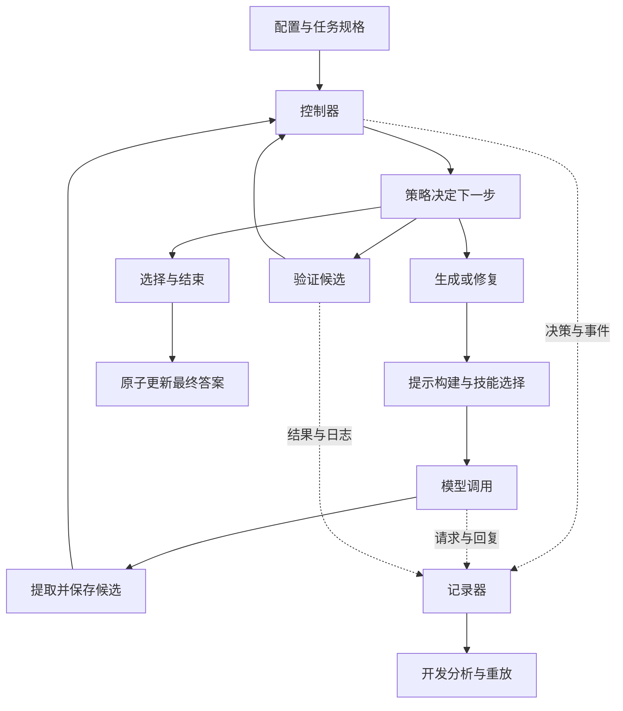

# Agent 框架重设计方案

| 项 | 内容 |
| --- | --- |
| 状态 | 设计提案，待评审；尚未实现，不代表收益已经验证 |
| 记录日期 | 2026-10-05 |
| 审查依据 | [Agent 框架审查记录](2026-10-05-agent-review.md) |
| 适用范围 | 正式单题 Agent 与开发实验入口 |
| 更新规则 | 本文只写设计；实施结果写入单独的进展记录与实验记录 |

## 1. 目标与边界

保留现有模型客户端、工具进程运行、接口解析、代码提取和原子落盘的可靠部分，重点重做控制器、
实验配置与证据记录。拟建立两层：运行框架可靠求解，实验框架记录、重放和比较；共享数据契约，
正式运行不依赖 `dev/`。

目标：

- 还原每次失败：模型看到什么、返回什么、提取了什么、检查与修复产生什么影响。
- 独立替换提示、技能、提取、验证、修复和选择，不修改主循环。
- 支持指定单题、集合、重复采样、组件测试、历史重放与消融。
- 用同一截止时间控制所有阶段，异常和取消时保留已有较好候选。
- 保存实际配置、代码与组件版本，使实验可以解释和重复。

正式入口保持 `run.sh <input_dir> <output_dir>`，输出 `solution.v` 与 `trace.jsonl`。
官方 baseline 文件不改动；开发评测器可以读取参考答案，Agent 只能读取允许提供的题面与接口。
运行检查仍使用 Vivado，不引入比赛禁止的第三方仿真、综合或形式验证工具。

首版不引入动态插件发现、复杂图执行框架或多个自主 Agent。显式注入组件和少量命名策略即可。

## 2. 总体结构与依赖



依赖方向：组件依赖共享契约；策略依赖状态和契约；控制器依赖策略与组件接口；实验工具依赖
公开运行入口和产物格式。模型不修改最终答案，验证器不发起修复，记录器不决定求解动作。

建议组织：

```text
agent/
├── main.py                     # 装配和启动，不包含求解策略
├── contracts.py                # 数据结构、组件接口
├── config.py                   # 读取、校验、实际配置快照
├── controller.py               # 执行动作和更新状态
├── state.py
├── budget.py
├── task.py
├── generation/
│   ├── prompt.py
│   ├── skills.py
│   └── llm.py
├── extraction/rtl.py
├── validation/
│   ├── interface.py
│   ├── lint.py
│   ├── synth.py
│   └── toolchain.py
├── policies/
│   ├── actions.py
│   ├── repair.py
│   └── selection.py
├── recording/
│   ├── events.py
│   └── artifacts.py
└── prompts/
config/default.json
dev/replay/
dev/eval/
dev/tests/
```

路径是建议，不要求每个接口一个文件。迁移既有模块时先保持行为，不同时改动算法。

## 3. 数据契约

| 对象 | 拟保存字段 | 约束 |
| --- | --- | --- |
| `TaskSpec` | 任务 ID、题面、目标模块、接口、来源、可信度、解析警告 | 不含参考实现；权威接口、题面推断和待修源码分开 |
| `ModelCall` | 调用 ID、阶段、messages、参数、响应、正文、耗时、错误、服务请求 ID | 保存实际发送与实际返回，不事后重建 |
| `Candidate` | ID、不可变代码、哈希、来源调用、父候选、提取结果 | 代码不可变，验证记录独立保存 |
| `CheckResult` | 检查 ID、候选 ID、检查类型、状态、诊断、命令、耗时、产物引用 | 未执行、不可用、失败与通过明确区分 |
| `RunState` | 候选集合、检查历史、当前修复对象、兜底选择、错误历史、调用计数、停止原因 | 供策略只读判断，由控制器更新 |
| `Action` | 动作类型、目标候选、检查类型、分配预算、决策理由 | 可记录、可测试、可重放 |

检查状态拟用 `passed`、`failed`、`timeout`、`unavailable`、`error`、`skipped`。
`error` 表示检查过程异常，`unavailable` 表示环境不具备条件，`skipped` 表示没有执行。
三者都不能当成检查通过。

诊断类别包括接口、语法、详细描述、综合、环境、输出截断、多草稿、模型传输及未知。
诊断附带阶段、错误码、对象、源码位置、可信度和日志引用；不确定就标为未知。

内部检查不命名成官方 L1/L2/L3；这些等级只由开发判定器产生。

## 4. 组件接口与装配

拟以 Python Protocol 或等价的明确接口描述组件，首版不需要外部注册服务。

| 组件 | 输入 | 输出 |
| --- | --- | --- |
| 任务解析 | 允许提供的输入文件 | `TaskSpec` |
| 提示构建 | 任务、动作、候选、相关诊断、选中技能 | messages 与模板版本 |
| 技能选择 | 任务特征、诊断类别、预算 | 有序技能引用及选择原因 |
| 模型客户端 | 请求、单次预算、取消信号 | 完整调用结果或分类错误 |
| 提取器 | 原始正文、目标模块 | 候选草稿与结构化诊断 |
| 验证器 | 候选、任务、配置、预算、取消信号 | `CheckResult` |
| 动作策略 | 状态、实际配置、剩余预算 | `Action` |
| 选择策略 | 候选与检查证据 | 候选 ID 和选择理由 |
| 记录器 | 事件或产物 | 产物引用及写入状态 |

`main.py` 解析配置后显式构造组件，再传入控制器。测试直接传入假组件；实际实验通过命名配置
替换组件。组件内部不读取大量隐式环境变量，凭据和工具路径在装配时解析后传入。

## 5. 控制流与失败路由

控制器只选取动作、记录决策、执行动作、应用结果、更新选择；不拼提示、不解析日志、不排序候选。

```python
while not state.finished:
    action = policy.choose_next(state, budget)
    recorder.record_decision(action)
    outcome = executor.execute(action, budget)
    state.apply(outcome)
    selection.update(state)
    recorder.record_outcome(outcome)
```

动作首版包括 `generate`、`repair`、`validate`、`retry_call`、`finish`。
拟先支持沿用现有顺序的策略：生成 → 提取 → 接口 → lint → 综合 → 分类修复或结束。

| 情况 | 拟采取动作 |
| --- | --- |
| 输出截断或只有未完成模块 | 在预算允许时调整输出或要求简洁实现；保留原始回复 |
| 目标模块缺失 | 明确要求修正目标，不忽略诊断 |
| 多个完整冲突草稿 | 保存全部草稿及选择理由，按配置处理，不默认长度代表质量 |
| 可重试模型传输失败 | 有限重试，不消耗 RTL 修复次数 |
| 请求配置或响应结构错误 | 明确分类；不盲目请求修改 RTL |
| 接口、语法等代码问题 | 根据诊断修复相关候选 |
| 环境或授权问题 | 保留候选，按策略停止或重试环境检查 |
| 完全重复的代码 | 条件一致时复用检查证据，避免重复运行工具 |
| 重复错误且没有进展 | 换修复策略、重新生成或停止 |

## 6. 候选选择与修复

状态分别维护最新候选、修复对象和最终选择。新候选先保存，经过证据比较后才决定是否更新
`solution.v`。首份完整候选可以作为无其他答案时的兜底；存在较好候选后，未验证或检查失败的
新候选不能无条件覆盖它。

选择规则拟优先使用已取得的验证证据，同等证据使用固定的选择顺序。规则必须记录理由，不能
把综合通过等同于功能正确。加入行为检查后，需另行明确证据冲突的排序。

检查缓存仅在代码、任务条件、检查配置和工具版本一致时复用；超时与环境失败不直接当成稳定代码结论。
相同哈希仍保留不同模型调用的来源关系。

修复提供可替换的 `minimal_edit` 与 `patch`：前者要求只改必要部分并返回完整文件，后者由程序
应用局部修改。两者都记录父候选、目标诊断、差异、原错误是否消失及新错误。patch 的应用失败
必须显式记录，不改变旧候选。

重复错误按稳定的阶段、错误码和对象识别，不比较包含临时路径的整段日志。换策略阈值通过配置控制。

## 7. 时间预算与取消

整题使用单调时钟和一个绝对截止时间；预算覆盖初始化、模型、检查、重试、产物写入及最终返回。
预算提供剩余时间、是否能启动动作和动作超时上限。HTTP 传入的截止时间是硬上限。

配置包括总预算、输出预留、各阶段上限、模型调用上限、修复次数和暂时失败重试次数。
这些是上限，不是必须用完的配额。策略需要判断剩余时间是否足以完成一个有用动作，不能只判断大于零。

运行监督层登记活动子进程组并统一取消；工具独立 session、外层超时和 HTTP 取消都纳入同一机制。
要求停止后先取消活动工作、回收进程，再返回已有选择。清理时间必须计入预算。

HTTP 超时不保证模型服务停止推理，需针对实际后端验证连接关闭与请求取消行为。
短期行为保持策略与阶段耗时估计可以并存，实际预算参数需通过实验确定。

## 8. 证据记录与产物生命周期

开发完整记录拟使用以下布局：

```text
<sample>/
├── solution.v
├── trace.jsonl
├── run.json
├── config.json
├── task.json
├── selection.json
├── calls/m001/
│   ├── request.json
│   ├── response.json
│   ├── content.txt
│   └── call.json
├── candidates/c001/
│   ├── solution.v
│   ├── metadata.json
│   └── extraction.json
└── checks/k001/
    ├── result.json
    ├── command.json
    └── full.log
```

原始响应保存服务端实际返回内容，包括可用的 reasoning；未返回的信息无法获取。
非 JSON 响应、异常前可获得的内容和脱敏错误也保存。不得用标准化结果伪装原始响应。
完整 messages 保存实际发送版本，不能根据当前提示模板事后拼回。

trace 保存事件与产物引用，使用运行、调用、候选、检查 ID 关联，避免重复塞入大段正文。
记录包含动作开始、结束、错误、取消和选择；开始事件在调用前落盘，使中断时也知道卡在哪一步。

提供 `basic` 与 `full` 记录级别。凭据请求头不落盘，正文与配置由统一过滤器处理。
详细记录失败要显式报告，但不能破坏已保存的最终答案；输出文件写入失败不能伪装成成功。
产物格式带版本；现有分析器通过兼容层读取，迁移时不静默改变工具调用计数。

HTTP 开发模式把详细产物写入独立运行目录，按运行 ID 读取，不随请求临时目录删除。
设置清理周期和磁盘上限，活动运行不清理；正式响应保持赛事格式。最终答案仍使用原子替换。

## 9. 配置与版本追踪

首版拟使用标准库 JSON，避免新增 YAML 依赖。以下是配置形状示例，数值仅为示意，不是测得的建议值：

```json
{
  "schema_version": 1,
  "profile": "default",
  "budget": {"deadline_s": 360, "reserve_s": 20, "max_model_calls": 3},
  "prompt": {"builder": "default"},
  "skills": {"selector": "error_category", "enabled": true},
  "extraction": {"strategy": "target_module"},
  "validation": {"stages": ["interface", "lint", "synth"]},
  "repair": {"strategy": "minimal_edit", "max_attempts": 2},
  "selection": {"strategy": "best_verified"},
  "recording": {"level": "full"}
}
```

覆盖顺序拟为内置默认 → 配置文件 → 显式运行覆盖；HTTP 截止时间再限制总预算。
环境兼容参数在入口解析，记录最终生效配置及来源；凭据不进入快照。
未知字段、组件名和非法组合明确拒绝，正式入口仍记录错误并满足输出契约。

记录源码版本、提示与技能内容哈希、任务清单、工具版本、模型和服务版本。未提交源码不能仅记
dirty 标志；开发实验应保存对应差异或快照，才能解释结果。

## 10. 实验入口与重放

继续使用 `dev/eval/run_eval.py` 和官方判定器，拟增加 `--task <id>` 与 `--config <file>`，
保留已有任务清单、模式、采样与并发接口。选择结果保存为冻结清单；默认排除项和实际排除结果明确记录。
只求解模式也应生成可用的运行记录和求解分析，只跳过需要判定的数据。

| 粒度 | 输入 | 输出 |
| --- | --- | --- |
| 单题完整求解 | 任务、配置 | 完整产物与判定 |
| 集合重复采样 | 冻结清单、配置、采样次数 | 逐样本结果与汇总 |
| 模块测试 | 固定输入与假依赖 | 输出和断言 |
| 提取重放 | 历史原始回复 | 新旧提取差异 |
| 候选验证 | 已保存候选 | 检查证据 |
| 选择重放 | 固定候选和已有证据 | 选择差异 |
| 流程重放 | 可匹配的历史请求与回复 | 动作及状态比较 |
| 消融比较 | 基础配置与变体 | 行为、耗时和判定差异 |

重放客户端必须核对请求内容和相关参数；策略发出历史中不存在的请求时标记不完整，不能顺序
消费下一条回复冒充匹配结果。更换提示、技能注入和生成策略需要实际调用模型。

从候选继续验证时保存来源与新配置。历史流程重放和真实重新运行的结果分别统计，避免混为模型收益。

## 11. 消融与实验口径

拟提供少量配置变体：关闭技能、关闭综合、单次生成、关闭修复、最新候选选择、按证据选择。
变体是基础配置的明确差异，不复制整套代码；单次 Agent 生成不等同于官方 baseline。

分别支持：

- 固定其他调用和步骤，移除组件，观察该组件的贡献。
- 固定总预算，允许重新利用节省资源，比较实际求解效果。

记录任务清单及哈希、实际配置、源码快照、模板和技能、模型服务、请求参数、采样、并发与预算。
若服务支持 seed 则记录，但不宣称 seed 保证不同运行完全一致。

分析既看总分，也看同一次运行内候选是否退化、错误是否消失、重复调用和停止原因。
基线与 Agent 最终结果差异不能单独归因于修复；第三轮的低最终正确率不能单独证明没有边际收益。

## 12. 功能验证扩展

先把现有验证器接入新契约，再实验从题面建立有限行为检查：规格条件 → 激励与断言 → Vivado
仿真 → 结果与覆盖范围。测试优先依据题面，避免只根据候选写测试而复述同一错误。

组合逻辑从边界输入开始，时序逻辑检查复位、保持、优先级和短序列。
多候选差分仿真只记录行为一致性，不能把多数答案当参考答案。自生成测试通过不能标为官方 L2。
测试台与最终 RTL 分开保存，不读取参考实现，不把公开题答案变成技能。

是否采用 patch、多候选或题型技能，由固定预算实验决定，不在重设计首版承诺收益。

## 13. 实施阶段与验收

| 阶段 | 拟实施工作 | 验收条件 |
| --- | --- | --- |
| 观测 | 请求、回复、候选、日志和决策证据 | 失败样本可以还原完整过程 |
| 拆分 | 契约、状态、装配与控制器 | 固定输入下与旧流程行为一致 |
| 策略修正 | 候选保护、预算、取消和错误路由 | 后续失败不覆盖较好候选，超时有效回收 |
| 实验 | 单题入口、重放与配置消融 | 不改主循环即可比较组件 |
| 能力扩展 | 行为检查、修复与多候选策略 | 固定实验条件下验证收益 |

阶段分别提交；行为保持重构与求解策略变化分开评估。改变方案结构或行为时同一 commit 更新
`../../README.md`，模型服务配置改变时同步模型声明，官方 baseline 保持不变。

必要测试覆盖：原始回复提取失败仍可分析；重复候选不重复检查；后续失败保留旧答案；暂时性故障
有限重试；环境问题不触发 RTL 修复；预算不足不启动无用动作；外层取消回收独立子进程组；
重放不匹配明确失败；单题和排除规则可追溯；正式 Agent 不依赖开发文件和参考答案。

## 14. 待评审问题

- 首版候选证据排序，以及未知检查和证据冲突的处理。
- 各阶段时间上限、最低启动预算、重试和重复错误阈值。
- 详细产物的默认级别、HTTP 开发获取方式与保存期限。
- 重放采用完整请求匹配的字段集合，以及模型服务不支持取消时的限制。
- 行为检查从哪些题型开始，如何减少测试与实现共享误解。
- 提示与技能版本快照方式，以及未提交代码快照的大小控制。
- 配置和 trace 的兼容迁移，如何保持已有分析工具可用。

上述事项需要评审或实验，不因本文记录而视为已经决定或实现。
