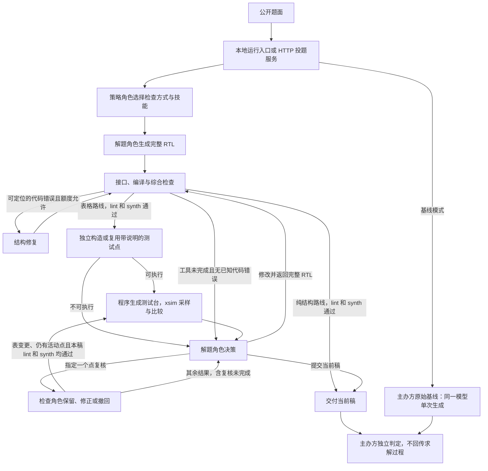

# FPGA 创新设计大赛 AMD RTL/HLS 本地智能体设计赛道——设计报告

本文沿用 2026-10-31 核对的主办方模板。第 1–5 节描述当前源码中的三角色工作流。第 6.1–6.5 节记录旧版本的模型实验及其预算，第 6.6 节记录三角色版本使用固定回复与真实 Vivado 的入口验收。三角色版本的真实模型增益尚待同配置对照。[主办方模板固定版本 fc8e26a](https://gitee.com/Vickyiii/rtlagent2026/blob/fc8e26a/REPORT_TEMPLATE.md)

## 1. 方案概述

### 1.1 设计目标

本方案在单张 AMD Radeon GPU 上运行开源模型，根据自然语言题面生成 RTL（寄存器传输级）代码。核心工作是将模型提出的实现和检查依据转为可执行的工具流程，在单题时间限制内发现部分错误并尝试修复，最终交付完整的 Verilog 源文件。

比赛中能力、增益、代价和工程质量的权重分别为 30、40、10、20。我们据此作出以下取舍：

- **能力目标：** 除接口、编译和综合检查外，执行有限行为检查，争取发现“能够综合但行为不符”的错误。能力以保存答案后的独立判定衡量，不能由内部检查代替。
- **增益目标：** 在相同模型、推理设置与时间预算下，检验智能体是否优于单次生成。当前版本尚未完成这种完整对照，不预设正增益。
- **代价目标：** 每题总时限 900 秒，预留 60 秒收尾，最多 8 次模型生成调用、65536 输出 token（模型处理文本的计量单位）。检查和修复共享这些额度，不能通过不断重试突破限制。
- **工程目标：** 保留请求、响应、候选、检查器和工具执行记录，区分代码错误、检查器错误、环境故障及未完成验证，使失败可以追溯。

默认流程由策略角色选择检查方式和求解技能，解题角色据此生成 RTL，必要时由独立检查角色构造行为测试点。解题角色阅读工具结果，可质疑测试点、修改实现或提交当前稿。三个角色分别构造请求，共用同一 Qwen3.8-27B 服务。RAG（检索增强生成）默认关闭。

## 2. 总体架构



工作流使用 Burr 框架组织各处理阶段，阶段之间按预先规定的条件转移，整体运行在一个 Python 进程中。程序统一管理模型调用、工具执行和外部进程的时间、用量与运行记录。每道题独立读取题面、查找可用技能并保存候选代码；当前实现不提供跨题记忆、进程重启续跑或跨次运行的检查缓存。

### 2.1 设计依据与相关工作

此前的调研先比较了工具反馈修复、独立行为参考、检查器纠错和领域知识提示，再结合无官方测试台、单卡和单题时间限制缩小实现范围。

| 相关工作 | 借鉴或对照的思想 | 本方案的实现及区别 |
| --- | --- | --- |
| AutoChip [1] | 根据编译与仿真反馈迭代修改 RTL | 结构诊断进入修复请求，新候选重新检查；本方案无法取得正式题的官方测试台，行为检查需自行构造 |
| MAGE [2] | 分开生成、检查和诊断，用执行失配定位问题 | 解题角色依据有限检查表、输入时序及实际比较结果决定下一步 |
| ChipMATE [3] | 分别构造实现与行为参考，通过比较发现分歧 | 检查器请求不接收候选 RTL 或实测输出；使用同一模型的独立请求与有限向量表，没有采用其训练方法、权重或 Python 行为模型 |
| CorrectBench [4] | 检查器本身也可能出错，需要审查和纠正 | 解题角色可请检查角色逐点独立复核，保留每次修改的理由和重新执行的结果 |
| HDLCoRe [5] | 按任务特点补充领域知识，减少生成中的错误 | 规划器按题选择方法技能，保留可选知识检索；默认关闭 RAG，未实现其完整检索方案 |
| SWE-agent [6] | 工具接口和返回内容应便于模型正确使用 | 统一工具调用、时间管理及诊断记录；采用 Burr 固定工作流，没有使用 SWE-agent 框架 |

上述关系属于方法借鉴或设计对照，不表示复现论文实验，也不能用论文结果证明本方案收益。AMD Ross 的 Vivado 仿真技能 [8] 还为错误分类、明确比较条件和修改后重新检查提供了工程参考；当前方案没有接入 Ross 的工具服务。

这些研究共同提示一个限制：独立生成的检查依据仍可能误读规格。我们因此把“检查器格式有效”“实际执行”“发现失配”“修复产生新稿”“复检通过”和“独立判定通过”分别记录。有限案例的一致性不构成功能完备证明。

## 3. 模型与推理栈

### 3.1 最终选用的模型

以下声明与[模型说明](model/MODEL.md)、[方案声明](manifest.json)一致。权重身份按 2026-10-30 的实际文件校验记录核对，不能仅凭服务对外显示的名称判断。

| 项目 | 内容 |
| --- | --- |
| 模型 | `Qwen/Qwen3.8-27B` |
| 量化权重来源 | [ggml-org/Qwen3.8-27B-GGUF 固定版本](https://huggingface.co/ggml-org/Qwen3.8-27B-GGUF/tree/a316ea527fde32c12487be7574e2db5ac2ad2a7e) |
| 权重仓库固定版本 | `a316ea527fde32c12487be7574e2db5ac2ad2a7e` |
| 主文件 | `Qwen3.8-27B-Q4_K_M.gguf`，18,973,870,528 字节 |
| 主文件校验值（SHA256） | `c600de0300ae8a0eb3a6c0b8b5561b8b96f16bd2c863c2a66c42de29d391a747` |
| 量化 | 两份权重均采用 GGUF 文件格式；主权重量化为 Q4_K_M，MTP（多 token 预测）头量化为 Q4_0 |
| 上下文长度 | 65536 token |
| 单次输出上限 | 策略 4096、解题 16384、检查器 8192 token |
| RoPE（旋转位置编码）外推 | 无额外覆盖 |
| 显存记录 | 设备瞬时已用 25,415,020,544 字节，即 23.67 GiB；非峰值 |
| 许可证 | 固定版本模型卡声明 Apache-2.0 |

MTP 预测头来自同一权重仓库版本，文件为 `mtp-Qwen3.8-27B-Q4_0.gguf`，大小 1,680,271,776 字节，SHA256 为 `c5be331f82fb61f5304adfa00ccd60c6743c8ce52255d66fa863446231d49ba4`。它与主模型在同一进程、同一 GPU 中进行推测解码，方案和基线共用，因此在方案声明中列为推理服务的组成部分。默认配置关闭可选模型配置组和 RAG，三个角色都使用主模型。此分类说明实现与申报方式，不表示主办方已对 MTP 分类作出专项认定。

实测设备识别为 Radeon Pro W7900D，物理显存约 48 GiB；赛事限制仍为单卡 32 GB 总占用，不能按物理容量放宽。上述设备快照已包含 MTP 和其他开销，主模型与 MTP 同进程另采得 24,566,664 KiB。离散采样和小题测试均不能替代正式负载峰值验收。主模型及预测头的精确参数量、发布方完整训练数据、转换工具版本和量化命令尚未全部核实。

### 3.2 评估过但未纳入最终方案的候选

| 候选或路线 | 开发阶段观察 | 未纳入当前默认的依据与限制 |
| --- | --- | --- |
| Qwen3 系列的 AWQ（激活感知权重量化）、FP8（8 位浮点）版本和小参数模型 | 早期筛选发现不同题型的功能错误，以及思考输出达到上限却没有最终代码 | 没有证据表明某一小模型能同时满足当前规划、检查和生成要求；旧题集、硬件与输出额度不同，不与本报告主结果直接排名 |
| `openai/gpt-oss-20b` | 早期 Radeon 镜像中权重可加载，但 Harmony 分词器需要的词表未准备，运行时下载失败 | 当时没有完成断网可用部署；这是该环境的依赖问题，不是模型能力结论 |
| Qwen3.8-27B EXL3 量化版本（每个权重平均 5 位）与 ExLlamaV3 后端 | 历史宽预算单题中模型调用吞吐高于 HIP；最终答案通过独立判定，内部验收却未完整通过 | AMD 路线依赖专用分支、编译修改和接口适配；量化与后端同时变化，未证明同等质量优势 |
| Vulkan 后端配合预测深度为 3 的 MTP、SGLang 后端配合 MTP | 历史同题比较暴露检查场景重复、覆盖不足或长请求耗时 | 单题不能形成后端排名；优先采用已有 HIP 部署与工具链记录 |
| VeriReason-Qwen2.5-1.5b 规划模型 | 曾准备为独立规划候选 | 许可、所需规划格式和合计运行显存未完成验收；当前由主模型规划 |

最终选择 HIP 后端与预测深度为 3 的 MTP，主要依据目标 AMD 环境已有可运行后端、固定权重可核对及服务接入记录，并非证明其在所有模型、题型和后端中最优。2026-10-23 的四后端单题实验使用旧版设计与验证循环、14400 秒研究预算和不同量化，只用于说明选型过程。

### 3.3 是否微调

否。本方案使用公开固定版本的量化权重，没有开展本队模型微调或强化学习训练。公开题面、文献与运行日志用于方法设计和故障分析；参考答案和官方测试台只供开发期独立判定，不进入求解提示、技能或知识检索。发布方权重的完整训练来源尚未审计，不将“本队未微调”扩展为对上游训练数据的保证。

### 3.4 推理栈

| 项目 | 配置 |
| --- | --- |
| 后端 | llama.cpp HIP（AMD GPU 计算后端），提供 OpenAI 兼容的 HTTP 接口 |
| 实测版本 | `0.4.0-dev (build 1, commit f114f91)` |
| 源码版本 | `f114f91f9ed6792cf402437e3874adad98902744` |
| 二进制 SHA256 | `290708d22f8b495d36b8aedd0afb0cdc081c415548f855e6a950a75dd742ad97` |
| 关键启动设置 | 上下文长度为 65536 token，单并发，启用 Jinja 聊天模板；不另设独立的思考 token 额度，总输出仍受各阶段上限约束 |
| 推测解码 | 启用 MTP，预测头全部放在 GPU，每次最多预测 3 个 token |
| 缓存与计算 | FP16（16 位浮点）键值缓存，Flash Attention 开启，所有模型层均放在 GPU，16 CPU 线程 |
| 请求设置 | 采样温度为 0.0，核采样概率阈值为 1.0；开启思考，强度为中等 |

启用 Jinja 聊天模板是使请求中的思考设置生效所需的条件，启动时还需指定镜像配套的 rocBLAS 库目录。方案和基线共用服务、权重、量化方式、上下文长度及方案声明中的生成设置；辅助检查请求也不另行关闭思考。推理服务一次处理一个请求，投题服务按顺序调度任务，避免同卡模型请求争抢预算。

## 4. 智能体设计

### 4.1 控制流

1. 读取公开题面，提取模块与端口信息，记录配置、源码版本与文件哈希。程序从技能文件读取正文，在求解材料记录中列出技能文件哈希及实际选用的技能。
2. 规划器读取完整题面、公开接口、检查器能力说明与可用技能描述，选择结构检查或表格行为检查，最多选择两项求解技能。规划回复无效时，程序按结构路线、空技能集继续。如果规划选择表格但接口超出支持范围，程序保留所选技能，将无法构表的原因交给解题角色。
3. 解题角色读取原题、接口和所选技能正文，生成完整 RTL。程序按候选编号记录来源调用、完整代码和父候选关系。
4. 依次执行接口检查、Vivado 编译展开（lint）和综合（synth）。确定的代码错误返回解题角色，修订稿重新走结构检查。若只要求结构检查，lint、synth 均实际通过就自动提交。
5. 在行为路线中，独立检查角色根据公开规格给出输入、期望输出及每个测试点的一句解释。程序校验格式和数值范围，生成测试台，执行仿真并记录逐点比较。
6. 解题角色评估当前稿，可显式提交（`submit`）、返回完整修订稿（`revise`），或指定一个活动测试点请求独立复核（`review`）。修订稿重新走结构检查。复核修正或撤回一个点后，只有表中尚有活动点且当前稿的 lint、synth 均通过，才重新执行仿真。保留原点、撤回最后一点或复核未完成时，结果直接交回解题角色。

共享预算不足或运行中断时，磁盘上的 `solution.v` 优先保留最近的 lint、synth 双通过候选，其次保留最新完整 RTL，尚无完整稿时文件为空。正常收尾会记录提交方式及稿件来源。进程被强制杀死时可核对已落盘文件与候选的哈希。独立判定读取实际文件。[决策与交付协议](docs/guided-verify.md#3-解题动作与交付)

### 4.2 重试与回退策略

| 阶段 | 单次时限上限 | 输出上限 |
| --- | ---: | ---: |
| 规划 | 90 秒 | 4096 token |
| 解题角色生成、决策与修复 | 300 秒 | 16384 token |
| 检查角色构表、纠正格式与复核 | 180 秒 | 8192 token |

修复和逐点复核可以循环，每一次都占用同一份预算。检查表格式错误时，程序可将具体解析诊断还给检查角色，要求重新给出完整合法表。首稿或初次构表的回复若最终正文为空，程序分别记录终止原因和用量，对已确认终止、用量已知的 `stop` 或 `length` 在预算内尝试恢复。重复且没有进展的空正文恢复会留下对应的调用记录。

默认每题共用 900 秒，最多发送 8 次生成请求，共用 65536 个输出 token。调度为需要的后续步骤留出时间，按余额缩短请求时限，低于最短请求时间时记录“未发送”。规划为求解预留 `solve.timeout_s` 与 `solve_minimum_s` 中较短的时间，默认 120 秒，另留首次工具检查的 120 秒。有请求用量未知时停止可选恢复。前一次生成尚未确认结束时停止发送后续生成请求。

本地入口以是否存在非空答案决定退出码。投题服务返回“任务已结束”只说明处理流程结束，不代表答案正确；还需检查是否保存了有效答案，以及检查是否实际执行。当前没有重启后自动续跑，服务守护进程也不会恢复丢失的题目状态。

### 4.3 上下文管理

程序为各阶段分别准备所需信息，不沿用完整聊天历史或模型思考正文。规划保留题面全文；生成与修复使用对应技能；结构修复接收当前候选、按类别整理的诊断与日志摘要。Vivado 日志摘要默认限制为约 2000 字符，关键诊断另记录位置、错误信息和截断情况，避免只截日志开头而丢失根因。

首次构表提供带段落编号的公开题面、接口、固定检查方法和实际采样规则。逐点复核额外提供当前表与指定测试点编号。候选 RTL、实测输出和解题角色质疑的理由均留在解题上下文中，避免把观测值变成期望值的来源。

解题角色收到当前 RTL、有效测试点及解释、实测比较、阶段状态和历轮简短决定。它可指出检查建议与题意的冲突，保留原稿或请求复核。本题的短记保留候选和检查器版本，可追踪同一测试点多次复核的经过。模型客户端按服务端分词结果计算上下文余量，记录原始用量和终止原因，缺失数据保留为未知。

### 4.4 自我验证

结构检查解决接口、语法、展开和综合问题；行为检查解决有限场景下的输入输出一致性。当前行为检查器要求公开接口可解析，最多 64 个端口，端口宽度 1–256 bit；支持组合逻辑或明确的单正沿时钟设计。负沿、多时钟、时钟归属不清等情况不猜测支持。

模型按 `case <id> # <短说明>` 给出每个测试点，逐行写激励和期望。程序生成测试台，默认最多 4 个点、每点 8 行。每个时序点有自己的被测设计实例，首行初始化默认重复 2 个有效沿，复位按题意显式驱动。表可声明首次初始化沿前或最后一次初始化沿后的期望，后续步骤按指定相位比较。组合场景在信号稳定后比较。

输入与期望值必须满足端口宽度。检查表中的未知值、越界值、缺少输入或无效格式都不予接受。程序先验证采样是否完整、是否属于当前稿和采样计划。对有效采样，只要有一个已知位失配即记为失败，同时保留未知位掩码。已知位无失配但含未知位、或比较位数为零时记为未知。已比较的位全部匹配但仍有输出未覆盖时记为部分通过，并列出未覆盖的输出。每次比较都记录实际候选和检查器的版本。

行式表让程序统一处理时钟、采样与未知位比较。长周期计数、复杂协议、异步行为和状态空间覆盖仍可能缺失，同一模型也可能在不同角色中共同误读题面。自由编写测试台、在模板内填充测试台与行式表格的实际优劣，仍需同题、同预算对照。

## 5. 技能包

### 5.1 技能清单

技能目录共有 14 项。下列 9 项允许规划器自动选择；每题最多使用其中 2 项。“允许选择”不表示已通过单项收益实验。具体文件与启用状态见[技能目录说明](skill/README.md)。

| 技能 | 解决的问题与适用条件 | 当前验证范围 |
| --- | --- | --- |
| 模块接口一致性 | 顶层模块、端口方向、位宽及声明一致性 | 接口诊断与调用路径已验证；未测独立增益 |
| 时序状态更新 | 寄存器、移位、复位与同拍优先级 | 加载技能并将其加入模型请求的过程已验证；未测独立增益 |
| 计数终点与进位 | 计数终点、首末拍及级联进位 | 查找、选择技能并将其加入模型请求的过程已验证 |
| 线性反馈移位寄存器 | LFSR（线性反馈移位寄存器）的反馈拓扑与位序 | 同上；不由名称猜测抽头 |
| 串并转换与分组边界 | 串并转换、分组边界及残留位 | 同上；不补造握手要求 |
| 存储器有效读写 | 单时钟 FIFO（先进先出队列）、RAM（随机存取存储器）的有效操作及冲突语义 | 同上；不覆盖异步 FIFO |
| 流水线数据与控制对齐 | 流水线数据、控制与有效位对齐 | 同上；不新增接口协议 |
| 打包数组索引与邻域 | 打包切片、网格邻域和边界 | 同上；不将非法索引改成零 |
| 卡诺图坐标映射 | 卡诺图坐标、最小项及有效输入域 | 同上；未测独立增益 |

关键场景行为检查方法由检查器固定使用，不进入上述自动求解技能名单。时序状态更新方法的第三版仍为候选，尚未启用；位宽算术、组合逻辑完整性和有限状态机三项方法也不允许选择。目录中有文件不等于运行时启用，每次实际选择的方法和内容哈希均随请求材料保存。

### 5.2 提炼过程与来源

模块接口方法来自主办方示例，保留 AMD 的版权和 MIT 许可。时序状态更新方法及其第三版、位宽算术、组合逻辑完整性与有限状态机方法从固定开源分支 [9] 迁入，保留来源及许可信息。七项专项求解方法与固定行为检查方法由本项目编写；不能将整个技能目录称为原创。

专项方法从公开题面分类、常见 RTL 语义和开发中的生成失败提炼：计数问题先确定终点事件发生在哪一拍；存储问题先区分请求与实际接受的操作；流水线问题先对齐数据、控制和有效标志；索引问题先确定打包方向和边界。方法写成可复用步骤，不按题号或平台标识匹配答案。

固定行为检查方法要求选择能够区分常见错误的少量输入，明确安排初始化并检查输出。它来自公开验证原则，具体依据见[行为检查方法的来源说明](skill/rtl-behavior-check-keycases/PROVENANCE.md)；没有复制官方测试台或参考实现。

### 5.3 有效性验证

现有验证分为三层：技能文件格式是否有效、是否启用，以及互斥方法是否同时出现；选定技能是否确实加入模型请求；真实模型是否因此改善答案。前两层已有单元测试、独立副本和假模型运行记录。第三层尚无当前模型、同预算、同题集的逐项开关对照。

2026-10-30 的 145 题实验启用了规划选技能，但没有配对关闭技能，因此不能把 82.76% 的 L3 比例归因于技能。RAG 开启组因向量兼容检查失败而未投题，也不能写成检索提高或降低了成绩。当前可以确认技能能被发现、选择和记录，无法确认每项技能的独立收益。

## 6. 实测结果

### 6.1 测试环境与版本

第 6.1–6.4 节的主表统计来自 `20261030-verilogeval-rag-comparison` 的 RAG 关闭首轮。源码冻结在 `45caf9716f9eed0fd993f787f782bbc518bda6cf`，早于当前针对空正文的恢复机制。11 月的两轮 Radeon 结果另见第 6.5 节。

- **数据集：** VerilogEval v2，原 156 题按主办方当时列出的 11 道已知缺陷题过滤后为 145 题；所有已选题保留在分母中。
- **采样：** 每题运行智能体一次，内部可按策略调用模型多次。没有按结果重选答案，也没有进行每题五次独立采样。
- **模型与硬件：** Radeon Pro W7900D，Qwen3.8-27B Q4_K_M、llama.cpp HIP `f114f91`，MTP 预测深度为 3，思考强度为中等，上下文长度为 65536 token；权重哈希与第 3 节一致。
- **预算：** 900 秒/题、60 秒收尾、8 次调用、65536 输出 token；当时规划为 300 秒/4096 token，生成为 300 秒/8192，检查器为 300 秒/16384，归因为 120 秒/1024。它与当前第 4 节的阶段额度不同。
- **独立判定：** 保存答案后调用主办方自测程序，Vivado 2026.1，目标器件 `xczu3eg-sbva484-1-e`，时钟约束 5 ns。判定结果不回传求解流程。

### 6.2 分级结果与基线对比

主结果采用逐题最高级别的互斥计数。L1 表示可编译但未通过后续仿真，L2 表示仿真通过但未达到综合通过，L3 表示全部阶段通过。

| 级别 | 历史规划与验证流程，145 题 | 同批基线 | 系数 |
| --- | ---: | --- | ---: |
| L0 未通过 | 11 | 未运行 | 0 |
| L1 可编译 | 14 | 未运行 | 0.2 |
| L2 仿真通过 | 0 | 未运行 | 0.7 |
| L3 可综合 | 120 | 未运行 | 1.0 |
| 平均等级系数 | 0.8469 | 未测 | — |

平均等级系数按（120 + 14 × 0.2）÷ 145 计算，不是包含难度分档及全部评分因素的赛事总分。145 份答案与判定副本逐一核对，工具错误为 0；达到 L2 以上的样本均有实际比较，未将零采样计为通过。

归一化增益衡量方案弥补了多少基线与满分之间的差距，即用方案比基线多得的分数除以基线距离满分的差值。主结果没有同批次基线，因此不能计算当前方案的归一化增益。

作为设计演进证据，另列 `20261025-verilogeval-full-d57eedf` 的历史完整对照。两组使用相同 Qwen 权重和 HIP 后端，MTP 预测深度均为 3，思考强度均为中等。但旧版自适应验证流程每题最多 9600 秒、7 次调用，基线为 900 秒、单次生成；156 题也未采用上述 11 题过滤规则。该批基线经方案的单次生成流程执行，复用主办方的提示、代码提取逻辑与采样参数，属于参数对齐的等效执行方式，未直接执行主办方原始基线脚本。

| 级别或指标 | 历史自适应验证流程 | 同批等效基线 |
| --- | ---: | ---: |
| L0 / L1 / L2 / L3 | 8 / 20 / 0 / 128 | 48 / 17 / 0 / 91 |
| 完整通过率 | 82.05% | 58.33% |
| 平均等级系数 | 0.8462 | 0.6051 |
| 模型调用 | 616 | 156 |
| 输出 token | 2,319,158 | 238,509 |
| 求解器累计耗时 | 45,814.33 秒 | 4,259.94 秒 |

历史智能体多通过 37 题，累计求解耗时约为基线的 10.75 倍。由于预算、工作流和题目集合不同，这项结果既不是当前版本成绩，也不能单独证明检查器、提示或修复机制的贡献；不将其换算成正式增益分。

### 6.3 pass@1 与 pass@5

| 指标 | 历史规划与验证流程（版本 `45caf971`） | 同批基线 |
| --- | --- | --- |
| 一次完整智能体运行达到 L3 的比例 | 120/145，82.76% | 未测 |
| pass@5 | 未测 | 未测 |

第一项相当于本批按“每题一次完整运行”统计的经验 pass@1，不是一次模型调用的通过率。没有五次独立采样，不能用内部多轮修复、失败题复测或确定性原样重跑计算 pass@5，也无法据此分析两者差值。

### 6.4 实际耗时与调用成本

145 题的耗时采用投题服务在任务完成后报告的处理时长，包括该任务的求解处理，不包含独立判定、证据收集及本机网络往返。

| 项目 | RAG 关闭首轮 |
| --- | ---: |
| 平均求解耗时 | 114.83 秒 |
| 中位求解耗时 | 94.9 秒 |
| 最长求解耗时 | 393.4 秒 |
| 任务累计求解耗时 | 16,650.4 秒，约 4.63 小时 |
| 模型调用数 | 447 |
| 已知输入 token | 1,293,443 |
| 已知输出 token | 631,628 |
| 用量未知调用 | 1 次 |
| 已知模型调用耗时 | 12,880.3 秒 |
| 文本向量计算调用 | 0 |

未知调用仍消耗过时间和资源，不计为零；各题求解耗时之和也不等于完整实验从准备到结束的实际时长。没有基线同批耗时，因此不据此计算赛事代价项。

### 6.5 结果分析与后续局部验证

首轮检查器有效 97 题、无效或请求失败 10 题、未建成 38 题。10 题中，9 题为格式、越界值或缺失输出问题，1 题为 HTTP 500 后未取得有效检查器，后者不归为格式错误。最终内部行为通过 85 题，其中仍有 3 题独立判定停在 L1。结构修复事件 34 次、行为修复事件 1 次、检查器重建事件 2 次。事件数量不能解释为相同数量的真实错误或成功修复，更不能直接当作分数提升。

11 个 L0 中，9 题的模型响应明确报告已达到 8192 token 的输出上限，却没有最终正文；另 2 题保存了非空答案但编译失败。这说明输出完整性和有限检查覆盖都影响结果，不能只优化仿真阶段。

| 后续批次 | 条件与结果 | 能支持的结论 |
| --- | --- | --- |
| `20261031-token-limit-retest` | 选择原 9 道空答案题，放宽到 32768 token 阶段额度及 3600 秒/题；6 L3、2 L1、1 L0 | 增加额度后部分题目能够生成正文，但仍有空答案；同时改了时间和 token，不能把变化归因于其中一项，不能替换首跑；保留逐题结果与自测摘要，但原始判定工作日志已清理 |
| `20261031-guided-recovery` | 固定 3 题，使用加入重新请求机制的待验证版本，检查器时限 150 秒；2 L3、1 L1 | 一题完成检查器空正文恢复、实际检错、行为修复和同版本复检；未取得真实生成空正文恢复成功证据 |
| `20261031-simple-api-smoke` | `1615689`，自编 AND（逻辑与）题，通过云端本机环回地址投题，64.5 秒、3 次调用、L3 | 验证当时的简单题生成、检查与服务 |
| `20261031-public-or-smoke` | `1615689`，自编 OR（逻辑或）题，从本机通过公网投题，端到端 60.374 秒、3 次调用、L3 | 完成该版本的公网提交、查询与简单题独立判定 |

三题恢复实验共 14 次调用，已知输入 47,013、输出 57,671 token，另 1 次用量未知，求解合计 1340.542 秒。当时发布的 `1615689` 将检查器时限调整为 180 秒，相应复杂题验证随后由用户中止且未判定。两道自编小题均穷举 4 个输入组合并通过综合，覆盖范围限于当时的组合逻辑与服务路径。

RAG 开启组计划复用同一 145 题，但 CPU 计算的文本向量与实验前固定的检索索引未通过兼容检查，因此停止，提交数为 0。没有降低门槛、更换索引或用后续版本补齐该组，因此 RAG 的对照结论仍缺失。

下面两次 Radeon 运行均早于三角色改造。两批都只运行方案，每题一次，保存答案后独立判定。

| 运行编号 | 冻结源码、题集与预算 | 判定结果 |
| --- | --- | --- |
| `20261116-radeon-verilogeval` | `52fa9e5` 的求解源码，固定 145 题。每题 900 秒，最多 8 次生成、65536 个输出 token | 125 题 L3、16 题 L1、4 题 L0 |
| `20261117-radeon-retest` | `52fa9e5` 加当时未提交的修复。从上一批选出 41 道未达 L3 或流程异常的题。每题 900 秒，取消额外的生成次数和输出 token 总量限制 | 25 题 L3、16 题 L1 |

41 题复测共发送 218 次生成请求并执行 52 次行为评估。22 道最终记录为内部行为通过的题中，10 道独立判定止于 L1。复测同时改动了求解源码与预算，无法据此单独估算放宽预算的收益，子集结果也不能替换上一批成绩。

### 6.6 三角色流程的入口验收

2026-11-18 的 `20261118-guided-three-roles` 在两道自编题上使用本机固定 HTTP 回复，通过 `run.sh` 执行了七个场景。Vivado 2026.1 实际执行结构检查。结构路线在 lint 和 synth 通过后自动提交，选择了不支持的行为检查时则由解题角色收到原因并提交。其余场景覆盖保留有失配的当前稿、同一 RTL 修正检查表、修改 RTL 后按原表复检，以及额度耗尽和 SIGTERM 中断时交付先前通过结构检查的稿件。

七个场景共发送 29 次生成请求。七次 XSim 执行各实际比较了 2 个已知位，验收时从原始仿真日志重读采样并核对候选与检查表哈希。本次未加载模型权重，也未进行官方复判。真实模型的决策质量和成绩变化仍需在同题集、同预算下测量。

## 7. 复现说明

### 7.1 构建

在方案仓库根目录执行：

```bash
docker build -t rtlagent:local .
```

`Dockerfile` 使用固定主办方基础镜像，安装固定 Python 依赖并检查镜像内 HIP 后端和 rocBLAS 库。源码无需读取开发区或题库；权重在断网运行前按 [MODEL.md](model/MODEL.md) 准备并校验，运行时只读挂载到 `/models`。

本地已有构建尝试受主办方基础镜像获取条件限制，未完成干净容器的实际构建与运行。以下为源码提供的复现方法，不能视为容器验收记录。平台 GPU 设备、授权和网络配置遵循基础镜像要求。

### 7.2 启动推理服务

先加载 Vivado 环境与有效授权。下列命令在方案目录执行：

```bash
export MODEL=/models/Qwen3.8-27B-Q4_K_M.gguf
export MTP_MODEL=/models/mtp-Qwen3.8-27B-Q4_0.gguf
export LLM_BACKEND=openai LLM_BASE_URL=http://127.0.0.1:8000/v1
export LLM_API_KEY=dummy
export MODEL_NAME=qwen38-27b-q4-k-m LLM_MODEL=qwen38-27b-q4-k-m
export AGENT_TMP=/var/tmp EDA_TMP=/var/tmp/eda SELFTEST_TMP=/var/tmp
./serve/start.sh
```

默认后端为 `/opt/llamacpp/llama-server`；使用其他安装位置时，按[服务说明](serve/README.md)配置。脚本只启动主模型及同进程 MTP。已有健康服务会被复用，仍需独立核对其文件哈希、实际参数和动态库。

通过 HTTP 接收题目时，还需在受保护的运行环境中配置赛事访问令牌，然后执行 `./serve/run_api.sh start`。8000 与 7860 端口均只监听本机环回地址，只通过平台隧道对外提供 7860 端口的投题服务。详细配置、报文、授权及隧道操作见[服务说明](serve/README.md)。

### 7.3 单题运行与基线运行

```bash
./run.sh /absolute/path/to/task /var/tmp/agent-output
./run_baseline.sh /absolute/path/to/task /var/tmp/baseline-output
```

题目目录包含 `prompt.txt`；接口由公开题面提供。两条入口共用模型服务和思考设置。正式基线文件不修改，不加载智能体或技能。

### 7.4 自测复现与已完成范围

主办方自测目录在方案仓库之外。下面在同时包含 `selftest/`、`tasks/` 和方案目录的工作区根目录执行：

```bash
selftest/run_selftest.sh --agent /absolute/path/to/agent --tasks tasks/verilogeval
```

完整题库目录通常包含 156 题；复核 145 题结果时应先按主办方清单准备相同公开题目集合，不能运行完后再按结果过滤。命令会重新调用当前方案，不会重现旧提交和旧预算；旧成绩的复核还需要其冻结源码、配置及保存答案。

| 验收事项 | 当前状态 |
| --- | --- |
| `1615689` 真实模型、Vivado 与 HTTP 小题流程 | 历史 AND/OR 两题已完成 |
| 历史两批各 145 份保存答案的独立判定 | 2026-10-30 和 2026-11-16 的批次分别完成，见第 6.2、6.5 节 |
| 三角色的入口、复核与交付 | 2026-11-18 完成七个固定回复场景，使用真实 Vivado，见第 6.6 节 |
| 当前版本全题集基线对照 | 未完成 |
| 对应完整题集的参考实现全部通过判定 | 本报告未取得同批完整证据，不勾选通过 |
| 干净 Docker 镜像复现 | 未完成 |
| 正式负载下单卡 32 GB 峰值与连续稳定性 | 未完成完整验收 |

### 7.5 已知环境依赖

权重和分词所需资源必须提前准备。Vivado 工具需可从环境中找到且授权有效；临时工程使用 `/var/tmp` 等本地目录，避免小容量内存盘或网络存储带来的空间和速度问题。HIP 二进制与 rocBLAS 库须匹配，不能仅按版本字符串替换。服务重启后需要恢复环境、模型与隧道；当前进程内任务状态不会跨重启保留。

## 8. 失败分析

### 8.1 仍然存在的失败类型

| 类型或现象 | 已有结果 | 原因判断及处理范围 |
| --- | --- | --- |
| 思考结束前达到输出上限 | 2026-10-30 的 145 题首轮中 9 题 L0，最终正文为空 | 原始响应明确报告达到输出长度上限；不是提取器丢失已有代码。当前增加首次空正文恢复，但完整收益未验证 |
| 自然停止却无最终正文 | 9 题增加额度的研究中仍有 1 题 L0 | 存在重复思考文本，不能仅凭服务报告正常终止推断成功；具体后端终止原因仍未知 |
| 非空 RTL 编译失败 | 首轮 2 题 L0 | 有答案不表示结构正确；需要结合端口声明和编译诊断定位，保存实际交付稿 |
| 有限案例漏检行为错误 | 首轮内部通过的 85 题中有 3 题为 L1 | 检查表覆盖不足或与生成阶段共同误读；内部通过不能代表全部规格 |
| 检查器截断或超时 | 三题恢复验证中仍有检查器不可用和未知用量 | 检查器自身也消耗思考预算；失败不等于 RTL 错误，不能填为行为通过 |
| 复杂时序及接口解析限制 | 部分任务无法建表，部分行为超过表的采样范围 | 多时钟、负沿或接口无法完整解析时无法建表。受支持的接口也可能在有限行数内到达不了长周期事件。跳过仍计入评估分母 |

2026-10-30 的 145 题批次中，归因请求单次仅有 1024 token，多次未能给出有效归因，阻断后续修复。当时的方案曾提高归因单次额度。当前由解题角色直接据证据选择动作，这一改变对失配处理和最终成绩的影响待实测。

### 8.2 尝试过但未达到预期的改进

| 尝试 | 预期 | 实际观察与结论 |
| --- | --- | --- |
| 直接增加输出上限与时间 | 长思考后能够产出完整答案 | 9 题研究重测仍有 1 题无最终代码，另 2 题仅 L1；仅增加额度不能充分解决问题 |
| 无变化地重复确定性请求 | 用重试弥补生成失败 | 历史请求重放曾得到相同输出；没有新信息或明确恢复条件时可能重复消耗预算 |
| 多加独立验收与模型审阅 | 扩大检查范围并降低误判 | 旧宽预算流程出现重复输入、覆盖不足及审阅计算错误，增加调用不保证增加有效检查 |
| 以更快后端替换现有服务 | 缩短总耗时 | ExLlama 历史单题吞吐更高，但内部验收未完整通过；量化、后端与输出长度同时变化，不能视为同质量提速 |
| 启用基于向量检索的 RAG | 检索方法卡片提高准确率 | 向量兼容门槛未通过，第二组没有运行；不能把部署失败解释为算法无效 |
| 仅检查 HTTP 状态与退出码 | 判断服务已经成功解题 | HTTP 200、任务已结束或退出码 0 都可能伴随无效检查或错误答案，必须再核对实际产物与执行证据 |

### 8.3 方案边界

当前的有限表格只检验已执行的输入序列和采样点。长协议、多个时钟、大规模存储或规格歧义会限制表达和覆盖能力。更换角色使用的模型、量化、上下文或缓存后，须重新验证构表、决策和最终结果。

每次结构检查后，交付程序更新用于中断兜底的候选。lint 和 synth 均通过的稿件仍可能有行为错误。当前缺少受控实验来区分技能、独立检查、解题决策与 MTP 各自的贡献。实验还需记录实际比较量、失败原因、修订行为及增加的耗时。

## 9. 创新点总结

本方案的贡献主要是面向竞赛约束的工程设计，不声称首创生成、验证和修复的一般方法。

1. **以有限检查表连接模型与仿真器。** 模型提出输入和期望值，程序负责时钟、初始化、采样和比较。2026-10-30 的 145 题实验建成 97 个有效检查器，内部通过 85 题，同时暴露 3 题漏检，明确了可用性与覆盖限制。
2. **解题角色决定如何处理行为证据。** 检查角色独立保留、修改或撤回被质疑的测试点。解题角色可提交当前实现，也可返回完整改稿接受重新检查。每份行为检查证据绑定实际候选和检查表。第 6.6 节的固定回复分别验证了保留失配、改表和改稿这三种决定。
3. **在总预算内安排恢复与交付。** 未知用量阻止可选恢复，未确认结束的请求阻止后续生成。中断兜底优先保留已实际通过 lint 和 synth 的最近候选，程序分别记录主动提交和兜底。

## 10. 结论与展望

### 10.1 达成度

当前源码实现三个隔离请求角色、RTL 方法技能、Vivado 检查、HTTP 投题与主办方原始基线。改造前的两轮 145 题公开开发测试中，`45caf971` 有 120 题达到 L3，`52fa9e5` 有 125 题达到 L3。两批都未运行同批基线。三角色版本的证据覆盖第 6.6 节的七个入口场景。

能力目标取得阶段性结果，增益目标尚缺当前版本的等预算基线对照。900 秒预算管理已实现，但完整负载峰值显存、干净容器复现及当前版本全题集稳定性尚未完成。现有结果不能支持“所有机制都有效”或“正式增益已经达成”的结论。

### 10.2 后续改进方向

优先固定当前模型、题集和总预算，补齐原样基线与方案对照，再分别关闭技能、行为检查或恢复，衡量各项作用。随后改进检查案例的区分能力、接口解析与长时序支持，用自编正确实现和故意错误实现验证能运行且能检错。候选交付策略也需单独比较，核查最后保存稿与有证据支持稿的差别。

恢复 RAG 实验前，应先核对实验前固定的索引向量从何生成，并确认当前计算结果与之兼容，不能更换索引后沿用旧对照。部署方面先完成干净镜像、峰值显存和连续运行验收，再根据测量结果决定是否增加模型调用或输出上限。

## 11. 参考文献

以下论文用于方法分析，未在本项目中复现其作者实验；文献成绩不计入本报告结果。

[1] *AutoChip: Automating HDL Generation Using LLM Feedback*. [arXiv:2311.04887v2](https://arxiv.org/abs/2311.04887v2).

[2] *MAGE: A Multi-Agent Engine for Automated RTL Code Generation*. [arXiv:2412.07822](https://arxiv.org/abs/2412.07822).

[3] *ChipMATE: Multi-Agent Training via Reinforcement Learning for Enhanced RTL Generation*. [arXiv:2605.12857](https://arxiv.org/abs/2605.12857).

[4] *CorrectBench: Automatic Testbench Generation with Functional Self-Correction using LLMs for HDL Design*. [arXiv:2411.08510](https://arxiv.org/abs/2411.08510).

[5] *HDLCoRe: A Training-Free Framework for Mitigating Hallucinations in LLM-Generated HDL*. [arXiv:2503.16528](https://arxiv.org/abs/2503.16528).

[6] *SWE-agent: Agent-Computer Interfaces Enable Automated Software Engineering*. [arXiv:2405.15793v3](https://arxiv.org/abs/2405.15793v3).

[7] *Revisiting VerilogEval: A Year of Improvements in Large-Language Models for Hardware Code Generation*. [arXiv:2408.11053v2](https://arxiv.org/abs/2408.11053v2)；[VerilogEval 项目](https://github.com/NVlabs/verilog-eval)。本项目使用主办方转换后的公开题面及独立判定流程。

[8] AMD Ross，固定版本的 [Vivado 仿真技能](https://github.com/Xilinx/ross-ai-assistant/blob/dce0fb90611b144dd529490359b51cea5d0d5596/skills/vivado-simulate-rtl/SKILL.md)。用于工程方法参考。

[9] [amd-rtlagent-prompt-engineering 固定分支](https://github.com/wyc888-crypto/amd-rtlagent-prompt-engineering/tree/fb1c2803e5db0f32b59b9ba9100877f2a0d26412)。技能来源以本地文件头和迁移记录为据，保留 MIT 许可；不据仓库名称推断作者关系。

[10] [RTL track 主办方参考仓库 fc8e26a](https://gitee.com/Vickyiii/rtlagent2026/tree/fc8e26a/)，报告模板、评分说明、投题契约与提交要求。

## 12. 大模型协作记录

### 12.1 所用模型与工具

本节核查北京时间 **2026-08-31 00:00 至 2026-10-31 本次文档核查时点**的本机项目交互，覆盖 Codex、Claude Code、DeepSeek Harness（dsh）和 Oh My Pi（omp）。依据会话元数据、用户与助手的可见消息及留存文档确认分工。初始化、认证失败和工具生成的错误消息不算模型贡献；中止的任务或未实施的草案不算已完成实现。

| 工具 | 本次找到的项目记录 | 证据范围 |
| --- | --- | --- |
| Codex | 9 月 10 日起有原生会话，10 月仍有持续记录 | 部分早期原始会话文件缺失，保留的线程数据库与可见消息可供追溯；线程模型字段不等于每轮调用的独立版本证明 |
| Claude Code | 历史索引从 9 月 5 日起有记录；原始日志中可核对模型标识的助手消息覆盖 9 月 22 日至 10 月 23 日 | 部分早期原始正文缺失，导入其他工具的历史可交叉核对内容，但不能据索引或导入记录补推模型版本 |
| dsh | 实际助手消息覆盖 9 月 25 日至 10 月 27 日 | 核对压缩会话日志中的模型事件、助手正文与结束记录 |
| omp | 实际助手消息覆盖 10 月 27 日至 10 月 30 日 | 核对主会话及子任务中的实际助手消息 |

上述日期表示本次可检索到的记录范围，不代表工具首次或最后一次使用时间。跨工具导入的历史按原始来源归属，不按存储位置重复计算；不从文件修改时间或工具名称推断模型版本。

| 工具 | 记录中的模型标识 | 参与环节 |
| --- | --- | --- |
| Codex | `gpt-6.1-sol` | 研究批次处理、实验记录审查与结果解释 |
| Codex | `gpt-6-astra` | 架构比较、文献研究、代码审查、上下文与预算修复 |
| Codex 文献子任务 | `gpt-6-luna` | 文献摘要筛选与分类 |
| Codex 历史子任务 | `gpt-6-sol`（仅线程级记录） | 历史技能组件拆分、开发文档与审阅；缺少逐轮模型记录 |
| Claude Code | `claude-opus-5` | 早期开发区规划、远端推理与本地判定分工、推理后端要求核对 |
| Claude Code | `claude-opus-5-5` | 实验体系建议、框架重构调研、Burr 与 LangGraph 两版方案 |
| dsh | `deepseek-official / deepseek-flash` | 早期模型筛选分析、文献卡片、证据审计及历史实验入口实现 |
| omp | `deepseek / deepseek-flash`、`deepseek / deepseek-v4-flash` | 实现审查、建议与开发协作 |
| omp | `openai-codex / gpt-6-astra` | Markdown 提示迁移、技能发现与相关代码实现 |
| 本地运行服务 | 第 3 节固定 Qwen3.8-27B 权重 | 2026 年 10 月实验中的规划、生成、检查与归因请求 |

表中的模型名称保留会话记录中的服务标识，背后的精确权重版本未取得，不把 `deepseek-flash` 与 `deepseek-v4-flash` 合并为同一已知版本，也不将 Claude Code 客户端版本当作模型版本。开发助手不参与正式断网求解，也不属于运行时辅助模型。开发协作总 token 和费用未作完整审计，与第 6 节求解成本分开。

### 12.2 设计创新点的来源

人工负责研究方向、运行约束和方案取舍，助手参与资料分析、方案细化与实现。9 月 22 日，人工提出保留主办方原文件、复制示例作为开发起点；Claude Code 参与细化开发资料与提交内容的隔离。9 月 23 日，人工提出模型选型、智能体设计和 RAG 三方面的研究安排，并要求借鉴论文；Claude Code 建议先建立评测与实验记录体系，同时观察基线和智能体结果。这些是早期讨论，不能将当时的目录结构、评分公式或后端设置当作当前方案。

能够与第 9 节设计对应的分工如下：

| 第 9 节设计 | 来源与决策过程 |
| --- | --- |
| 有限检查表连接模型与仿真 | 人工提出无官方测试台时如何提高行为正确率的研究问题，助手比较相关论文并参与实现；表格形式经过多个版本和失败记录修订，不能归为单一来源 |
| 解题决策、独立复核与复检证据 | 早期方案借鉴独立行为参考与检查器纠错研究。Codex 审查发现候选证据混用和逐案例覆盖遗漏，团队通过最小复现核实并修正。三角色版沿用候选与检查表的绑定，由解题角色决定如何处理结果 |
| 总预算内的恢复与交付 | Codex 根据九题重测日志提出区分空正文、截断与不支持，并增加一次受限恢复及阶段预算调整；人工批准后实现，另批验证 |

10 月 23 日，人工要求保留可自定义工作流、节点、工具和完整日志，并优先比较成熟框架。Claude Code 的 `claude-opus-5-5` 提出 Burr 与 pydantic 的组合；人工要求同时形成 LangGraph 对照方案，随后留下两份设计文档。同日，人工在 Codex 中分别授权两条路线在独立分支实现。两次授权说明当时仍在比较方案，不能只取其中一次作为最终选型依据；当前采用 Burr 的事实以源码为据。

2026-10-30 的交互明确记录了人工决定默认采用先规划、再生成与检查的流程，关闭 RAG，由 Qwen3.8-27B 执行规划，并为各阶段分别准备请求上下文。单卡 AMD、参考资料隔离和不覆盖首跑等约束持续适用。

### 12.3 大模型给出的正确建议

2026-10-04，dsh 的 `deepseek-flash` 指出旧版只保存提取成功的 RTL 和工具日志，缺少完整模型请求与回复，因而难以判断空答案来自模型输出还是提取过程。它建议将原始交互与候选来源关联。10 月 5 日的设计和实施记录保留了这一方向：先保存响应再解析，提取失败仍留证据，未知用量保留为空。这里记录的是历史改进过程，旧开发脚本不作为当前入口。

2026-10-28 的 Codex 审查发现，父候选的结构结果与子候选的行为结果可能被错误合并，逐案例漏查也可能被全局输出集合掩盖。问题经最小复现确认后，修复为按实际候选和检查器版本绑定结果，并保留逐案例覆盖缺项。

2026-10-30 的 Codex 审查指出，规划仅收到关键词摘要、检查器缺少初始化次数、结构化诊断未进入修复请求等问题。修复后保留完整公开题面、实际执行规则和关键诊断，离线回归通过；当时没有据此宣称真实模型收益。

同日 omp 中的 `gpt-6-astra` 参与技能目录自动发现和 Markdown 提示迁移。子任务明确说明尚未自行测试，随后统一在独立副本验证，记录为 71 项测试及 59 个子测试通过，并经实际运行入口发起假模型请求，确认所选技能进入请求内容。此证据证明机制与调用路径，不证明技能提升了真实模型成绩。

### 12.4 大模型给出的错误建议

2026-09-22，Claude Code 的 `claude-opus-5` 在远端执行方案中直接把示例使用的 vLLM 当作既定前提。人工要求核查后，助手对照主办方文档撤回这一假设，明确后端仍待选择，并将结论记入开发笔记。此例说明，示例的默认配置不能代替项目决策；历史记录中的旧硬件要求也不能直接沿用到当前提交。

2026-10-18，dsh 的 `deepseek-flash` 曾断言一份历史 RTL 因嵌套模块而无法编译。主代理没有直接采纳，而是在同一 Vivado 2026.1 环境中比较完整正文、结构化提取和原有提取结果：前两者编译成功，后一种发生截断并报文件结束错误。助手随后撤回原断言，将结论限定为该例的提取问题；没有把编译成功扩大为功能正确。

2026-10-21，Codex 的 `gpt-6.1-sol` 曾把部分历史校验记录缺失扩大为“必须全部重新判定”。后续交互中明确纠正：已有结果仍是真实执行所得，缺口影响的是历史输入完全一致性的证明，应先查实际变更再决定重测范围。

这些例子说明，模型可能将默认配置当作既定选择，也可能过度解释语言规则或证据要求。处理方式是保留原结论与纠正记录，通过实际工具和文件证据缩小判断范围。第 8 节运行时模型的空正文、错误检查建议等问题另行统计，不能与开发助手的贡献混为一项收益。

### 12.5 验证与判别

最终判断依据为源码审查、配置和文件哈希、请求与响应记录、单元测试中的正确例与错误反例，以及保存答案后的独立 Vivado 判定。不同助手的同意不构成正确性证明。已知正确与错误建议都需落到具体版本和执行结果，未记录的版本、建议来源或因果关系保持未知。

## 13. 附录

### 13.1 关键代码清单

| 实现入口 | 阅读重点 |
| --- | --- |
| [工作流组织](agent/orchestration/workflows/guided_verify.py) | 各阶段设置、执行顺序及转移条件 |
| [规划、检查与修复](agent/orchestration/nodes/guided.py) | 三角色调用、工具执行与共享预算 |
| [解题决策](agent/domain/rtl/guided_author.py) · [逐点复核](agent/domain/rtl/guided_revision.py) | 动作格式、本题决策短记与单点变更 |
| [公开题面与接口](agent/domain/rtl/guided_context.py) | 检查角色可见的带编号公开段落和接口 |
| [行为检查器](agent/domain/rtl/guided_checker.py) | 能力限制、采样规则、检查表解析与逐位比较 |
| [仿真采样](agent/domain/rtl/observation.py) | 生成测试台、调用 XSim、校验采样记录 |
| [Vivado 工具调用](agent/domain/rtl/vivado.py) | 工具执行、结构诊断及日志摘要 |
| [答案保存与交付](agent/submission/gateway.py) | 完整文件保存、实际交付与内部选稿的区别 |
| [调用预算管理](agent/runtime/allowance.py) | 模型调用及输出预算 |
| [运行记录](agent/observability/recorder.py) | 事件与详细运行材料 |
| [投题服务](serve/serve_api.py) | 鉴权、排队、任务处理与统一响应 |

### 13.2 实验记录索引

| 运行编号 | 内容与适用版本 |
| --- | --- |
| `20261023-four-backend-single` | 旧版设计与验证循环的宽预算单题后端比较 |
| `20261025-verilogeval-full-d57eedf` | 156 题自适应验证流程与基线，时间预算不等 |
| `20261030-hip-mtp3-32535` | 固定权重、HIP 后端和实际部署核对 |
| `20261030-verilogeval-rag-comparison` | `45caf971` 的 145 题首跑；RAG 开启组未执行 |
| `20261031-token-limit-retest` | 对 9 道首跑空答案题另行增加额度的研究 |
| `20261031-guided-recovery` | 150 秒检查器候选的三题验证及随后发布记录 |
| `20261031-simple-api-smoke` / `20261031-public-or-smoke` | `1615689` 的两道自编小题验证 |
| `20261116-radeon-verilogeval` / `20261117-radeon-retest` | 三角色改造前的 145 题和单独放宽预算的 41 题复测 |
| `20261118-guided-three-roles` | 基于 `52fa9e5` 的冻结工作树，固定模型回复、Vivado 2026.1 和七个入口场景 |

逐题等级表、原始请求响应、现存判定日志、冻结源码及哈希清单保存在本机开发区，与上述运行编号对应；九题增加额度的研究缺少原始判定工作日志，保留的结果与摘要不能补足该缺口。为保持参考答案、测试台和判定反馈与参赛方案隔离，这些原始文件不纳入方案包；本文只呈现汇总统计和机制分析。当前方案不依赖这些历史文件运行。

### 13.3 关键运行记录的含义

三题恢复实验中，一次首次检查器响应达到 8192 token 且正文为空；在原预算内恢复后得到合法检查表，随后发现失配、生成内容改变的修复稿，并用同一检查器对新稿实际比较。另一题两次检查器都截断，最后保存的 RTL 虽经独立判定达到 L3，内部行为检查仍记为不可用。这两类记录说明必须分别报告“答案正确”与“检查过程完成”。

报告不嵌入原始模型思考、参考 RTL 或官方测试台，也不编造运行记录摘录。复核时以对应运行编号的原始记录为准；后续局部成功不能抹去首跑失败。
