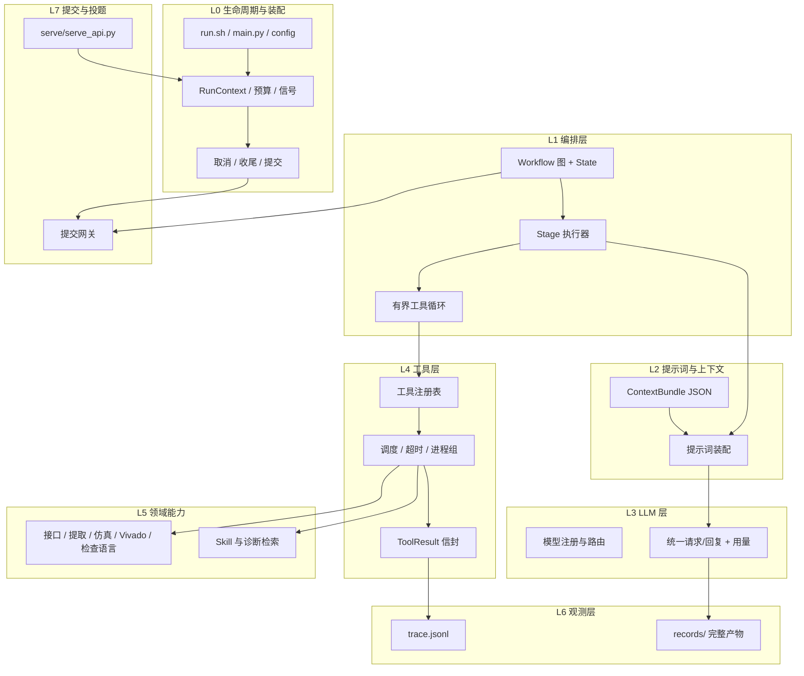

# Agent 分层与编排设计

状态：分层、接口方向、入口切换与日志格式已确认；代码开始按本设计改动，逐节点最简输入输出仍待确认。
适用分支：`refactor/adaptive-orchestration`。数据契约见 [Agent 接口契约](agent-interfaces.md)。

## 0. 已确认决策（2026-10-28）

1. **工具双路径。** 模型可自主调用工具；节点也可指定调用。两条路径共用注册、校验、预算和记录。
2. **提交暂用 last-write-wins。** 工具写候选并发布；`selected_id` 仍记录，切换开关保留。
3. **模型 profile 固定映射。** 角色决定 profile，不让模型自己选模型。
4. **默认入口切换点为 `run.sh`。** 未设置 `AGENT_CONFIG` 时使用
   `$HERE/config/adaptive_verify.yaml`，显式环境变量仍然优先；用户给出的相对路径仍按调用者
   cwd 解析。本分支按此实现；`main` 在封存前保持 `single_generate`。
5. **封存前不切默认流程。** 本次改造只在分支验证，封存版本不包含该改造。
6. **辅助模型占位。** 选用 `Qwen/Qwen3-0.6B` 作为 `small` profile 占位，默认不启用、
   回落到主模型。启用前必须补 `manifest.json` 的 `auxiliary_models` 与 `model/MODEL.md`
   的名称、基座、参数量、用途、运行位置和显存，并确认与主模型合计不超过 32 GB。
7. **退出码对齐赛事契约。** `run.sh` 在 `solution.v` 有非空白内容时返回 0，否则返回非 0。
8. **`trace.jsonl` 时间格式对齐赛事契约。** `ts` 为 Unix 秒（浮点），另存 `ts_iso` 供人阅读；
   日志查看器优先使用 `ts_iso`。

本文只描述目标结构。现有实现的行为边界仍以 [架构与设计原则](architecture.md) 和
[自适应工作流](adaptive.md) 为准；两者冲突时，本文标注“待实现”，不把计划写成已实现。

## 1. 设计目标与不变量

1. **图控制流程，模型只在阶段内行动。** 下一步节点由工作流和显式状态决定，不由模型回复直接决定。
2. **模型可以调用工具，节点也可以指定工具。** 两条路径共用同一工具注册表、参数校验、预算和记录。
3. **调用可观测。** 每次模型与工具调用都有统一信封，提示词、回复、返回码和摘要可回溯。
4. **答案文件唯一。** 最终答案只落在 `<output>/solution.v`，写入必须原子。
5. **证据与候选绑定。** 候选、检查器、采样计划和执行身份一起保存，不用旧证据为新稿背书。
6. **不确定不写成通过。** 未知用量、未执行、零比较、未触发和超时都单独记录。

## 2. 分层总览

层间只通过下表接口通信；领域层不反向依赖编排层。

| 层 | 职责 | 输入 | 输出 | 不做什么 |
| --- | --- | --- | --- | --- |
| L0 生命周期 | 启动、预算、信号、收尾、提交 | 命令行、配置、题面目录 | `RunContext`、退出状态、`run/end` | 不解释题目语义 |
| L1 编排 | 节点、状态、条件边、阶段内工具循环 | Stage 描述、上一状态 | 新状态、下一节点 | 不直接发 HTTP 或起进程 |
| L2 提示词与上下文 | 组装 JSON 上下文与消息 | 任务、路由、证据、知识 | `messages` + 装配元数据 | 不调用模型或工具 |
| L3 LLM | 模型选择、请求、回复、用量 | 装配后的消息与参数 | `LLMReply` + `Usage` | 不解析业务语义 |
| L4 工具 | 注册、校验、调度、结果封装 | 工具名与参数 | `ToolResult` | 不决定流程分支 |
| L5 领域 | RTL 与知识的具体能力 | 领域输入 | 领域结果，包装前不面向模型 | 不读取官方答案或判定反馈 |
| L6 观测 | 事件、产物、回看 | 各层事件 | `trace.jsonl`、`records/` | 不改变执行结果 |
| L7 提交 | 答案发布与投题协议 | 候选选择结果 | `solution.v`、HTTP 响应 | 不评判检查通过 |

## 3. LLM 层

### 3.1 输入与输出

- 输入：装配后的提示词（`messages`）、上下文引用（`context_ref`）、角色与模型 profile、采样参数、输出上限和超时。
- 输出：回复正文、工具调用请求、结束原因，以及 `tokens_in`、`tokens_out`、实际模型名、墙钟耗时和用量来源（服务端上报 / 估算 / 未知）。

现有 `agent/llm/types.py` 的 `Reply` 已包含 `tokens_in`、`tokens_out`、`tool_calls`、`finish_reason`；
本设计只补 `Usage` 对象与 `profile`，不拆掉现有字段。

### 3.2 大模型与小模型协作

已确认采用“角色固定映射 profile”（方案 A），不让模型自己选择模型。

| 角色 | 默认 profile | 理由 |
| --- | --- | --- |
| 分析者 | small | 只做分类、风险与 requirement 选择，输出短且结构化 |
| 作者（首稿/救援） | large | 代码生成是正确性关键路径 |
| 检查器构造者 | large | DSL 表达式与采样语义容易因小模型出错 |
| 检查器复核者 | large | 复核必须比对宿主证据与引文 |
| 归因与修复者 | large | 需要同时理解反例、公开要求与 RTL |

约束：

- profile 到具体模型的映射写在配置中；未配置时回落到主模型。
- `small` profile 的占位模型为 `Qwen/Qwen3-0.6B`，仅用于接口联调，默认不启用。
  启用前必须补 `manifest.json` 的 `auxiliary_models` 与 `model/MODEL.md` 的声明。
- 所有模型必须在 `manifest.json` 中声明；辅助模型同时写入 `model/MODEL.md`（名称、基座、参数量、用途、运行位置、显存）。
- 单卡 32 GB 上限包含主模型、辅助模型和运行时开销。
- 思考开关和生成参数统一取 `manifest.json` 的声明，不按调用切换。

## 4. 工具层

### 4.1 两种调用路径

1. **模型自主调用**：模型在阶段内返回 `tool_calls`，宿主按白名单执行，结果回填后继续，直到无工具调用、调用 `finish_task` 或达到 `max_steps`。
2. **节点指定调用**：节点代码直接调用某个工具，用于确定性检查、复检和收尾；不经过模型。

两条路径共用同一个分发入口，因此参数校验、超时、进程组、预算和日志只有一份实现。

### 4.2 固定输出信封

所有工具返回 `ToolResult`：`tool`、`call_id`、`rc`、`status`、`excerpt`、`artifacts`、`elapsed_s`、
`truncated`、`failure_kind`、`meta`。

- `excerpt` 最多 2048 字节，按 UTF-8 边界截断并标注，可直接进入下一轮提示词。
- 完整输出保存在 `artifacts` 指向的文件中；模型默认只看摘要。
- `rc` 统一映射：`0` 成功，`1` 领域失败，`2` 参数非法，`3` 超时，`4` 不可用。
- `status` 保留领域语义：`passed / failed / timeout / error / skipped`。
- 现有 `CheckResult` 已具备 `rc`、`status`、`failure_kind`、`summary`、`log_paths`，只需适配为 `ToolResult`。
- 记录器当前已把 `excerpt` 截断到 2048 字节，和本约定一致。

### 4.3 工具类别

| 类别 | 例子 | 是否写文件 | 是否允许模型自主调用 |
| --- | --- | --- | --- |
| 只读探测 | 接口检查、lint、综合、仿真 | 否（只写临时工作目录） | 由阶段白名单决定 |
| 只读知识 | 技能与诊断检索 | 否 | 否，由装配层调用 |
| 提交 | `submit_answer` | 是，写候选与答案 | 是 |
| 控制 | `finish_task` | 否 | 是 |

工具白名单属于 Stage 描述，逐节点确认后填入本文和配置。

## 5. 编排层

- 工作流仍由显式节点和条件边组成；节点返回状态，图决定下一步。
- 每个节点对应一个 Stage 描述：`role`、`tools`、`max_steps`、`reads`、`writes`、`budget`。
- Stage 内的工具循环是有界的；达到上限后返回最后一次回复，并记录 `tool_limit`，不自动追加请求。
- State 只保存路由字段：`route`、`target_id`、`parent_id`、`has_candidate`、`action`、`checker_status`、`stop_reason`、`status`。
- 候选、上下文、轨迹和证据保存在 `ctx.store` 与 `records/`，不进入 State 快照。

## 6. 提交层

### 6.1 单一答案位置

`<output>/solution.v` 是唯一最终答案文件，由宿主原子写入（临时文件 + `fsync` + `os.replace`）。

`submit_answer` 工具：

- 输入：`code`、可选 `top`、可选 `note`。
- 宿主校验：非空、可提取完整模块、顶层名匹配。
- 登记：`CandidateStore.create()`，草稿保存在 `records/<run_id>/candidates/<id>.v`。
- 返回：`candidate_id`、`code_hash`、`accepted`。

`finish_task` 工具只表达“本阶段结束”，不直接改变图。

### 6.2 当前临时策略：last-write-wins

已确认暂时采用 last-write-wins（LWW）：

- `submit_answer` 通过校验后立即原子发布到 `solution.v`；
- 收尾 `finalize_submission()` 复核最后一次写入的候选与文件哈希，缺失时重发同一候选；
- 记录 `submission` 事件，包含 `policy=last_written`、`candidate_id`、`code_hash`、是否覆盖了此前的 `selected_id`。

已知风险（保留记录）：未复检的后续草稿可能覆盖已通过晋升规则验证的答案。现有
`promotion_decision` 仍会运行并记录 `selected_id`，但 LWW 期间不作为发布依据。

切换计划：配置项 `submission_policy` 取 `last_written` 或 `selected`，默认暂时为 `last_written`；
后续切到 `selected` 时只改配置，不改工具接口。

### 6.3 触发点

- 图进入 `finish`；
- 到达工作截止或 `SIGTERM`；
- 流程异常收尾。

`finalize_submission()` 幂等；没有候选时保留空文件，并记录 `delivery=empty`。

## 7. 观测层

- 事件：`run/*`、`node/*`、`llm/request`、`llm/reply`、`tool/call`、`tool/result`、`prompt/assembly`、`artifact`、`submission`。
- `trace.jsonl` 保存摘要与不超过 2 KB 的 `excerpt`；`records/<run_id>/` 保存完整请求、回复、工具输出、候选和证据。
- 日志查看器不进入 agent 运行路径，也不进入参赛包；现有 `dev/log-viewer.html` 读取相同记录，按新事件扩展。

## 8. 与现有代码的映射

| 层 | 现有实现 | 缺口 |
| --- | --- | --- |
| L0 | `agent/main.py`、`agent/config.py`、`runtime/budget.py`、`runtime/process.py` | 统一提交收尾与 `RunContext` |
| L1 | `runtime/graph.py`、`agent/workflows/*`、`agent/nodes/*` | Stage 描述与有界工具循环 |
| L2 | `agent/prompts/*`、`knowledge/context.py`、`rtl/adaptive_context.py` | 中央装配器与 `ContextBundle` |
| L3 | `agent/llm/client.py`、`llm/types.py`、`runtime/allowance.py` | profile 路由、`Usage`、按角色配额 |
| L4 | `runtime/registry.py`、`Ctx.call/dispatch/tool_schema`、`rtl/result.py` | `ToolResult` 信封与工具分类 |
| L5 | `rtl/*`、`rtl/suite/*`、`knowledge/*` | 保持 |
| L6 | `runtime/recorder.py`、`dev/log-viewer.html` | 事件 schema 扩展 |
| L7 | `rtl/candidate.py`、`serve/serve_api.py` | `submit_answer`、提交网关、策略开关 |

迁移顺序：接口与提交网关 → 工具信封 → 编排 Stage → LLM 路由。每一步先保持现有工作流可运行，
再切换 `adaptive_verify`；默认入口的切换点见第 9 节第 6 条。

## 9. 赛事文档约束对照

以下依据来自工作区根目录的只读文档，实施时必须保持：

1. **默认分支才参与封存。** `docs/SUBMISSION.md` 第三节写明赛事方拉取默认分支，`README.md`
   “提交要求”第 4 节同义。当前工作在 `refactor/adaptive-orchestration`。按已确认决策 5，
   本次改造不在 2026-10-31 10:00 前合回默认分支，封存版本仍是 `main` 的
   `single_generate`；后续合并只影响之后的拉取，不改变已封存版本。
2. **辅助模型必须声明。** `docs/FAQ.md` Q26 与 `SCORING.md` 2.12 要求 `MODEL.md` 与
   `manifest.json` 声明辅助模型的名称、基座、参数量、用途、运行位置和显存；32 GB 为总上限。
3. **`solution.v` 是判定输入。** `docs/API_CONTRACT.md` 第八节与 `SCORING.md` 提交检查清单
   都以该文件为准。做不出来时保留空文件；`run.sh` 按同一节返回非 0 表示放弃本题。
   空文件与退出码分别表达“无答案”和“本题结束”，服务端仍以文件内容为准。
4. **`trace.jsonl` 是必需项。** `docs/API_CONTRACT.md` 第五节要求每次工具与模型调用可追溯，
   建议字段为 `ts`、`tool`、`rc`、`excerpt`、`tokens_in`、`tokens_out`；`SCORING.md`
   将其计入工程质量与作弊复核。新事件不得移除这些字段。
5. **900 秒单题上限。** `SCORING.md` 与 `API_CONTRACT.md` 均以赛事方时钟为准；投题服务已在
   `deadline_s - 10` 秒发送 `SIGTERM`，agent 必须更早自行收尾。
6. **默认入口切换点已定为 `run.sh`（方案 A，本分支已实现）。** 原默认路径是
   `agent/config.py` 加载 `config/single_generate.yaml`，`manifest.json` 的
   `agent.workflow` 也是 `single_generate`，`serve/start.sh` 不设置 `AGENT_CONFIG`。
   本分支在 `run.sh` 未设置 `AGENT_CONFIG` 时使用 `$HERE/config/adaptive_verify.yaml`，
   显式环境变量仍可覆盖；`main` 在封存前保持 `single_generate`。

   | 备选切换点 | 未采用的原因 |
   | --- | --- |
   | `agent/config.py` 改默认路径 | 会同时改变开发与其它工作流对照的默认 |
   | `serve/start.sh` 设置环境变量 | 只覆盖该脚本拉起的常驻进程；容器重建方式下赛事方随后单独调用 `run.sh`，不会继承该导出 |

   本分支的 `manifest.json` 已同步为 `adaptive_verify`；合并回 `main` 时一并更新
   `model/MODEL.md` 的模型、上下文和显存声明。
7. **900 秒预算与 `adaptive_verify` 默认阶段限额不匹配。** `config/adaptive_verify.yaml`
   使用 `AdaptiveParameters` 默认值：`draft` 1200 秒、`profile` 180 秒，并且
   `CompletionLedger.reserve()` 的准入条件是
   `timeout_s + followup_s <= budget.remaining()`。投题服务把 `AGENT_DEADLINE_S`
   设为剩余时间（约 890 秒）后，`profile` 请求需要
   `180 + (1200 + 300) = 1680` 秒，会被判为 `insufficient_followup_time`，
   导致分析、首稿都不发送。120 秒冒烟同样复现该拒绝；不能用更长的实验时限代替
   900 秒可运行性验证。
   在正式切到 `adaptive_verify` 前，必须为 900 秒预算重设阶段限额与后继预留，并单独验证。

## 10. 待确认

已确认事项见第 0 节，不再重复。仍待处理：

- 900 秒预算下的阶段限额与后继预留重设；重设前不得把 `adaptive_verify` 用于正式投题。
- 逐节点的最简输入输出与工具白名单。
- 合并回 `main` 时 `manifest.json`、`model/MODEL.md` 与 `dev/docs` 当前指南的同步内容。
