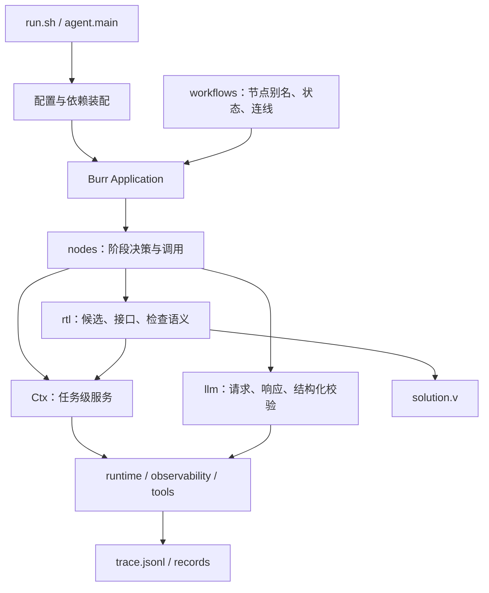

# 架构与设计原则

[文档入口](index.md) · [扩展规范与示例](development.md)

本文描述当前基于 Burr 的运行时。Burr 用于组织节点、状态和条件连线；依赖版本以 [requirements.txt](../requirements.txt) 为准，当前使用 `apache-burr==0.43.0`。文中“应当”是新增模块的约束，“当前”说明已有实现；历史方案与实验结果见 [REPORT.md](../REPORT.md)。

## 1. 要解决的问题

系统根据公开题面生成 RTL（寄存器传输级）代码，并将候选答案保存到输出目录。在有限时间内，模型生成、结构检查、功能检查和修复可能失败或中断，因此设计还必须回答：

- 这次动作依据了什么输入，读取和修改了什么状态？
- 失败来自候选代码、检查器、模型响应还是执行环境？
- 当前选择的答案对应哪次生成，以及哪一版检查证据？
- 时间不足时怎样停止，并保留已保存的答案？

核心原则是：**代码定义流程，状态决定分支，模型请求和外部命令通过统一接口执行，日志保存依据。** 模型生成的解释、HTTP 成功或节点结束本身都不等于答案通过检查。

## 2. 组件边界

图表达职责和调用关系，不意味着所有导入都是单向的。例如 `agent.kit` 是扩展入口，汇集了运行时 API 和 RTL 的 `CheckResult`；不能将它当作通用运行时内部的依赖入口。

| 层 | 位置 | 负责什么 | 新增代码应避免什么 |
| --- | --- | --- | --- |
| 入口与配置 | `run.sh`、`agent/main.py`、`agent/config.py` | 目录协议、配置覆盖、任务服务装配、退出收尾 | 在入口堆放题目策略或重复工作流分支 |
| 编排 | `agent/orchestration/` | Burr 节点绑定、状态记录、工作流装配；节点通过统一服务调用模型和工具 | 在图装配或工作流构造函数中直接发起模型请求、运行外部命令 |
| 提示与上下文 | `agent/context/` | `TemplateRenderer`、Jinja2 渲染的 Markdown 模板 | 调用模型或工具 |
| 模型服务 | `agent/llm/` | HTTP 协议、分词、模型配置组（profile）、响应类型、结构校验、离线重放 | 在节点中复制网络请求、隐式切换思考策略 |
| 工具 | `agent/tools/` | 注册、参数校验、统一返回结构 `ToolResult` | 决定流程分支或题目语义 |
| RTL 领域 | `agent/domain/rtl/` | 公开题面、接口、候选身份、检查结果、检查器语义与仿真 | 决定整条工作流应重试几轮或读取官方判定 |
| 求解知识 | `agent/domain/knowledge/`、`knowledge/`、`skill/` | 固定方法、当前诊断检索、整段上下文装配 | 读取实验标签、官方反馈，或给独立检查器注入候选相关知识 |
| 日志与记录 | `agent/observability/` | 事件、脱敏、请求与运行产物 | 改变执行结果 |
| 答案交付 | `agent/submission/` | 管理 `guided_verify` 的提交策略，通过候选存储写入 `solution.v` | 评判检查通过 |
| 共享运行时 | `agent/runtime/` | 预算、许可、`Ctx`、进程组 | 引入具体题目语义 |
| 预设 | `config/` | 可选择的参数组合 | 把 Python 逻辑藏进 YAML，或将凭据写进预设 |

运行时装配见 [graph.py](../agent/orchestration/graph.py)，公共扩展符号见 [kit.py](../agent/kit.py)。工具虽然可在 `agent/orchestration/nodes/` 适配层注册，具体检查语义仍应放到 `agent/domain/rtl/`，避免同一检查在不同工作流各实现一份。

## 3. 一次运行怎样完成

1. `run.sh` 接收输入目录和输出目录，将相对路径转换为绝对路径，切换到所选方案目录，再启动 `python3 -m agent.main`。
2. `agent.main` 创建协议输出，加载配置，建立统一预算与信号处理，记录配置、源码身份和公开题面。
3. 导入内置节点、工作流及显式插件，创建 `Ctx`，把工具分发绑定到模型客户端。
4. `build_graph()` 根据配置选择工作流、替换节点实现和工具别名，校验参数，构造 Burr Application，并记录实际装配的图。
5. `run_graph()` 每步检查剩余预算，再调用 `app.step()`。没有下一步、执行了别名为 `finish` 的动作，或达到 `runtime.max_steps` 时结束；步数耗尽会写入停止原因。
6. 收尾关闭受管进程与模型客户端，写入 `run/end`，保留本次已经原子保存的答案。

当前是单次任务内的单进程、逐步执行；没有独立的工作流监督进程、分布式节点调度或自动断点恢复。可选 Burr tracker 用于记录，不意味着入口提供恢复执行能力。`run.sh` 按赛事契约在有答案时返回 0、无答案时返回非 0；退出码仍不是功能验收标准，必须查看结束状态、已保存答案和对应检查证据。

入口会在新一次运行开始时初始化 `solution.v`，因此每次实验应使用独立输出目录。`guided_verify` 在正式提交前就会保存本次的兜底候选，可在失败或取消时交付。尚无本次完整候选时，文件为空。

## 4. 为什么使用显式图和小状态

Burr 提供动作、不可变状态更新和条件连线；工作流选择了哪些动作、执行到了哪个分支，不需要从提示词或自由文本中猜测。节点读写字段通过装饰器声明，图构造后还会把定义记录到日志，便于对照计划路径和实际路径。

节点负责“做一步并给出结果”，工作流负责“下一步去哪里”。节点内部允许有边界明确的格式重问或局部检查，但这些调用也必须记录；独立、可复用、需要单独控制重试的阶段，应作为图节点暴露。不要为了减少节点数，把整条修复流程藏进一个函数。

`State` 保存后续分支需要的 JSON 可序列化数据，例如 `round`、`target_id`、`reply_id`、`action`、状态与停止原因。返回 `state.update(...)`，不直接改内部字典。回复对象、领域对象与临时集合可放在任务级 `ctx.store` 或已有服务中，但它们没有自动持久化或跨运行恢复保证。

完整模型回复、候选代码和工具输出优先交给记录器保存，以 ID、摘要和路径关联。状态过大会让每一步快照重复写入大量内容，也使基本日志意外承载正文。字段名称、含义和初始值属于节点间契约，扩展时应与 `reads`、`writes` 和条件表达式一起检查。

## 5. 内置流程及其用途

| 工作流 | 主要路径 | 能据此说明什么 |
| --- | --- | --- |
| `single_generate`（显式选择） | 按官方基线（baseline）生成 → 提取 → 选择 → 结束 | 默认配置复用基线提示与提取函数，不执行语法编译、综合或功能检查；可通过显式研究配置替换节点 |
| `guided_verify`（默认） | 策略选技能与检查方式 → 生成 → 结构检查 → 按需行为检查 → 解题角色提交、改稿或指定复核点 | 每次结构检查对应实际候选，每次行为比较还对应一个检查表版本 |

默认入口 `run.sh`、`agent/config.py` 与 HTTP 服务均选择 `config/guided_verify.yaml`。该配置关闭 RAG（检索增强生成）和可选模型配置组 `small`、`large`。三个角色共用端口 8000 的 Qwen3.8-27B 服务，每次请求重新构造消息。策略角色先读取公开题面、接口和检查器规则，为解题角色选技能，即使本题无法执行行为表也能选。解题角色按当前稿接收检查证据和历轮决策短记。独立检查角色只读取公开信息和自己负责的检查表。

两条工作流的连线分别定义在 [guided_verify.py](../agent/orchestration/workflows/guided_verify.py) 和 [single_generate.py](../agent/orchestration/workflows/single_generate.py)。RAG 保留为显式 `single_generate` 或 `guided_verify` 研究配置，默认不检索卡片、不请求文本向量（embedding）。实际采用了哪条路径，由有效配置、状态及日志决定。

## 6. 统一服务与预算

节点使用 `ctx.llm` 访问模型，使用 `ctx.call()` 调用已注册工具，使用 `ctx.processes.run()` 执行外部命令。这样模型请求、工具记录、进程取消都受同一任务预算约束，不会形成各自独立的隐性时间额度。

`Budget.remaining_s()` 默认扣除收尾预留；请求和进程超时会受剩余预算裁剪。入口按有效配置设置基于信号的硬截止，`runtime.deadline_s` 默认 900 秒，可设为任意有限正数，没有内置 900 秒上限或单独的研究模式。`--hard-deadline-s` 可额外收紧截止时间，不能延长配置时限；实际配置、外部限制和有效时限写入 `budget/configured`。外部调用方仍可提前终止任务。输出 token 上限同时受上下文剩余空间影响：扩大 `max_tokens` 不代表服务一定能输出这么多，更不能作为截断问题已解决的证据。超过赛事规定时限的实验单独记录，不能作为符合赛事预算的结果。

每次受管外部命令由短时运行的 `process_worker.py` 管理其子进程并回收失去父进程的后代进程；它和外部命令均继承整题进程组。
单次命令超时只清理该命令的进程树；外层终止整题进程组时，也能清理智能体暂停或崩溃后遗留的工具进程，不扫描或结束其他任务的子进程。
`process_worker.py` 不提供工作流恢复，也不是常驻服务。工具真实返回码与该管理进程的返回码分别记录。

生成策略来自 `manifest.json` 的声明，模型客户端统一使用 `baseline.load_generation()` 的结果；辅助 JSON 请求也不能另设一套思考开关。`openai` 是客户端协议后端名，不表示必须使用某个远程商业服务；分词协议另外显式选择 `vllm` 或 `llama_cpp`。

`structured_outputs: false` 只关闭服务端的数据结构约束（schema）。`Client.ask()` 仍执行严格 JSON、Pydantic 和调用方提供的语义检查。`guided_verify` 的规划、解题动作、检查表与逐点复核各有专用解析器。格式纠正、修复及恢复请求各自计入全题共享预算，记录实际发出情况和停止原因。

## 7. 检查独立性与答案身份

检查角色依据公开规格和程序的执行规则（点数与行数限制、初始化、时钟和采样相位），为每个测试点写一行说明。单正沿时钟可带低有效异步复位。负沿、多时钟和时钟归属不明会得到具体的不支持原因。逐点复核沿用固定检查技能和执行规则，把公开题面、当前表与指定点编号交给检查角色。候选、实测输出及解题角色质疑的理由保留在解题上下文中。结构修复显式传入 `repair_diagnostics`、工具状态与日志摘要。解题角色可以提交当前稿、返回完整修改稿、或请求复核一个点，并从下一轮的短记中看到此前的决定。

`guided_verify` 使用 [guided_checker.py](../agent/domain/rtl/guided_checker.py) 解析行式表、校验位宽并按已知位比较，[observation.py](../agent/domain/rtl/observation.py) 生成测试台并解析 xsim 的采样记录。`compared_bits` 是实际比较的已知位数，可按测试点和相位核对。零比较、未知位、未执行、无效检查器和环境不可用分别保留其状态。检查模块验收必须含自编正确例与错误反例，确认既能执行也能检出错误。

候选通过 `CandidateStore` 分配 ID，记录父候选、代码哈希和来源调用。结构工具用 `bind_result()` 绑定候选哈希、检查器代码哈希和可选套件哈希。行为结果单独记录候选哈希、表内容哈希（`checker_hash`）、检查器实现哈希（`checker_version`）、采样计划哈希和本次执行编号。修订候选或检查器后应重新检查，不能拿旧结果替新稿背书。

新增修复或复核分支应核对产物的实际变化及重新执行的记录。纯结构路线在编译展开和综合都通过时自动提交。行为路线由解题角色确认提交。超时兜底优先交付最近一份编译展开和综合都通过的稿件，若没有则交付最近完整稿。[检查器接纳、共享预算与交付依据](guided-verify.md)

答案选择由工作流策略决定，`CandidateStore.select()` 只负责按候选身份原子写入 `solution.v` 并记录选择；它不会自行保证“最好”或“检查通过”。因此应区分候选存在、候选被选择、内部检查通过、独立验收和官方判定。

## 8. 日志与记录接口

[Recorder](../agent/observability/recorder.py) 使用 `run_id`、事件 `seq` 和 `span_id`／`parent_span_id` 关联运行、节点、工具和内部调用。通过 `NodeRecorder` 自动记录节点开始、结束、耗时、异常以及输入／输出状态；通过工具和模型封装记录内部动作，而不是让每个节点复制日志协议。

- `trace.jsonl`：始终保留的事件流；`basic` 也会包含节点状态，因此状态只应保存后续决策所需的数据。
- `records/<run_id>/`：`full` 级别保存请求、响应、候选、工具输出、配置与源码信息；`basic` 不生成这些正文文件。
- `trace.jsonl` 中的 `run/graph` 事件：保存实际工作流名称、入口、节点实现与参数、读写字段、条件连线和工具选择；当前 `graph_schema_version` 为 1。
- `run/end`：结束状态、停止原因、实际交付的候选（`published_id`、`published_sha256`）、内部选择的候选（`selected_id`、`selected_sha256`）、交付方式和模型调用用量。token 未知保持未知，不当零成本。

记录器先对配置密钥及常见敏感字段脱敏，再序列化为 JSON，避免对序列化文本重复替换而破坏转义，并限制摘要长度。新增服务仍须主动检查记录内容，不能据此假定任意秘密都能自动识别。图元数据只描述顶层装配；节点内部日志的相邻顺序不能用来推断源代码控制流或并发依赖。日志阅览不会重新执行求解。

当前 `source.json` 记录指定源码、配置、skill/knowledge 资产、插件的哈希及可取得的 Git 信息；它不是完整环境快照。真实实验仍需另外冻结源码副本、模型权重、服务版本、有效配置与工具环境。

## 9. 当前边界与演进原则

可扩展的是显式节点、工具、工作流与配置，不是任意 YAML 脚本执行系统。插件是显式导入的受信任 Python 文件，没有安全沙箱。增加新的模型协议需修改统一客户端与配置校验；增加新领域能力应保持通用运行时不依赖该领域。

目前没有通用并行图调度、持久化 `ctx.store`、自动恢复、运行时插件下载或完整请求缓存。若需要这些能力，应先定义取消、预算、状态合并、身份与日志兼容契约，再分阶段实现，不能只靠新增一个配置开关宣称支持。

每个扩展尽量只改变一层的职责，通过已有契约组合其他层；必要的跨层改动必须说明触发条件、旧行为、新行为和兼容范围。具体步骤见[开发规范](development.md)。

知识卡片检索由 `agent/domain/knowledge/guided.py` 提供；`single_generate` 的显式 RAG 配置使用 `rtl_generate`，`guided_verify` 默认不向提示词加入检索卡片。技能由 `assets.py` 自动发现 `skill/` 的直接子目录，每题建立正文快照，再按阶段、准入状态和冲突组选择，不需要维护额外清单。卡片和向量文件不保存版本、文件哈希、路径或发布锁定信息；技能快照记录实际读取内容的 SHA-256 哈希。使用方法见 [Skill 与知识检索](knowledge.md)。

## 10. 可选的模型请求额度

`CompletionLedger` 记录并限制模型生成请求额度，当前 `guided_verify` 已启用，`single_generate` 未启用。新工作流可显式使用它。调用方先用
`reserve(stage, max_tokens, timeout_s, followup_s, optional, min_timeout_s=None)` 预留一次生成请求、输出额度和后续操作时间，
再在 `with ctx.llm.permitted(permit)` 内完成知识准备与请求。不传最小时长时，必须有完整阶段时限及后续操作所需的时间；`guided_verify` 显式传入 `min(阶段 timeout_s, minimum_request_s)`，后者默认 20 秒。扣除后续操作预留后，允许缩短模型请求时限；低于最小时长则拒绝发送。实际获准额度写入许可与请求记录，总预算和思考策略不变；已取得许可的请求不会再受模型客户端默认 `timeout_s` 限制。
请求合并 `generation` 后再次限制输出，上下文长度限制仍生效。一份许可只允许一次生成请求，不能通过更换 `purpose` 名称绕过。

已知 token 用量按实际值结算；输出用量未知时保留预留额度，任一输入或输出用量未知时阻止后续可选调用。请求发出后，既未收到响应、也未获得独立的服务端终止证据时，所有后续生成请求都被阻止；
关闭客户端不算服务端停止证据。账本适用于串行请求，不提供并发调度或服务端取消能力。
调用方分别记录每次请求，保存已生成候选，并为修改后的 RTL 或测试点安排对应版本的复检。
