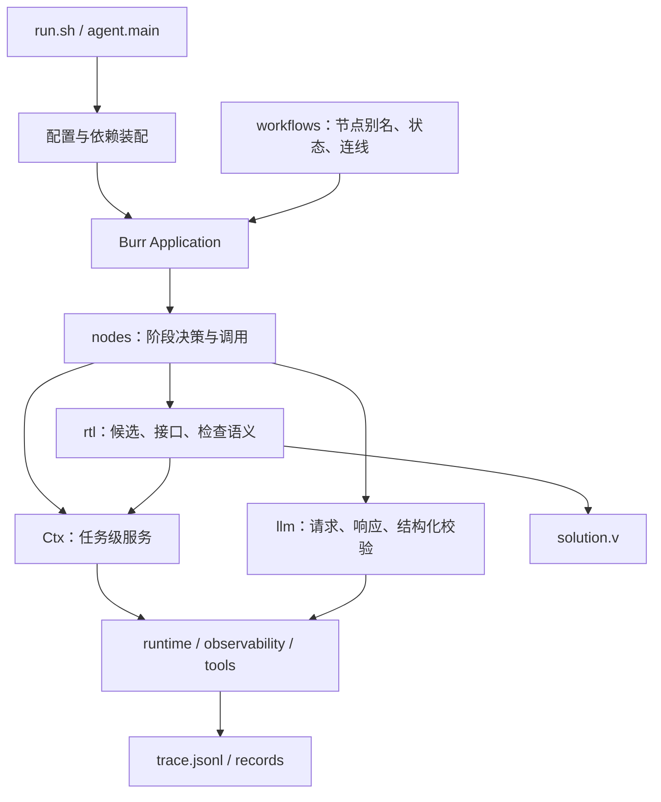

# 架构与设计原则

[文档入口](index.md) · [扩展规范与示例](development.md)

本文描述当前 Burr 运行时；不是旧运行时或 LangGraph 实现的说明。依赖版本以 [requirements.txt](../requirements.txt) 为准，当前使用 `apache-burr==0.43.0`。文中“应当”是新增模块的约束；“当前”说明已有实现，不把计划当成功能。

## 1. 要解决的问题

系统把公开 RTL 题面变成一个保存到输出目录的候选答案。在有限时间内，模型生成、结构检查、功能检查和修复可能失败或中断，因此设计不能只关注一条成功路径，还必须回答：

- 这次动作依据了什么输入，读取和修改了什么状态？
- 失败来自候选代码、检查器、模型响应还是执行环境？
- 当前选择的答案对应哪次生成，以及哪一版检查证据？
- 时间不足时怎样停止，并保留已保存的答案？

核心选择是：**由代码定义流程，由显式状态决定分支，由统一服务执行副作用，由日志保存证据。** 模型生成的解释、HTTP 成功或节点结束本身都不等于答案通过检查。

## 2. 组件边界

图表达职责和调用关系，不意味着所有导入都是单向的。例如 `agent.kit` 是扩展入口，汇集了运行时 API 和 RTL 的 `CheckResult`；不能将它当作通用运行时内部的依赖入口。

| 层 | 位置 | 负责什么 | 新增代码应避免什么 |
| --- | --- | --- | --- |
| 入口与配置 | `run.sh`、`agent/main.py`、`agent/config.py` | 目录协议、配置覆盖、任务服务装配、退出收尾 | 在入口堆放题目策略或重复工作流分支 |
| 编排 | `agent/orchestration/` | Burr 绑定、Stage 描述、工具循环、节点与工作流 | 执行模型、进程或工具副作用 |
| 提示与上下文 | `agent/context/` | `ContextBundle`、`PromptAssembly`、Jinja2 模板 | 调用模型或工具 |
| 模型服务 | `agent/llm/` | HTTP 协议、分词、模型 profile、响应类型、结构校验、离线重放 | 在节点中复制网络请求、隐式切换思考策略 |
| 工具 | `agent/tools/` | 注册、参数校验、`ToolResult` 信封 | 决定流程分支或题目语义 |
| RTL 领域 | `agent/domain/rtl/` | 公开题面、接口、候选身份、检查结果、检查器语义与仿真 | 决定整条工作流应重试几轮或读取官方判定 |
| 求解知识 | `agent/domain/knowledge/`、`knowledge/`、`skill/` | 固定方法、当前诊断检索、整段上下文装配 | 读取实验标签、官方反馈，或给独立检查器注入候选相关知识 |
| 观测 | `agent/observability/` | 事件、脱敏、完整产物 | 改变执行结果 |
| 提交 | `agent/submission/` | 原子发布 `solution.v` | 评判检查通过 |
| 共享运行时 | `agent/runtime/` | 预算、许可、`Ctx`、进程组 | 引入具体题目语义 |
| 预设 | `config/` | 可选择的参数组合 | 把 Python 逻辑藏进 YAML，或将凭据写进预设 |

运行时装配见 [graph.py](../agent/orchestration/graph.py)，公共扩展符号见 [kit.py](../agent/kit.py)。工具虽然可在 `agent/orchestration/nodes/` 适配层注册，具体检查语义仍应放到 `agent/domain/rtl/`，避免同一检查在不同工作流各实现一份。

## 3. 一次运行怎样完成

1. `run.sh` 接收输入目录和输出目录，将相对路径转换为绝对路径，切换到所选方案目录，再启动 `python3 -m agent.main`。
2. `agent.main` 创建协议输出，加载配置，建立统一预算与信号处理，记录配置、源码身份和公开题面。
3. 导入内置节点、工作流及显式插件，创建 `Ctx`，把工具分发绑定到模型客户端。
4. `build_graph()` 根据配置选择工作流、替换节点实现和工具别名，校验参数，构造 Burr Application，并记录实际装配的图。
5. `run_graph()` 每步检查剩余预算，再调用 `app.step()`。没有下一步、执行了别名为 `finish` 的动作，或达到 `runtime.max_steps` 时结束；步数耗尽会写入停止原因。
6. 收尾关闭受管进程与模型客户端，写入 `run/end`，保留本次已经原子保存的答案。

当前是单次任务内的单进程、逐步执行；没有独立监督进程、分布式节点调度或自动断点恢复。可选 Burr tracker 用于记录，不意味着入口提供恢复执行能力。`run.sh` 按赛事契约在有答案时返回 0、无答案时返回非 0；退出码仍不是功能验收标准，必须查看结束状态、已保存答案和对应检查证据。

入口会在新一次运行开始时初始化 `solution.v`，因此每次实验应使用独立输出目录。所谓保留答案，是指本次运行中已经选定的答案在后续失败或取消时仍保留，并不是自动续接上一次输出目录。

## 4. 为什么使用显式图和小状态

Burr 提供动作、不可变状态更新和条件连线；工作流选择了哪些动作、执行到了哪个分支，不需要从提示词或自由文本中猜测。节点读写字段通过装饰器声明，图构造后还会把定义记录到日志，便于对照计划路径和实际路径。

节点负责“做一步并给出结果”，工作流负责“下一步去哪里”。节点内部允许有边界明确的格式重问或局部检查，但这些调用也必须记录；独立、可复用、需要单独控制重试的阶段，应作为图节点暴露。不要为了减少节点数，把整条修复流程藏进一个函数。

`State` 保存后续分支需要的 JSON 可序列化数据，例如 `round`、`target_id`、`reply_id`、`action`、状态与停止原因。返回 `state.update(...)`，不直接改内部字典。回复对象、领域对象与临时集合可放在任务级 `ctx.store` 或已有服务中，但它们没有自动持久化或跨运行恢复保证。

完整模型回复、候选代码和工具输出优先交给记录器保存，以 ID、摘要和路径关联。状态过大会让每一步快照重复写入大量内容，也使基本日志意外承载正文。字段名称、含义和初始值属于节点间契约，扩展时应与 `reads`、`writes` 和条件表达式一起检查。

## 5. 内置流程及其用途

| 工作流 | 主要路径 | 能据此说明什么 |
| --- | --- | --- |
| `single_generate` | baseline 等价生成 → 提取 → 选择 → 结束 | 目录、模型调用与答案提取链路；不主动执行 lint、综合或功能验收 |
| `guided_verify` | 规划 → 生成 → 结构检查 → key-case checker → 归因 → 有限修复 → 收尾 | 结构、行为和候选证据分别绑定；检查器无效或未覆盖时保持 conservative 结果 |

详细连线以 [工作流源码](../agent/orchestration/workflows/__init__.py) 为准。RAG 配置仍是
显式的 `single_generate` 变体，不作为默认流程。实际采用了哪条路径，由状态及日志决定。

## 6. 统一服务与预算

节点使用 `ctx.llm` 访问模型，使用 `ctx.call()` 调用已注册工具，使用 `ctx.processes.run()` 执行外部命令。这样模型请求、工具记录、进程取消都受同一任务预算约束，不会形成各自独立的隐性时间额度。

`Budget.remaining_s()` 默认扣除收尾预留；请求和进程超时会受剩余预算裁剪。入口按有效配置设置基于信号的硬截止，`runtime.deadline_s` 默认 900 秒，可设为任意有限正数，没有内置 900 秒上限或单独的研究模式。`--hard-deadline-s` 可额外收紧截止时间，不能延长配置时限；实际配置、外部限制和有效时限写入 `budget/configured`。外部调用方仍可提前终止任务。输出 token 上限同时受上下文剩余空间影响：扩大 `max_tokens` 不代表服务一定能输出这么多，更不能作为截断问题已解决的证据。超过赛事规定时限的实验单独记录，不能作为符合赛事预算的结果。

生成策略来自 `manifest.json` 的声明，模型客户端统一使用 `baseline.load_generation()` 的结果；辅助 JSON 请求也不能另设一套思考开关。`openai` 是客户端协议后端名，不表示必须使用某个远程商业服务；分词协议另外显式选择 `vllm` 或 `llama_cpp`。

`structured_outputs: false` 只关闭服务端 schema 约束，客户端仍执行严格 JSON、Pydantic 和已有语义检查。不会剥离 Markdown、补全缺失 JSON 或把未知值猜成确定值。格式／语义重问有上限；连接失败、预算耗尽和取消不能无差别重试。

## 7. 检查独立性与答案身份

检查器构造依据公开题面与明确的语义约束，不能读取候选 RTL 或实测输出作为期望值来源。诊断可以使用检查证据来判断需要改 RTL、规划还是检查器，但后续独立构造仍要保持这一输入边界。新模块不得读取参考答案、官方测试台或官方判定反馈来辅助求解。

检查器语义、值宽、未知值和状态采样由 `agent/domain/rtl/suite/` 处理。未知、未执行、无效检查器和环境不可用都不等于通过；“预期可比较”不代替实际 `compared_samples`、`compared_bits`。检查模块验收必须含自编正确例与错误反例，确认既能执行也能检出错误。

候选通过 `CandidateStore` 分配 ID，记录父候选、代码哈希和来源调用。检查结果通过 `bind_result()` 绑定候选哈希、检查器代码哈希和套件哈希。修订候选或检查器后应重新检查，不能拿旧结果替新稿背书。

检查器接纳条件、修复上限和收尾证据见 [Guided Verify](guided-verify.md)。新增分支须验证实际产物变化和重新执行，不能仅以节点到达为验收。

答案选择由工作流策略决定，`CandidateStore.select()` 只负责按候选身份原子写入 `solution.v` 并记录选择；它不会自行保证“最好”或“检查通过”。因此应区分候选存在、候选被选择、内部检查通过、独立验收和官方判定。

## 8. 可观测性也是接口

[Recorder](../agent/observability/recorder.py) 使用 `run_id`、事件 `seq` 和 `span_id`／`parent_span_id` 关联运行、节点、工具和内部调用。通过 `NodeRecorder` 自动记录节点开始、结束、耗时、异常以及输入／输出状态；通过工具和模型封装记录内部动作，而不是让每个节点复制日志协议。

- `trace.jsonl`：始终保留的事件流；`basic` 也会包含节点状态，所以状态必须克制。
- `records/<run_id>/`：`full` 级别保存请求、响应、候选、工具输出、配置与源码信息；`basic` 不生成这些正文文件。
- `trace.jsonl` 中的 `run/graph` 事件：保存实际工作流名称、入口、节点实现与参数、读写字段、条件连线和工具选择；当前 `graph_schema_version` 为 1。
- `run/end`：结束状态、停止原因、最终选择候选与模型调用用量。token 未知保持未知，不当零成本。

记录器按对象层脱敏配置密钥及常见敏感字段（先脱敏再序列化，落盘文本不再二次替换，避免破坏 JSON 转义），并限制摘要长度；新增服务仍须主动检查记录内容，不能据此假定任意秘密都能自动识别。图元数据只描述顶层装配；节点内部日志的相邻顺序不是源代码控制流或并发依赖。某个观测页面的播放不会重新执行求解。

当前 `source.json` 记录指定源码、配置、skill/knowledge 资产、插件的哈希及可取得的 Git 信息；它不是完整环境快照。真实实验仍需另外冻结源码副本、模型权重、服务版本、有效配置与工具环境。

## 9. 当前边界与演进原则

可扩展的是显式节点、工具、工作流与配置，不是任意 YAML 脚本执行系统。插件是显式导入的受信任 Python 文件，没有安全沙箱。增加新的模型协议需修改统一客户端与配置校验；增加新领域能力应保持通用运行时不依赖该领域。

目前没有通用并行图调度、持久化 `ctx.store`、自动恢复、运行时插件下载或完整请求缓存。若需要这些能力，应先定义取消、预算、状态合并、身份与日志兼容契约，再分阶段实现，不能只靠新增一个配置开关宣称支持。

每个扩展尽量只改变一层的职责，通过已有契约组合其他层；必要的跨层改动必须说明触发条件、旧行为、新行为和兼容范围。具体步骤见[开发规范](development.md)。

知识检索由 `agent/domain/knowledge/guided.py` 提供；`single_generate` 的显式 RAG 配置使用 `rtl_generate`，guided 默认关闭知识注入。卡片和向量不保存版本、sha256、路径或 release lock。使用方法见 [Skill 与知识检索](knowledge.md)。

## 10. 可选的模型请求额度

`CompletionLedger` 供新工作流显式启用；原工作流未启用时保持既有请求行为。调用方先用
`reserve(stage, max_tokens, timeout_s, followup_s, optional)` 预留一次 completion、输出额度和后继时间，
再在 `with ctx.llm.permitted(permit)` 内完成知识准备与请求。时间不足直接拒绝；许可不会被旧服务默认840秒隐式收紧。
真实请求合并 generation 后再次限制输出，模型上下文仍生效。一份许可只允许一次 completion，不能通过辅助请求的 purpose 名称绕过。

已知 usage 按实际值结算；未知保留预留，并阻止后续可选调用。HTTP异常后无法确认远端结束时，所有后续 completion 都暂停准入；
关闭客户端不算服务端停止证据。账本适用于串行请求，不提供并发调度或服务端取消能力。
调用方仍负责限制每个阶段只执行一次、保存已有候选、安排工具复检；额度充足不意味着应继续生成。
