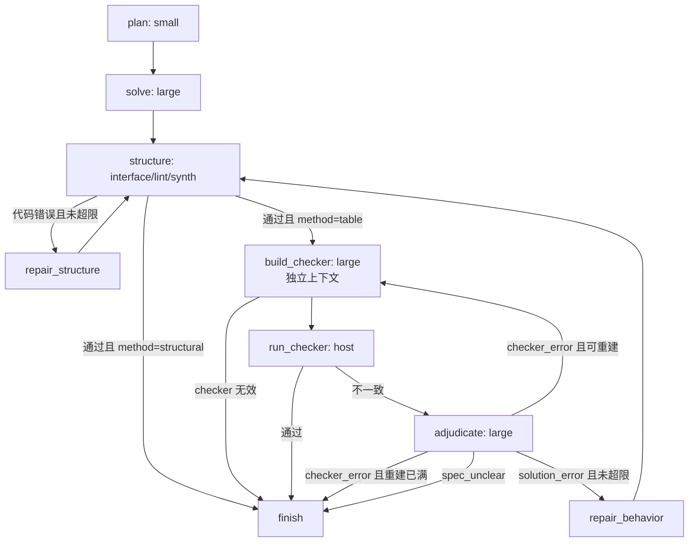

# guided_verify 工作流设计

状态：初版已实现，单元测试通过；真实模型与 Vivado 单题验证完成，完整题集仍未验证。
它是非默认流程，需要 8011 小模型服务；官方默认 `serve/start.sh` 不启动 8011。
当前仓库只保留 `single_generate` 与其并存，不再保留 adaptive/design/repair 工作流。
实现位于 `agent/orchestration/nodes/guided.py`、`agent/orchestration/workflows/guided_verify.py`，配置为 `config/guided_verify.yaml`；8011 小模型由可选的 `serve/start_verireason.sh` 启动，默认 `serve/start.sh` 不包含它。

## 1. 设计目标

- 小模型只做轻量路由和知识选择，输出扁平文本，不写长计划。
- 大模型负责解题、构造少量关键行为 case、归因和修复。
- 检查器不写 Verilog；宿主根据模型给出的行式向量表生成自检 testbench。
- 行为检查只覆盖关键输出和关键场景；未覆盖项明确记录，不报完整通过。
- 次数、超时和 token 预算全部来自工作流参数，不散落 magic number。

## 2. 流程



## 3. 节点与最小 I/O

| 节点 | 模型/工具 | 最小输入 | 最小输出 |
|---|---|---|---|
| `plan` | small | 公开题面、host 的 skill/RAG 候选短名单 | 扁平 `key=value` 文本 |
| `solve` | large | 题面、system prompt、选中的 skill/RAG | 完整 RTL |
| `structure` | interface/lint/synth | 候选 | 结构检查结果 |
| `repair_structure` | large | 题面、当前候选、处理后诊断 | 新候选 |
| `build_checker` | large | 题面、行为检查 skill、`focus`；不读候选/实测 | 行式向量表 |
| `run_checker` | host | 候选 + 合法向量表 | 逐 case/step/output 结果 |
| `adjudicate` | large | 题面、checker、失败明细、当前候选 | 扁平归因文本 |
| `repair_behavior` | large | 题面、当前候选、checker、失败明细 | 新候选 |
| `finish` | host | 选稿与状态 | `solution.v`、结果 |

State 最小字段：`method`、`target_id`、`parent_id`、`phase`、`action`、`checker_status`、`repair_used`、`stop_reason`、`status`。

## 4. 小模型输出

只允许逐行 `key=value`，不使用嵌套 JSON：

```text
method=table
skills=rtl-sequential-state-update
knowledge=diag-vrfc-10-1280
focus=reset priority|load vs shift
reason=single clock, reset and load are public
```

规则：

- `method` 只能是 `structural` 或 `table`。
- `skills` 来自 host 短名单，最多 2 个；未自动准入的 Skill 不发送。
- `knowledge` 来自 host 检索候选，最多 3 个；host 还原卡片原文。
- `focus` 最多 4 段，用 `|` 分隔，只用于 checker 提示，不作为题面要求。
- 格式错误、未知 ID、超限或不支持的方法：回退 `structural`，记录原因，仍继续解题。

## 5. 检查器格式

模型只输出行式向量表，宿主生成 Verilog testbench、时钟、reset 阶段、采样和比较。

```text
case reset
init reset=1 load=0 data=00 q=01
step reset=0 load=1 data=a5 q=a5
step reset=0 load=0 data=00 q=4a
case shift_boundary
init reset=0 load=1 data=80 q=80
step reset=0 load=0 data=00 q=01
```

规则：

- `case <id>` 开始一组；每行以 `init` 或 `step` 开头。
- 每个非时钟公开输入在每行必须出现一次；时钟由宿主生成。
- 首行的输出名定义该 case 的检查集合；后续行必须使用同一组输出名。
- 未列出的公开输出记入该 case 的 `unchecked_outputs`，不计为通过。任一 case 漏查公开
  输出都会使整个 checker 成为 `partial_passed`，不能被其他 case 的覆盖抹掉。
- 顺序 case 首行必须是 `init`。宿主用该行输入执行 `init_cycles` 个有效沿，在最后一个
  init 沿并稳定后采样并比较 `init` 行声明的输出；随后才逐行执行 `step` 并在每行沿后比较。
  组合 case 可以 `step` 开始。
- 期望值为十六进制，宿主按端口宽度校验；未知、越界或缺少输入直接判无效。
- 最多 `max_cases` 个 case、每个 `max_steps_per_case` 行。
- 不写 Verilog、task、delay、循环、层次引用或注释。

## 6. 判定与重建

- 行为比较结果记录 `checked_outputs`、`unchecked_outputs`、`unknown_outputs`。
- 只要存在 unchecked 公开输出，结论为 `partial_behavior`；`functional_passed` 保持 false/unknown。
- 行为证据按 `candidate_id` 与 checker 指纹保存；收尾只使用当前 checker 下实际选中候选的
  证据。不能把子稿的行为通过和父稿的结构通过拼成一次完整通过。
- 时序 case 没有任何行、或 case 在读取首行前为空，均按 `checker invalid` 处理，不抛出未捕获异常。
- `adjudicate` 输出扁平文本：

  ```text
  decision=solution_error
  reason=reset state differs at case reset
  failed_cases=reset
  ```

- `checker_error`：若 `checker_rebuilds_used < checker_rebuild_limit`，重建 checker。重建输入只允许
  公开题面、旧 checker、失败 case ID 和决策类别（`checker_error`）；不得传入归因 reason 正文、
  候选 RTL、期望/实测值或任何采样记录，并在重建记录中明确 `candidate_input=false`、
  `observed_outputs_input=false`。
- 重建后再次运行 checker；仍不一致则再次归因，受 `adjudicate_limit` 限制。
- 重建次数达到限制后仍为 `checker_error`：停止行为分支，不再重建、不再做行为检查，保留结构检查结论并标记 `behavior_unverified`。
- `solution_error`：允许一次行为修复；用同一 checker 复检。复检仍不一致则停止并记录失败，不再追加归因。
- `spec_unclear`：停止，不猜语义。

## 7. 可配置参数

全部由工作流参数模型校验，代码不写死：

| 参数 | 建议默认 | 说明 |
|---|---:|---|
| `planner` | 60s / 512 | 小模型路由 |
| `solve` | 300s / 8192 | 首稿 |
| `checker` | 300s / 8192 | 构造向量表 |
| `adjudicate` | 120s / 1024 | 归因 |
| `structure_repair_limit` | 1 | 结构修复次数 |
| `behavior_repair_limit` | 1 | 行为修复次数 |
| `checker_rebuild_limit` | 1 | checker 重建次数（0 表示不重建） |
| `adjudicate_limit` | 2 | 归因次数上限 |
| `max_cases` | 4 | 关键 case 上限 |
| `max_steps_per_case` | 8 | 每 case 行数上限 |
| `init_cycles` | 2 | 顺序 case 初始化沿数 |
| `knowledge_candidates` | 5 | host 知识候选数 |
| `knowledge_select` | 3 | 小模型最多选卡数 |
| `retrieval_mode` | legacy | `off` / `legacy` / `rag` / `all` |
| `retrieval_strategy` | bm25 | `bm25` / `dense` |
| `embedding_url` | 空 | dense 服务地址 |
| `max_calls` | 8 | 总 completion 上限 |
| `max_output_tokens` | 65536 | 总输出 token 上限 |

`checker_rebuild_limit=0` 时，第一次 `checker_error` 就停止行为分支。修复和重建次数
大于 1 时，每次请求使用独立 stage（如 `repair_behavior_2`、`checker_rebuild_2`），避免
同一 stage 只能请求一次的约束把合法配置变成异常。

## 8. 小模型与 Skill

- 小模型候选：`Nellyw888/VeriReason-Qwen2.5-1.5b-RTLCoder-Verilog-GRPO-reasoning-tb`。
- HF API 复核 revision `a171280d7f001fef819e90218e008a887f1292c7`，`license` 为空，
  两个 safetensors 合计约 6.2 GB（F32）。
- 按用户要求先写入 `model/MODEL.md` 并纳入正式启用配置；`manifest.json` 的
  `auxiliary_models` 暂时保持为空。**正式封存前必须补齐 manifest 声明，否则不满足
  FAQ Q26 / SCORING 2.12。**
- 独立 flat plan 输出格式尚未实测；当前服务是 8010 的 Qwen3.8-27B，不含该小模型权重。
  启用后 `guided_verify` 的小模型请求需要单独部署和验证，否则会失败。
- 行为检查 skill：`rtl-behavior-check-keycases`，团队原创 candidate，不在自动准入集合。

## 9. 知识检索路线

`guided_verify` 默认 `retrieval_mode=legacy`，只从 `knowledge/cards.json` 的
`legacy_policy` 卡片中选取候选。显式启用 RAG 时使用：

```bash
AGENT_CONFIG=config/guided_verify_rag_bm25.yaml ./run.sh <input> <output>
# 或
AGENT_CONFIG=config/guided_verify_rag_dense.yaml ./run.sh <input> <output>
```

`rag` 模式包含 `legacy_policy` 和 `restricted` 卡片。plan 阶段记录
`knowledge/retrieval`，收尾结果也带 retrieval 摘要；dense 失败时关闭知识注入并记录
`embedding_unavailable`，不退回 BM25。dense 路线必须与
`config/rag_embedding.yaml` 的模型别名、1024 维、last pooling、L2 归一化和查询投影一致；
知识库和向量文件本身不保存版本、sha256、路径或 release lock。

## 10. 验证边界

- 关键 case 通过只证明被检查输出在本次采样上一致，不是完整功能证明。
- 未覆盖输出、未知值、未触发 case、checker 无效和环境失败分别记录。
- 归因 `solution_error` 不是 RTL 错误的证明；`checker_error` 也不证明候选正确。
- 正式成绩仍需官方判定；真实模型与 Vivado 小样本只作机制验证。
