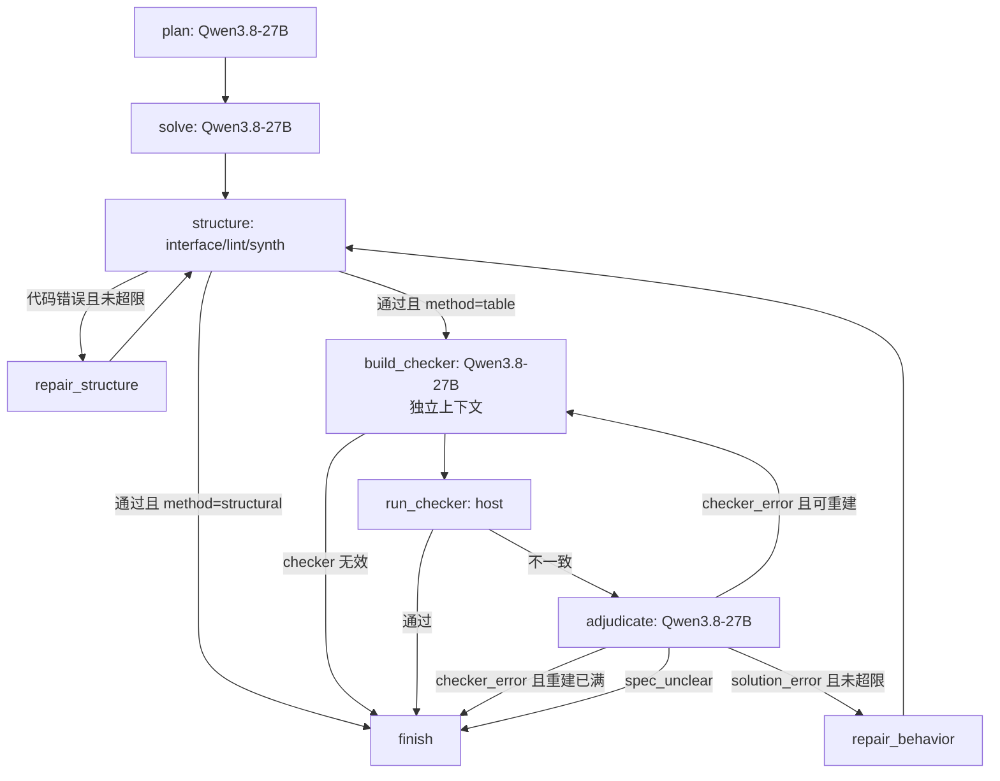

# guided_verify 工作流设计

状态：2026-10-30 已切换为源码默认工作流，`run.sh`、配置加载和 HTTP 服务统一选择 `config/guided_verify.yaml`。RAG 关闭，规划与其他模型阶段均使用 8000 的 Qwen3.8-27B；无需 8011 小模型或 embedding 服务。旧版本云端已切换，并完成自编单题真实模型及 API 验证；2026-10-31源码的恢复和预算改动须按新版本独立验收；这不代表完整题集或官方成绩。早期实现的单元测试、真实模型与 Vivado 单题记录保留为对应版本证据，不能代替新默认或完整题集验收。
当前仓库只保留 `single_generate` 与其并存，不再保留 adaptive/design/repair 工作流。
实现位于 `agent/orchestration/nodes/guided.py`、`agent/orchestration/workflows/guided_verify.py`。`serve/start.sh` 只启动主模型及同进程 MTP；显式小模型研究仍可手动运行 `serve/start_verireason.sh`。

## 1. 设计目标

- 规划阶段用主模型做检查路由和技能选择，输出扁平文本，不写长计划；默认不选择 RAG 卡片。
- 同一主模型通过独立请求负责解题、构造少量关键行为 case、归因和修复。
- 检查器不写 Verilog；宿主根据模型给出的行式向量表生成自检 testbench。
- 行为检查只覆盖关键输出和关键场景；未覆盖项明确记录，不报完整通过。
- 次数、超时和 token 预算全部来自工作流参数，不散落 magic number。

## 2. 流程



首次solve或首次checker收到`stop`/`length`且最终正文为空时，可在原全局额度内各恢复一次。恢复重新构造公开上下文，不带前次reasoning；checker仍不带候选、实测或planner公式。非空格式错误、未知终止、HTTP异常和宿主unsupported不进入此恢复。未知usage或未确认请求也不能盲重发。恢复尝试、实际发出次数、原失败与恢复响应分别记录；原失败不会被覆盖。

`solve_empty_recovery_limit`、`checker_empty_recovery_limit`只允许0或1，默认1。`solve_minimum_s=120`让planner保留最小求解时间及工具额度，而非完整solve超时；剩余时间不足仍记录未发送。它不是所有阶段都能用满上限的保证。

## 3. 节点与最小 I/O

| 节点 | 模型/工具 | 最小输入 | 最小输出 |
|---|---|---|---|
| `plan` | Qwen3.8-27B | 完整公开题面、显式接口、宿主检查器契约、辅助 features（特征）、skill ID 与描述；默认卡片候选为空 | 扁平 `key=value` 文本 |
| `solve` | Qwen3.8-27B | 题面、system prompt、选中的 skill；显式 RAG 配置才包含卡片 | 完整 RTL |
| `structure` | interface/lint/synth | 候选 | 结构检查结果 |
| `repair_structure` | Qwen3.8-27B | 题面、当前候选、结构化 `repair_diagnostics` 与日志摘要 | 新候选 |
| `build_checker` | Qwen3.8-27B | 题面、行为检查 skill、实际执行契约；不读候选/实测 | 行式向量表 |
| `run_checker` | host | 候选 + 合法向量表 | 逐 case/step/output 结果 |
| `adjudicate` | Qwen3.8-27B | 题面、checker、失败明细、当前候选、执行契约与展开后的输入时间线 | 扁平归因文本 |
| `repair_behavior` | Qwen3.8-27B | 题面、当前候选、checker、失败明细、执行契约、展开时间线与已存归因 | 新候选 |
| `finish` | host | 选稿与状态 | `solution.v`、结果 |

规划请求包含原始公开题面全文、显式接口、解析后的接口证据与宿主检查器契约；`guided_plan._features()` 的端口和关键词只作辅助摘要。检查器契约说明可支持的检查方式、实际配置限制、初始化与采样规则；不支持时选择 `structural`，不凭关键词猜测支持能力。每阶段重新构造 messages，不续接其他阶段的聊天历史或思考正文；阶段间需要的规划、候选和检查证据按契约显式传递。检查器独立构造仍不得接收候选 RTL 或实测输出。

`small` / `large` 是兼容角色的 profile 标签，不要求对应模型大小；默认二者均为 `enabled: false`，实际请求使用主模型。这是请求上下文隔离，不是第二模型进程或独占 KV 内存。

State 最小字段：`method`、`target_id`、`parent_id`、`phase`、`action`、`checker_status`、`repair_used`、`stop_reason`、`status`。

## 4. 规划输出

只允许逐行 `key=value`，不使用嵌套 JSON：

```text
method=table
skills=rtl-sequential-state-update
knowledge=
focus=reset priority|load vs shift
reason=single clock, reset and load are public
```

规则：

- `method` 只能是 `structural` 或 `table`。
- `skills` 来自每题自动扫描 `skill/` 形成的候选，最多 2 个；只向规划器提供允许自动选择的技能。宿主按生成/修复阶段和冲突组检查，实际发送与快照哈希记录在 material 产物中。新增技能无需改代码或清单，格式见[技能扩展指南](../skill/README.md)。
- 默认 `retrieval_mode=off`，host 不检索卡片，`knowledge` 为空；显式研究 RAG 时只能从 host 候选中选择，最多 3 个，由 host 还原卡片原文。
- `focus` 最多4段，用 `|` 分隔，保留为规划记录；独立checker不接收这些可能包含答案公式的推导。
- 技能和卡片中的未知或重复 ID 被移除，再按配置上限截取。格式错误、不支持的方法、超出限制的 `focus` / `reason` 或规划无响应时，回退 `structural`，记录原因，仍继续解题。

## 5. 检查器格式

模型只输出行式向量表，宿主生成 Verilog testbench、时钟、reset 阶段、采样和比较。

```text
case reset
init reset=1 load=0 data=00 q=01
step reset=0 load=1 data=a5 q=a5
step reset=0 load=0 data=00 q=4a
case shift_boundary
init reset=0 load=1 data=80 q=80
step reset=0 load=0 data=00 q=01
```

规则：

- `case <id>` 开始一组；每行以 `init` 或 `step` 开头。
- 每个非时钟公开输入在每行必须出现一次；时钟由宿主生成。
- 首行的输出名定义该 case 的检查集合；后续行必须使用同一组输出名。
- 未列出的公开输出记入该 case 的 `unchecked_outputs`，不计为通过。任一 case 漏查公开
  输出都会使整个 checker 成为 `partial_passed`，不能被其他 case 的覆盖抹掉。
- 表格检查支持组合逻辑或可明确识别的单一正沿时钟。`posedge clk or negedge reset_n` 的复位边沿不再被当成负沿时钟；真实负沿时钟、多时钟或边沿归属不明确时拒绝行为表格检查，不猜语义。对异步复位也只比较既定采样点，不证明任意时刻的复位性质。
- 顺序 case 首行必须是 `init`。宿主用该行输入执行 `init_cycles` 个有效沿，在最后一个
  init 沿并稳定后采样并比较 `init` 行声明的输出；随后才逐行执行 `step` 并在每行沿后比较。
  组合 case 可以 `step` 开始。每个 case 使用独立 DUT，不共享状态；宿主不会自动复位，模型需显式驱动复位输入。
- 规划、检查器初建和重建都接收实际 `init_cycles`、case/行数限制及宿主执行规则；归因和行为修复还接收解析后的输入时间线。每事件相对时刻为 5 ns 驱动输入、9 ns 记录 pre、10 ns 正沿、11 ns 记录并比较 post、15 ns 时钟回低；组合事件没有时钟沿。pre 只用于诊断。
- 失败中的 `step` 是 case 内从零起算的展开事件索引，不是原表行号。默认 `init_cycles=2` 时首个 init 在索引 1 比较，下一行 step 在索引 2 比较。表格值为十六进制；JSON 失败记录和输入时间线的位模式为十进制整数，未知位仍由掩码表示。
- 期望值为十六进制，宿主按端口宽度校验；未知、越界或缺少输入直接判无效。
- 最多 `max_cases` 个 case、每个 `max_steps_per_case` 行。
- 不写 Verilog、task、delay、循环、层次引用或注释。

## 6. 判定与重建

- 行为比较结果记录 `checked_outputs`、`unchecked_outputs`、`unknown_outputs`。
- 只要存在 unchecked 公开输出，结论为 `partial_behavior`；`functional_passed` 保持 false/unknown。
- 行为证据按 `candidate_id` 与 checker 指纹保存；收尾只使用当前 checker 下实际选中候选的
  证据。不能把子稿的行为通过和父稿的结构通过拼成一次完整通过。
- 时序 case 没有任何行、或 case 在读取首行前为空，均按 `checker invalid` 处理，不抛出未捕获异常。
- `adjudicate` 输出扁平文本：

  ```text
  decision=solution_error
  reason=reset state differs at case reset
  failed_cases=reset
  ```

- `checker_error`：若 `checker_rebuilds_used < checker_rebuild_limit`，重建 checker。重建输入只允许
  公开题面、固定检查方法、实际执行契约、旧 checker、失败 case ID 和决策类别（`checker_error`）；不得传入归因 reason 正文、
  候选 RTL、从失败报告摘出的期望/实测值或任何实测采样记录，并在重建记录中明确 `candidate_input=false`、
  `observed_outputs_input=false`。
- 重建后再次运行 checker；仍不一致则再次归因，受 `adjudicate_limit` 限制。
- 重建次数达到限制后仍为 `checker_error`：停止行为分支，不再重建、不再做行为检查，保留结构检查结论并标记 `behavior_unverified`。
- `solution_error`：默认允许一次行为修复；请求显式带入已存归因（包括 reason），但将其标为待验证假设，公开题面优先；用同一 checker 复检。复检仍不一致则停止并记录失败，不再追加归因。
- `spec_unclear`：停止，不猜语义。

## 7. 可配置参数

下表为 `config/guided_verify.yaml` 的有效预设，均由工作流参数模型校验。各阶段上限共享单题 900 秒总预算（预留收尾 60 秒），请求还会受剩余预算和上下文裁剪：

| 参数 | 当前默认配置 | 说明 |
|---|---:|---|
| `planner` | 90s / 4096 | 主模型规划路由 |
| `solve` | 300s / 16384 | 首稿 |
| `checker` | 180s / 8192 | 构造向量表 |
| `adjudicate` | 120s / 8192 | 归因 |
| `minimum_request_s` | 20s | 裁剪后模型请求的最小可用时间；阶段上限不足 20s 时取该阶段上限 |
| `structure_repair_limit` | 1 | 结构修复次数 |
| `behavior_repair_limit` | 1 | 行为修复次数 |
| `checker_rebuild_limit` | 1 | checker 重建次数（0 表示不重建） |
| `adjudicate_limit` | 2 | 归因次数上限 |
| `max_cases` | 4 | 关键 case 上限 |
| `max_steps_per_case` | 8 | 每 case 行数上限 |
| `init_cycles` | 2 | 顺序 case 初始化沿数 |
| `knowledge_candidates` | 5 | host 知识候选数 |
| `knowledge_select` | 3 | 显式启用 RAG 后规划最多选卡数 |
| `retrieval_mode` | off | `off` / `legacy` / `rag` / `all` |
| `retrieval_strategy` | bm25 | `bm25` / `dense` |
| `embedding_url` | 空 | dense 服务地址 |
| `max_calls` | 8 | 总 completion 上限 |
| `max_output_tokens` | 65536 | 总输出 token 上限 |

模型请求先保留 `followup_s` 所需后续时间，再把请求 timeout 裁剪到剩余额度；不再要求始终凑齐完整阶段上限加后续预留。裁剪后不足 `min(阶段 timeout, minimum_request_s)` 时不发送并记录原因。默认检查阶段若剩余 250 秒、后续预留 120 秒，可分配至多 130 秒给模型；不会侵占后续工具时间，也不延长 900 秒总时限、增加调用/token 上限或改变思考设置。

`checker_rebuild_limit=0` 时，第一次 `checker_error` 就停止行为分支。修复和重建次数
大于 1 时，每次请求使用独立 stage（如 `repair_behavior_2`、`checker_rebuild_2`），避免
同一 stage 只能请求一次的约束把合法配置变成异常。

## 8. 历史小模型研究与当前 Skill

以下小模型信息来自早期研究记录，不是当前默认依赖，也不证明其现有服务可用：

- 小模型候选：`Nellyw888/VeriReason-Qwen2.5-1.5b-RTLCoder-Verilog-GRPO-reasoning-tb`。
- HF API 复核 revision `a171280d7f001fef819e90218e008a887f1292c7`，`license` 为空，
  两个 safetensors 合计约 6.2 GB（F32）。
- 该候选已记入 `model/MODEL.md` 的研究说明，当前默认未启用；`manifest.json` 的 `auxiliary_models` 为空。研究配置若以后成为正式方案，须先补齐实际辅助模型的声明、许可与资源验收。
- 该小模型的独立 flat plan 输出格式尚未实测。`guided_verify_rag_bm25.yaml` 和 `guided_verify_rag_dense.yaml` 保留其 8011 profile，需要显式启动 `serve/start_verireason.sh` 并核验对应服务；`serve/start.sh` 不因设置 `VERI_GGUF` 自动启动它。默认 `guided_verify.yaml` 已关闭此 profile，不读取它的服务地址或模型名。
- 行为检查 skill：`rtl-behavior-check-keycases`，团队原创 candidate，不在自动准入集合。

## 9. 知识检索路线

`guided_verify` 默认 `retrieval_mode=off`，不检索卡片或调用 embedding；规划的 Skill 选择仍可用。`legacy` 卡片属于
`post_diagnostic`，不能在首稿阶段注入；需要知识时显式使用 RAG 配置。下列两份配置仍启用 8011 小模型，须先准备其研究服务与声明，不能作为默认主模型配置直接替换。显式启用 RAG 时使用：

```bash
AGENT_CONFIG=config/guided_verify_rag_bm25.yaml ./run.sh <input> <output>
# 或
AGENT_CONFIG=config/guided_verify_rag_dense.yaml ./run.sh <input> <output>
```

`rag` 模式包含 `legacy_policy` 和 `restricted` 卡片。plan 阶段记录
`knowledge/retrieval`，收尾结果也带 retrieval 摘要；dense 失败时关闭知识注入并记录
`embedding_unavailable`，不退回 BM25。dense 路线必须与
`config/rag_embedding.yaml` 的模型别名、1024 维、last pooling、L2 归一化和查询投影一致；
知识库和向量文件本身不保存版本、sha256、路径或 release lock。

## 10. 验证边界

- 关键 case 通过只证明被检查输出在本次采样上一致，不是完整功能证明。
- 未覆盖输出、未知值、未触发 case、checker 无效和环境失败分别记录。
- 归因 `solution_error` 不是 RTL 错误的证明；`checker_error` 也不证明候选正确。
- 正式成绩仍需官方判定；真实模型与 Vivado 小样本只作机制验证。
