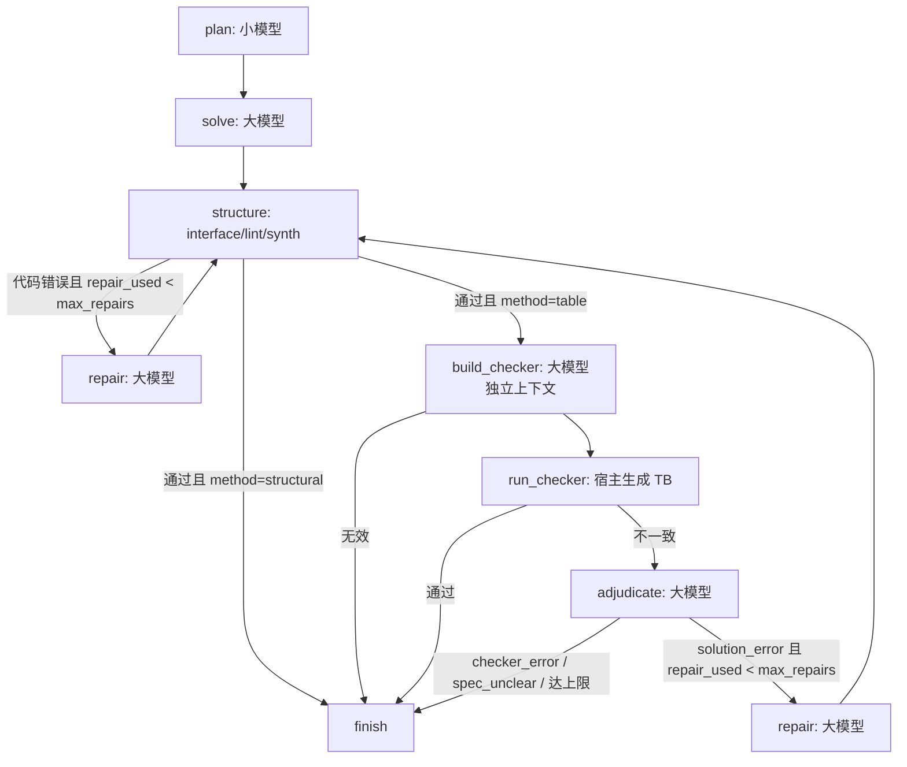

# Guided Verify 工作流设计

状态：设计已确认主要结构，尚未实现。与现有 `adaptive_verify` 并存，不替换它。
本文只描述目标行为；当前可用行为仍以 [自适应工作流](adaptive.md) 和
[架构](architecture.md) 为准。

## 1. 目标

用一个小模型做有限决策，让大模型解题；结构检查后只对关键行为做少量表格化检查；
不一致时由解题模型判断是 checker 还是 RTL 的问题；所有循环次数、预算和模型角色可配置。

不追求全行为覆盖，不生成复杂检查器，不让模型维护 Verilog testbench 语法。

## 2. 流程



- 新建 `guided_verify`，保留 `adaptive_verify` 做对照。
- 修复使用**一个**总计数器 `repair_used`，不再区分结构修复和行为修复；
  达到 `max_repairs` 后停止。
- checker 只构造一次；`checker_error` 不触发重建，直接结束并保留结构结论。

## 3. 节点与最小 I/O

| 节点 | 角色 | 最小输入 | 最小输出 | 工具 |
|---|---|---|---|---|
| `plan` | small | 公开题面、skill 短名单、可选知识卡 ID/标题 | 扁平行式计划 | 无 |
| `solve` | large | 题面、system prompt、选中的 skill/知识 | 候选 RTL | 无 |
| `structure` | host | 候选 | interface/lint/synth 结果 | `interface_check`、`vivado_lint`、`vivado_synth` |
| `repair` | large | 题面、当前候选、最近诊断或 checker 失败 | 子候选 | 无 |
| `build_checker` | large | 题面、行为检查 skill、`focus`；不读候选/实测 | 行式向量表 | 无 |
| `run_checker` | host | 候选 + 合法表 | 逐 case/line 的检查结果 | 仿真 |
| `adjudicate` | large | 题面、checker、失败明细、当前候选 | `checker_error` / `solution_error` / `spec_unclear` | 无 |
| `finish` | host | 选稿结果 | `solution.v`、状态 | 无 |

State 最小字段：`method`、`target_id`、`parent_id`、`phase`、`action`、
`repair_used`、`checker_status`、`stop_reason`、`status`。计划、checker、trace
和失败明细保存在 `ctx.store` 与 `records/`。

## 4. 小模型计划格式

只输出行式 `key=value`，不使用嵌套 JSON：

```text
method=table
skills=rtl-sequential-state-update
knowledge=
focus=reset priority|load vs shift
reason=single clock, reset and load are public
```

- `method`：`structural` 或 `table`。
- `skills`：逗号分隔，最多 2 个，必须来自 host 短名单。
- `knowledge`：逗号分隔的卡片 ID，最多 3 个；可以为空。
- `focus`：最多 4 条，`|` 分隔，仅作为检查器提示，不作为题目要求。
- `reason`：单行短文本。
- 任何未知字段、未知 ID、重复项、超限或格式错误都回退到 `structural`，
  并记录回退原因；不追加一次模型请求。

## 5. 检查器格式

模型只输出行式向量表；宿主生成时钟、reset 时序、采样和比较逻辑。

```text
case reset
init reset=1 load=0 data=00 q=01
step reset=0 load=1 data=a5 q=a5
step reset=0 load=0 data=00 q=4a
case boundary
init reset=0 load=1 data=80 q=80
step reset=0 load=0 data=00 q=01
```

- `case <id>` 开始一组；每行 `init` 或 `step`。
- 每个非时钟公开输入在每行必须完整出现；时钟由宿主生成。
- 同一 case 的输出集合由首行确定；后续行必须使用相同输出集合。
- 允许只检查关键输出；host 记录 `checked_outputs` 与 `unchecked_outputs`。
  存在未检查公开输出时，结论为 `partial_outputs`，`functional_passed` 保持
  false/unknown，不能报完整功能通过。
- 顺序 case 第一行必须是 `init`；组合 case 可以 `step` 开始。
- `init` 行执行 `init_cycles` 个有效沿后再比较；默认由参数配置，不在代码写死。
- 期望值用十六进制；host 校验端口宽度、未知值和范围。
- 最多 `max_cases` 个 case、每个 `max_steps_per_case` 行。
- 不写 Verilog、always、initial、延时、任务、循环、类或层次引用。

## 6. 归因

输出扁平行式：

```text
decision=solution_error
reason=reset case expects q=01 but observed 00
failed_cases=reset
```

- `solution_error`：允许一次 `repair`，然后重新结构检查，并用同一 checker 复检。
- `checker_error`：不修 checker，停止为“结构通过、行为未确认”。
- `spec_unclear`：停止，不猜语义。
- 所有决定共用一个 `repair_used` 计数；达到 `max_repairs` 后不再生成。
- 修复后仍不一致：记录失败并结束，不第二次归因。

## 7. 可配置参数

不把次数、token 和超时写死在代码里：

```yaml
params:
  planner: {timeout_s: 60, max_tokens: 512}
  solve: {timeout_s: 240, max_tokens: 4096}
  repair: {timeout_s: 240, max_tokens: 4096}
  checker: {timeout_s: 180, max_tokens: 2048}
  adjudicate: {timeout_s: 120, max_tokens: 1024}
  max_repairs: 2
  max_checker_builds: 1
  max_cases: 4
  max_steps_per_case: 8
  init_cycles: 2
  knowledge_candidates: 5
  knowledge_select: 3
  first_tools_s: 120
  recheck_tools_s: 120
  max_calls: 7
  max_output_tokens: 65536
```

`max_repairs` 是结构修复和行为修复共用的总上限；`max_checker_builds` 当前固定为 1，
不提供 checker 重建路径。

## 8. 未决问题

1. **RAG 语义**：现有 `knowledge/cards.json` 是 lint 诊断修复卡，不是解题知识。
   plan 阶段没有失败证据，无法使用现有 `retrieve()`。可选项：
   - 只让 plan 选 skill，诊断卡留给 lint 失败后的修复；
   - 新增“解题知识”语料和检索；
   - plan 阶段不选 RAG。
2. **小模型正式启用**：候选模型已在分支配置中 `enabled: true`，但 HF license 为空、
   flat plan 格式尚未实测、`auxiliary_models` 未声明。正式提交前须解决许可证与 manifest 声明。
3. `init_cycles` 的默认值、`max_repairs` 默认值仍需真实题集校准。
