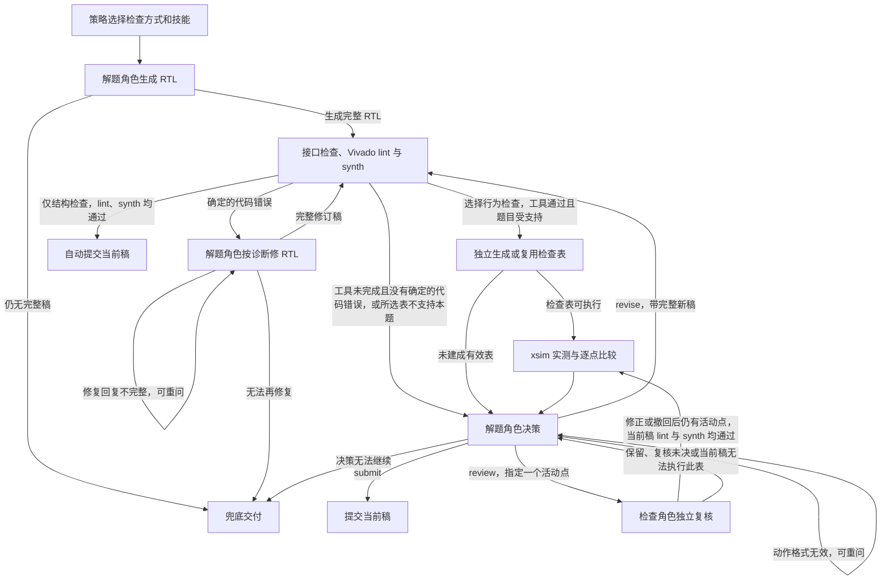

# guided_verify 工作流设计

`guided_verify` 是 `run.sh` 和 HTTP 服务的默认工作流，入口配置为 `config/guided_verify.yaml`。策略选择、解题和行为检查使用同一 Qwen3.8-27B 服务，各自构造请求。程序负责约束检查语法、运行 Vivado、比较实测输出、记录提交理由与交付文件。

## 1. 三个角色

| 角色 | 输入 | 决定与输出 |
| --- | --- | --- |
| 策略（`plan`） | 完整公开题面、接口、检查器能力，以及允许选择的技能名称和说明 | 选择 `structural`（只做结构检查）或 `table`（增加行为检查），为解题角色选最多两项技能 |
| 解题（`solve`、`repair_structure`、`author_decision`） | 原题、接口和所选技能正文。首次生成后按当前稿接收结构诊断、行为检查结果及本题历轮决定 | 生成完整 RTL，处理明确的代码错误。行为检查后或结构工具未能完成时自行提交或改稿，有活动测试点时也可指定一点请检查角色复核 |
| 检查（`checker`、`checker_format_repair`、`checker_review`） | 公开题面、接口、固定检查方法和实际执行规则。格式纠正另收自己的无效表及解析诊断，逐点复核另收当前检查表和待复核点编号 | 为每个点给出激励、期望值与一句说明，复核时独立决定保留、修正或撤回，并说明理由 |

检查角色仅凭公开规格推导期望值。程序不会将候选 RTL、实测输出、解题角色质疑的理由、规划中的公式或其他角色的思考正文发给它。解题角色可阅读检查点说明和复核结论，并按题意提出不同判断。每题的决定独立记录。

## 2. 执行顺序



程序先检查接口，再对允许编译的候选运行 Vivado lint（编译与展开），lint 通过才运行 synth（综合）。接口、lint 或 synth 报告确定的代码错误时，解题角色接收对应候选、来源位置、`repair_diagnostics` 和日志摘要，以完整 RTL 回复，再依次重检。接口、lint 和 synth 全部通过才记 `structural_passed`。lint 和 synth 各自报告 `status=passed` 且返回整数退出码 0 时，记为 `toolchain_passed`。即使接口证据不足，只要接口检查允许编译，仍可能达到这一条件。工具缺失、超时和未执行保留实际状态。

即使表格处理不了某种时钟，第一步仍是策略选择。策略角色能选择适用的求解技能，程序会记录能力限制。收到无效计划或规划请求不可用时，采用空技能的结构路线并记录原因。策略选择 `table` 而题目不受支持时，程序保留该选择、跳过构表，并在结构评估后把原因交给解题角色决定。建表失败、仿真未完成或比较不充分也会反馈给解题角色。

## 3. 解题动作与交付

每次决策只允许一个动作，`reason` 必须是一行，最多 400 个字符。程序将操作绑定当前候选。

| 动作 | 回复约定 | 执行结果 |
| --- | --- | --- |
| `submit` | `action=submit` 和 `reason=...` 两行 | 提交已做结构评估的当前稿。解题角色可根据题意拒绝检查建议，也可在行为未验证时提交 |
| `revise` | `action=revise`、`reason=...`，随后是一个标记为 `verilog` 或 `systemverilog` 的代码围栏 | 同一回复必须给出含题目顶层的完整 RTL。新候选保留父稿身份，重新进行结构检查，适用时再执行当前行为表 |
| `review` | `action=review`、`reason=...`、`case_id=<当前表中的编号>` | 请求检查角色独立复核这一点。没有活动点时只提供前两种动作 |

动作格式有误时，下一次解题请求会带上解析诊断。同一稿、同一张表连续得到相同的无效决定，或回复为空且结束原因未知时，程序转入兜底。下例请求复核一个测试点的采样时刻。

```text
action=review
reason=题面要求沿后采样，请复核本点的采样相位。
case_id=load_then_hold
```

同一题的下一次解题请求携带历轮动作和复核的简短记录，保留先前对同一点的判断。记录包括相关候选、检查表版本、理由与修订关系。完整 RTL 只传当前稿。实现和日志可按候选及检查器版本核对。[解题决策协议](../agent/domain/rtl/guided_author.py)

共享预算耗尽、决策失败且无法继续、或运行中断时，程序优先交付按生成顺序最近的一份 **lint 与 synth 均实际通过** 的完整候选。没有这样的候选则交付最近的完整稿，没有任何完整稿则交付空文件。每次登记或结构评估后都会重新确定兜底候选。目标候选改变时，程序才把对应 RTL 写入磁盘，供中断时交付。应从提交方式区分解题角色确认（`author_submit`）、纯结构路线自动提交（`structural_auto`）与兜底（`fallback`）。[答案交付实现](../agent/submission/gateway.py)

## 4. 规划输出

```text
method=table
skills=rtl-sequential-state-update
knowledge=
focus=load priority|state hold
reason=The public task describes one rising edge and observable state.
```

`skills` 和 `knowledge` 只能从程序提供的候选中选择。程序去除未知或重复的标识，按上限截取，再按阶段、技能状态和冲突组检查求解材料。每题从 `skill/` 建立快照，记录实际发送给解题角色的正文标识与校验值。默认关闭 RAG（检索增强生成），`knowledge` 为空。启用 RAG 时，默认最多选择 3 张知识卡片。`focus` 推荐用 `|` 分隔，解析器也接受英文逗号。最多 4 段，每段不超过 80 个字符，仅保留在规划记录中。[规划解析](../agent/domain/rtl/guided_plan.py) · [技能与知识检索](knowledge.md)

## 5. 检查表与采样

每个 `case` 是一个可独立复核的测试点。点编号在表内唯一，由 1 至 63 个英文字母、数字、下划线或连字符组成。编号后用 `#` 附一行说明，指出激励与预期行为，最多 240 个可打印字符。下面是一个自编单正沿加载寄存器的例子，`rst` 为同步高有效复位，`en` 为加载使能，`d`、`q` 为 8 位。

```text
case load_then_hold # 加载 a5，然后撤销使能。下一沿前后都应保持 a5。
init rst=1 en=0 d=00 q=00
step rst=0 en=1 d=a5 pre.q=00 q=a5
step rst=0 en=0 d=01 pre.q=a5 q=a5
```

- 每一行都要写出所有非时钟输入，每行至少检查一个公开输出。同一点每行都用同一组输出名。每个点独占一个 DUT（被测设计）实例，复位由表格显式驱动。数值写成不带 `0x` 或位宽前缀的十六进制位模式，有符号值用端口位宽的补码。越界、X/Z、负数字面量或缺少输入会得到解析错误。
- 单正沿时钟题以 `init` 开始。一个 `init` 默认重复两个有效沿，`pre.q` 在第一次沿前比较，`q` 在最后一个沿后比较。`step` 只执行一个沿。`pre.<输出>` 表示沿前期望，直接写输出名表示沿后期望。每个时序事件相对起点在 5 ns 驱动输入、9 ns 采集沿前值、10 ns 产生有效沿、11 ns 采集沿后值、15 ns 拉低时钟。组合逻辑可从 `init` 或 `step` 开始，用无前缀的输出名比较稳定值。
- 默认最多 4 个点、每点 8 行。检查器支持公开接口清晰的组合逻辑和明确的单正沿设计，其他时钟情形在规划中显示不支持原因。时序日志的 `step` 从 0 起，指展开后的事件序号。JSON 记录的整数使用十进制。
- `case_results` 按测试点和相位统计已比较位数、未知位数。失配或含未知位的输出另列步骤、端口、相位、期望值、实测值及已知位掩码。`full` 日志还保存原始观测。一个向量可同时有已知位失配和未知位。有失配记为 `failed`，无失配但有未知或零个比较位记为 `unknown`，实际比较吻合但某点漏查输出记为 `partial_passed`。只有执行且已知比较全部吻合并满足输出覆盖时，整张有限表才是 `passed`。缺少观测、检查器无效或工具环境故障另记实际原因。

程序从表格生成测试台并驱动 xsim。当前语法让程序校验端口、值宽、相位并统计实际比较量。与模型直接生成测试台或填写 Verilog 测试台模板相比，这三种方式的正确率、覆盖率和成本尚无同预算对照。[检查器与执行规则](../agent/domain/rtl/guided_checker.py)

## 6. 逐点复核

检查角色看到公开规格、当前表和指定点编号。它可以独立核对原激励、采样位置和期望值。每次只返回指定点的处理结果及一句理由。

```text
review load_then_hold keep # 题面要求 en=0 保持，且该点在前一个有效沿已加载 a5。
```

`keep`（保留）和 `withdraw`（撤回）只需这一行。`correct`（修正）要在同一回复中附上同编号的完整替代测试点及说明，其他测试点保留原样。修正或撤回后仍有活动点，且当前稿的 lint 和 synth 都通过时，流程再次调用仿真。工具预算也会限制实际执行。撤到零点时，行为检查为未验证。解题角色收到复核结果与理由后再次决定是否提交或改稿。[复核协议](../agent/domain/rtl/guided_revision.py)

复核没有取得有效结论时，程序按测试点编号把原因和检查表哈希记入 `unresolved_reviews`，下一轮解题请求也会收到这份记录。只有同一点取得有效的保留、修正或撤回结论后，程序才清除它的未决记录。其他点的结论只更新各自编号。

结果中的 `current_table_passed` 表示交付稿对当前表有真实的已知位比较并整表通过。`functional_passed` 还要求没有未决复核，历轮复核都未改变激励、采样或期望，且没有撤回过测试点。若解题角色在当前表仍有已知位失配时提交，记录 `submitted_with_mismatch`。这些信息随交付候选编号、代码哈希和检查表哈希保存。

## 7. 默认预算

| 参数 | 值 | 使用范围 |
| --- | --- | --- |
| `runtime.deadline_s` / `reserve_s` | 900 / 60 秒 | 时间由所有请求与工具共享，预留用于收尾 |
| `max_calls` / `max_output_tokens` | 8 / 65536 | 整道题允许的模型请求次数与累计输出 token |
| `planner` | 90 秒 / 4096 token | 策略选择 |
| `solve` | 300 秒 / 16384 token | 解题首稿、RTL 修复和提交决策 |
| `checker` | 180 秒 / 8192 token | 独立构表、格式纠正和单点复核 |
| `minimum_request_s` | 20 秒 | 扣除后续预留时间后，一次请求至少需要的时长，最多取该阶段上限 |
| `solve_minimum_s` | 120 秒 | 规划为首次解题预留的最小时长，最多取解题时限 |
| `first_tools_s` / `recheck_tools_s` | 120 / 120 秒 | `first_tools_s` 用于每份 RTL 的整轮结构检查，也在规划、首稿、结构修复及检查角色等请求前给后续工具留时。`recheck_tools_s` 限制每次行为仿真 |
| `max_cases` / `max_steps_per_case` / `init_cycles` | 4 / 8 / 2 | 检查表容量与时序点初始化规则 |

修复、复核、格式纠正和空正文恢复均在共享预算内进行。检查角色在首次构表、复核指定测试点和纠正格式前都会检查剩余调用次数。如果只剩一次，程序把它留给解题角色处理当前稿。格式纠正使用检查角色自己的原回复与解析诊断。已确认结束、用量已知且终止原因为 `stop` 或 `length` 的空正文才进入相应恢复。每次发出请求分别计账，用量未知阻止可选请求，未确认结束阻止后续生成。剩余时间或上下文不足时记录哪些步骤未发送或未执行。默认配置与只限制总时长的研究配置分开记录。[默认 YAML](../config/guided_verify.yaml) · [工作流参数](../agent/orchestration/workflows/guided_verify.py)

迁移旧自定义 YAML 时，从随包的同名配置开始保留所需的时限、共享额度和检索参数。旧 `adjudicate`、分支次数上限（如 `behavior_repair_limit` 和 `checker_empty_recovery_limit`）、`submission_policy` 及 `plan_when_checker_unsupported` 已从工作流参数移除，沿用它们会触发配置校验错误。当前交付方式由工作流确定。运行结果可从 `submission_mode`、`calls_sent_by_role` 和 `decision_history` 核对实际提交方式、各角色发送次数和每轮决定。

## 8. 历史小模型研究与当前技能

以下是早期研究配置，不是当前默认依赖：

- 小模型候选为 `Nellyw888/VeriReason-Qwen2.5-1.5b-RTLCoder-Verilog-GRPO-reasoning-tb`。历史记录核对的 Hugging Face 版本为 `a171280d7f001fef819e90218e008a887f1292c7`，当时 `license` 字段为空；两个 safetensors 文件合计约 6.2 GB，采用 32 位浮点数。
- 2026-10-28 的 `3e1efcc` 单题实验与 `333f32e` 四题实验使用了转换后的 F16（16 位浮点数）小模型，并得到逐行规划输出；也观察到技能与卡片标识混淆、检查方式理由不准确等问题。这些是历史小样本证据，不证明规划可靠性或当前默认配置的效果。
- 当前默认关闭该服务配置，`manifest.json` 的 `auxiliary_models` 为空。若以后纳入正式方案，仍需补齐实际辅助模型声明、许可和资源验收，不能沿用旧试验作为当前证明。
- `guided_verify_rag_bm25.yaml` 和 `guided_verify_rag_dense.yaml` 保留端口 8011 的小模型配置。使用前需显式启动 `serve/start_verireason.sh` 并核验服务；`serve/start.sh` 不会因设置 `VERI_GGUF` 自动启动它。默认 `guided_verify.yaml` 不读取该服务地址或模型名。
- 固定行为检查技能 `rtl-behavior-check-keycases` 的文本由本项目编写。它不参与求解技能的自动选择，但检查器构造节点固定读取它；来源与许可见[说明](../skill/rtl-behavior-check-keycases/PROVENANCE.md)。

## 9. 可选知识检索

`guided_verify` 默认不检索卡片，也不调用文本嵌入服务；技能选择仍启用。启用 RAG 时，程序先按卡片状态、使用阶段和许可筛选候选。`rag` 模式考虑 `legacy_policy` 和 `restricted`，但现有 `legacy_policy` 卡片不允许加入首稿请求。详细规则见[技能与知识检索](knowledge.md)。

下列配置仍启用早期小模型，须先准备第 8 节所述研究服务与声明。准备完成后，在方案仓库根目录显式选择配置，并替换输入、输出路径：

```bash
AGENT_CONFIG=config/guided_verify_rag_bm25.yaml ./run.sh /path/to/input /path/to/output
# 或使用向量检索配置
AGENT_CONFIG=config/guided_verify_rag_dense.yaml ./run.sh /path/to/input /path/to/output
```

规划阶段记录 `knowledge/retrieval`，收尾结果也包含检索摘要。BM25 按词项相关性排序；`dense` 使用文本嵌入向量排序。向量检索失败时不向本次请求添加知识卡片，记录 `embedding_unavailable`，不改用 BM25。该配置必须与 `config/rag_embedding.yaml` 的模型别名、1024 维向量、最后词元池化、L2 归一化和查询文本模板保持兼容；术语与服务配置见[知识检索说明](knowledge.md#3-文本嵌入与向量检索)。知识库和向量文件本身不保存版本、路径、校验值或发布版本锁定信息。

## 10. 验证边界

有限表通过只说明受测场景、采样时刻和已比较输出相符。解题角色可以决定提交，正式功能等级仍需用实际交付文件另行判定。2026-10-31 的两道自编简单题检验了当时 `1615689` 的真实模型、工具和服务。三题恢复记录使用检查器时限 150 秒的历史候选。2026-11-18 的三角色入口验收使用两道自编题和固定模型回复，7 个场景共执行 7 次真实 xsim，累计比较 14 个已知位。真实模型调用和官方重评次数均为 0。当前三角色的收益需要相同版本、硬件和预算下的对照。[历史记录及适用版本](../REPORT.md#6-实测结果)

## 日志历史版本

`extract/result` 将完整提取或拒收绑定到实际生成调用。工作流执行到 `finish` 且有交付候选时，`guided/verification` 记录该候选、检查器版本和行为比较。`run/end` 的 `candidate_id` 与 `published_id` 依据最终文件字节和写入记录确定，`selected_id` 表示内部选稿；两者各有对应的 SHA-256。若进程在写结束事件前被强制终止，可用实际 `solution.v` 的 SHA-256 对照已落盘的 `submission/published` 和 `submission/checkpoint`，正式提交决定另有 `submission/decision`。总截止、主动取消、模型请求超时与环境错误分别记录。

`full` 记录级别下，guided 产物的每次保存写入 `guided/history/<revision>/`，`trace.jsonl` 的材料事件指向该次独立快照。`guided/` 下原有路径仍保存最新内容，供现有读取方使用；追溯复检或逐点复核过程应沿事件路径读取历史快照。历史与最新文件均经过记录器脱敏。`basic` 不保存附件，事件路径为空。此机制不恢复旧运行已被覆盖的附件，也不是任务重启后的检查点恢复。

## 仅按总时长约束的研究配置

通过 `AGENT_CONFIG=config/guided_verify_deadline_only.yaml` 可显式选用研究配置。单题仍为 900 秒，收尾、求解与工具预留均为 0，各角色请求时限为 900 秒并受整题剩余时间约束，工具使用当前剩余时间。模型调用数、输出 token 数、单次输出上限和图步数配置为 `null`。当本次生成没有输出 token 上限时，模型发现、模板展开、分词和生成共用本次请求的剩余时间。单次输出仍受实际分词后的上下文余量限制。该配置与比赛默认设置分开报告。[研究配置](../config/guided_verify_deadline_only.yaml)
