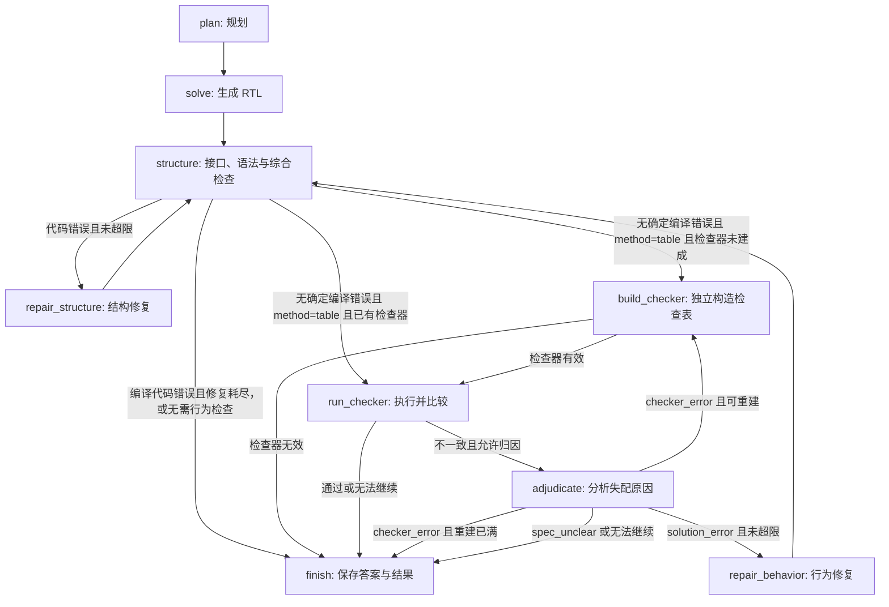

# guided_verify 工作流设计

本文描述当前默认工作流 `guided_verify`。`run.sh`、配置加载和 HTTP 服务统一选择 `config/guided_verify.yaml`：关闭 RAG（检索增强生成），规划、RTL（寄存器传输级）代码生成和检查等阶段均使用同一 Qwen3.8-27B 服务，分别构造请求上下文。默认不依赖小模型或文本嵌入服务。

2026-10-31，提交 `1615689` 已部署，并完成自编 AND、OR 两道组合逻辑题的真实模型、行为检查和服务验证，其中 OR 题由本机经公网提交。两题均未触发恢复或修复分支。此前检查器时限为 150 秒的三题恢复实验，与当前 180 秒发布配置不同，不能替代当前配置的复杂题或完整题集验收。版本与证据范围见[报告](../REPORT.md)。

仓库还保留 `single_generate`，已移除早期的 `adaptive`、`design`、`repair` 工作流。当前实现位于 `agent/orchestration/nodes/guided.py` 和 `agent/orchestration/workflows/guided_verify.py`。`serve/start.sh` 启动主模型及同一进程中的 MTP（多词元预测）组件；早期小模型研究仍可显式使用 `serve/start_verireason.sh`，不属于默认启动流程。

## 1. 设计目标

- 规划阶段由主模型选择检查方式和技能，输出逐行字段，不要求长篇计划；默认不选择知识卡片。
- 同一主模型通过独立请求负责解题、构造少量关键行为场景、分析失配原因和修复代码。
- 模型生成输入与期望输出表，由执行程序据此生成 Verilog 自检测试台（testbench）。
- 行为检查只覆盖指定输出和有限场景，明确记录未覆盖项。
- 调用次数、超时和词元（token）预算统一由工作流参数规定，避免在各处重复写死数值。

这些是实现方式与使用范围，不代表已证明相对于基线的收益。

## 2. 流程



首次生成（`solve`）或首次检查器构造（`checker`）收到 `stop` 或 `length` 终止标记、且最终正文为空时，可在原全局额度内各恢复一次。恢复时重新构造公开上下文，不复制前次思考正文；检查器请求仍不接收候选 RTL、实测值或规划阶段推导的答案公式。非空格式错误、未知终止原因、HTTP 异常和程序不支持的检查方式不触发这种恢复。用量未知或请求是否结束尚未确认时，也不能直接重发。恢复尝试、实际发出次数、原失败与恢复响应分别记录，原失败不会被覆盖。

结构检查节点优先处理仍有额度的代码修复。修复额度耗尽后，若 `lint.status=failed` 且 `failure_kind=code`，记录 `checker-skipped`（`reason=compile_failed`）并收尾，不再构造或运行行为检查器。其他情况按 `method` 和检查器状态选择行为分支，并不以 `structural_passed` 为必要条件；单独综合失败、超时或环境不可用不当作确定的编译代码错误。检查程序的支持范围、预算和实际工具执行仍可能阻止行为检查；进入该分支不表示结构检查已通过。

`solve_empty_recovery_limit`、`checker_empty_recovery_limit` 只允许为 0 或 1，默认均为 1。`solve_minimum_s=120` 让规划阶段保留最小求解时间和工具额度，不要求预留生成阶段的完整超时上限。剩余时间不足时记录请求未发送；各阶段并不保证能够用满各自上限。

## 3. 节点的输入与输出

| 节点 | 执行者 | 主要输入 | 主要输出 |
| --- | --- | --- | --- |
| `plan` | Qwen3.8-27B | 完整公开题面、显式接口、检查器执行规则、辅助特征、技能标识和描述；默认知识卡片候选为空 | 逐行 `key=value` 文本 |
| `solve` | Qwen3.8-27B | 题面、系统提示、选中的技能；显式启用 RAG 时才包含卡片 | 完整 RTL |
| `structure` | 接口检查与 Vivado | 候选 RTL | 接口、语法与综合检查结果 |
| `repair_structure` | Qwen3.8-27B | 题面、当前候选、结构化诊断 `repair_diagnostics` 与日志摘要 | 新候选 |
| `build_checker` | Qwen3.8-27B | 题面、固定行为检查技能、实际执行规则；不读候选或实测值 | 行式输入与期望输出表 |
| `run_checker` | 执行程序与 Vivado | 候选 RTL、合法检查表 | 按场景、步骤和输出记录的比较结果 |
| `adjudicate` | Qwen3.8-27B | 题面、检查表、失败明细、当前候选、执行规则与展开后的输入时间线 | 逐行归因文本 |
| `repair_behavior` | Qwen3.8-27B | 题面、当前候选、检查表、失败明细、执行规则、展开时间线与已存归因 | 新候选 |
| `finish` | 执行程序 | 候选选择与运行状态 | `solution.v` 和结果记录 |

规划请求保留原始公开题面全文、显式接口、解析后的接口证据和检查器执行规则；`guided_plan._features()` 提取的端口与关键词只作辅助摘要。执行规则说明支持的检查方式、配置限制、初始化和采样时刻。不支持行为检查时选择 `structural`，不凭关键词猜测支持能力。

每阶段重新构造消息列表，不续接其他阶段的聊天历史或思考正文。阶段间需要的规划、候选和检查证据按接口约定显式传递；构造或重建检查器时始终不接收候选 RTL 和实测输出。这是请求上下文隔离，不是统计独立性或正确性保证。

`small`、`large` 是兼容早期实现的服务配置名称，不要求对应模型大小。默认二者均为 `enabled: false`，实际请求使用主模型；不会因此启动第二个模型进程，也不表示独占键值缓存（KV cache）。

Burr 状态（`State`）的主要字段为 `settings`、`method`、`target_id`、`parent_id`、`action`、`checker_status`、`stop_reason` 和 `status`。详细候选、检查结果和预算记录保存在本题执行上下文中。

## 4. 规划输出

规划结果只允许逐行 `key=value`，不使用嵌套 JSON：

```text
method=table
skills=rtl-sequential-state-update
knowledge=
focus=reset priority|load vs shift
reason=single clock, reset and load are public
```

- `method` 只能为 `structural`（只做结构检查）或 `table`（增加表格行为检查）。
- `skills` 来自每题扫描 `skill/` 形成的候选，最多 2 个；规划器只看到允许自动选择的技能。程序按生成或修复阶段、使用状态和冲突组校验，将实际发送内容和快照校验值记入 `guided/material*.json`。新增技能格式见[技能扩展指南](../skill/README.md)。
- 默认 `retrieval_mode=off`，程序不检索卡片，`knowledge` 为空。显式启用 RAG 时，规划器只能选择程序提供的候选，当前默认最多 3 个；程序再读取对应卡片内容。
- `focus` 最多 4 段，用 `|` 分隔，保留为规划记录。独立检查器不接收这些可能包含答案公式的推导。
- 未知或重复的技能、卡片标识会被移除，再按配置上限截取。格式错误、方法不受支持、`focus` 或 `reason` 超限、规划无响应时，记录原因并回退到 `structural`，仍继续解题。

## 5. 检查表格式与执行规则

模型只输出行式输入与期望输出表，由程序生成 Verilog 测试台并负责时钟、输入驱动、采样和比较。以下仅展示格式：

```text
case reset
init reset=1 load=0 data=00 q=01
step reset=0 load=1 data=a5 q=a5
step reset=0 load=0 data=00 q=4a
case shift_boundary
init reset=0 load=1 data=80 q=80
step reset=0 load=0 data=00 q=01
```

- `case <id>` 开始一组检查场景；每行以 `init` 或 `step` 开头。
- 每个非时钟公开输入在每行必须出现一次，时钟由执行程序生成。
- 首行的输出名定义该场景的检查集合；后续行必须使用同一组输出名。未列出的公开输出记入 `unchecked_outputs`，不计为通过，也不能由其他场景的覆盖抵消。
- 表格检查支持组合逻辑，或能明确识别的单一上升沿时钟。`posedge clk or negedge reset_n` 中的复位下降沿不会被当成时钟下降沿；真正的下降沿时钟、多时钟或边沿归属不明时拒绝行为表格检查。异步复位也只在既定采样点比较，不能证明任意时刻的复位性质。
- 时序场景首行必须为 `init`。每个 `init` 行的输入重复执行 `init_cycles` 个有效沿，在最后一个有效沿之后、信号稳定时比较该行声明的输出。每个 `step` 行只执行一次并在沿后比较。组合场景可以从 `step` 开始。
- 每个场景使用独立的被测设计（DUT）实例，不共享状态。程序不会自动复位，模型需要按公开题意显式驱动复位输入。
- 规划、检查器初建和重建都接收实际 `init_cycles`、场景与行数限制、执行规则；归因和行为修复还接收解析后的输入时间线。每个事件相对开始时刻在 5 ns 驱动输入、9 ns 记录沿前采样 `pre`、10 ns 产生上升沿、11 ns 记录并比较沿后采样 `post`、15 ns 将时钟置低。组合事件没有时钟沿；`pre` 仅用于诊断。
- 失败记录中的 `step` 是场景内从零起算的展开事件索引，不是原表行号。默认 `init_cycles=2` 时，首个 `init` 在索引 1 比较，下一行 `step` 在索引 2 比较。表格使用十六进制，JSON 失败记录和输入时间线中的位值使用十进制整数；未知位另用掩码表示。
- 程序按端口宽度校验数值，未知、越界或缺少输入时直接判无效。最多允许 `max_cases` 组场景，每组最多 `max_steps_per_case` 行。
- 表中不能写 Verilog 代码、任务、延时语句、循环、层次引用或注释。

## 6. 判定与重建

行为比较结果分别记录已检查输出 `checked_outputs`、漏查输出 `unchecked_outputs`、失配明细 `failed` 和未知样本 `unknown`。有失配时结果为 `failed`，没有失配但有未知样本时为 `unknown`；仅当上述两项均不存在、仍有漏查输出时，才记为 `partial_passed`。最终结果中的 `partial_behavior` 表示这种部分通过，`functional_passed` 只有在行为结果为 `passed` 时才为 `true`。

行为证据绑定 `candidate_id` 和检查表内容的校验值。收尾时只使用实际交付候选在当前检查表下的结果，不能把修复稿的行为通过和原稿的结构通过拼成一次完整通过。空场景或无有效行的时序场景按检查器无效处理。

`adjudicate` 输出逐行文本，例如：

```text
decision=solution_error
reason=reset state differs at case reset
failed_cases=reset
```

程序按归因结果处理：

- `checker_error`（可能是检查器错误）：若 `checker_rebuilds_used < checker_rebuild_limit`，允许重建。重建只接收公开题面、固定检查方法、实际执行规则、旧检查表、失败场景标识和决策类别；不接收归因 `reason` 正文、候选 RTL、从失败报告摘出的期望或实测值，以及任何实测采样。记录明确标为 `candidate_input=false`、`observed_outputs_input=false`。
- 重建后重新执行检查；仍不一致时可再次归因，受 `adjudicate_limit` 限制。重建额度用尽后仍归因为 `checker_error`，停止行为分支，保留结构检查结论并标记 `behavior_unverified`（行为未验证）。
- `solution_error`（可能是 RTL 错误）：默认允许一次行为修复。请求带入已存归因及 `reason`，但明确标为待验证假设，以公开题面为准。修复后用同一检查表复检；仍不一致时可在 `adjudicate_limit` 内再次归因，已用尽的行为修复额度不会恢复。达到分支或全局限制后停止并记录结果。
- `spec_unclear`（题意不明确）：停止，不猜测语义。

## 7. 可配置参数

以下为 `config/guided_verify.yaml` 的默认配置，由工作流参数模型校验。各阶段共享单题 900 秒总预算，其中预留收尾时间 60 秒。表中的阶段额度依次为请求时限和最大输出词元数，实际请求还受剩余时间与上下文容量限制。

| 参数 | 当前默认配置 | 说明 |
| --- | --- | --- |
| `planner` | 90 秒 / 4096 token | 选择检查方式与资料 |
| `solve` | 300 秒 / 16384 token | 生成首稿 |
| `checker` | 180 秒 / 8192 token | 构造检查表 |
| `adjudicate` | 120 秒 / 8192 token | 分析失配原因 |
| `minimum_request_s` | 20 秒 | 缩短请求时限后仍需满足的最小时间；阶段上限不足 20 秒时取该上限 |
| `structure_repair_limit` | 1 | 结构修复次数上限 |
| `behavior_repair_limit` | 1 | 行为修复次数上限 |
| `checker_rebuild_limit` | 1 | 检查器重建次数上限，0 表示不重建 |
| `adjudicate_limit` | 2 | 归因次数上限 |
| `max_cases` | 4 | 检查场景数上限 |
| `max_steps_per_case` | 8 | 每组场景的表格行数上限 |
| `init_cycles` | 2 | 时序场景中每个初始化行重复的有效沿数 |
| `knowledge_candidates` | 5 | 程序提供的知识卡片候选数 |
| `knowledge_select` | 3 | 显式启用 RAG 后，规划器最多选择的卡片数 |
| `retrieval_mode` | `off` | 可选 `off`、`legacy`、`rag`、`all` |
| `retrieval_strategy` | `bm25` | 可选 `bm25`、`dense` |
| `embedding_url` | 空 | 文本嵌入服务地址 |
| `max_calls` | 8 | 模型生成请求的总次数上限 |
| `max_output_tokens` | 65536 | 总输出词元数上限 |

模型请求先保留 `followup_s` 指定的后续执行时间，再将请求时限缩短到可用额度。可用时间不足 `min(阶段时限, minimum_request_s)` 时不发送请求并记录原因。例如，默认检查阶段若剩余 250 秒、后续预留 120 秒，本次模型请求最多使用 130 秒。这样不会侵占已预留的工具时间，也不延长 900 秒总时限、增加调用或词元上限、改变思考设置。

`checker_rebuild_limit=0` 时，第一次 `checker_error` 就停止行为分支。修复或重建次数上限大于 1 时，每次请求使用不同阶段标识，如 `repair_behavior_2`、`checker_rebuild_2`，以满足同一阶段标识只请求一次的约束。

## 8. 历史小模型研究与当前技能

以下是早期研究配置，不是当前默认依赖：

- 小模型候选为 `Nellyw888/VeriReason-Qwen2.5-1.5b-RTLCoder-Verilog-GRPO-reasoning-tb`。历史记录核对的 Hugging Face 版本为 `a171280d7f001fef819e90218e008a887f1292c7`，当时 `license` 字段为空；两个 safetensors 文件合计约 6.2 GB，采用 32 位浮点数。
- 2026-10-28 的 `3e1efcc` 单题实验与 `333f32e` 四题实验使用了转换后的 F16（16 位浮点数）小模型，并得到逐行规划输出；也观察到技能与卡片标识混淆、检查方式理由不准确等问题。这些是历史小样本证据，不证明规划可靠性或当前默认配置的效果。
- 当前默认关闭该服务配置，`manifest.json` 的 `auxiliary_models` 为空。若以后纳入正式方案，仍需补齐实际辅助模型声明、许可和资源验收，不能沿用旧试验作为当前证明。
- `guided_verify_rag_bm25.yaml` 和 `guided_verify_rag_dense.yaml` 保留端口 8011 的小模型配置。使用前需显式启动 `serve/start_verireason.sh` 并核验服务；`serve/start.sh` 不会因设置 `VERI_GGUF` 自动启动它。默认 `guided_verify.yaml` 不读取该服务地址或模型名。
- 固定行为检查技能 `rtl-behavior-check-keycases` 的文本由本项目编写。它不参与求解技能的自动选择，但检查器构造节点固定读取它；来源与许可见[说明](../skill/rtl-behavior-check-keycases/PROVENANCE.md)。

## 9. 可选知识检索

`guided_verify` 默认不检索卡片，也不调用文本嵌入服务；技能选择仍启用。启用 RAG 时，程序先按卡片状态、使用阶段和许可筛选候选。`rag` 模式考虑 `legacy_policy` 和 `restricted`，但现有 `legacy_policy` 卡片不允许加入首稿请求。详细规则见[技能与知识检索](knowledge.md)。

下列配置仍启用早期小模型，须先准备第 8 节所述研究服务与声明。准备完成后，在方案仓库根目录显式选择配置，并替换输入、输出路径：

```bash
AGENT_CONFIG=config/guided_verify_rag_bm25.yaml ./run.sh /path/to/input /path/to/output
# 或使用向量检索配置
AGENT_CONFIG=config/guided_verify_rag_dense.yaml ./run.sh /path/to/input /path/to/output
```

规划阶段记录 `knowledge/retrieval`，收尾结果也包含检索摘要。BM25 按词项相关性排序；`dense` 使用文本嵌入向量排序。向量检索失败时不向本次请求添加知识卡片，记录 `embedding_unavailable`，不改用 BM25。该配置必须与 `config/rag_embedding.yaml` 的模型别名、1024 维向量、最后词元池化、L2 归一化和查询文本模板保持兼容；术语与服务配置见[知识检索说明](knowledge.md#3-文本嵌入与向量检索)。知识库和向量文件本身不保存版本、路径、校验值或发布版本锁定信息。

## 10. 验证边界

- 关键场景通过只证明被检查输出在本次采样中一致，不是完整功能证明。
- 未覆盖输出、未知值、未执行场景、检查器无效和环境失败分别记录，不计为通过。
- `solution_error` 不是 RTL 错误的证明，`checker_error` 也不证明候选正确；两者都是模型归因，仍需复检。
- 当前两道自编简单题验证了已部署版本的生成、检查和服务流程，未覆盖复杂时序、恢复与修复分支，也没有形成完整题集的收益结论。
- 历史单元测试、真实模型与 Vivado 小样本只支持各自版本及实际执行分支的结论，正式赛事成绩以赛事方判定为准。

## 日志历史版本

`full` 记录级别下，guided 产物的每次保存写入 `guided/history/<revision>/`，`trace.jsonl` 的材料事件指向该次独立快照。`guided/` 下原有路径仍保存最新内容，供现有读取方使用；追溯重检或重建过程应沿事件路径读取历史快照。历史与最新文件均经过记录器脱敏。`basic` 不保存附件，事件路径为空。此机制不恢复旧运行已被覆盖的附件，也不是任务重启后的检查点恢复。

## 仅按总时长约束的研究配置

`config/guided_verify_deadline_only.yaml` 是独立研究配置，不替换默认比赛配置。用 `AGENT_CONFIG` 指定后，每题总时限仍为 900 秒，收尾预留为 0，工作流节点步数上限也为 `null`；阶段时限均为 900 秒并被总剩余时间截短。生成调用总数、累计输出 token、各阶段输出 token、结构/行为修复、检查器重建、归因与空正文恢复次数可设置为 `null`，表示没有该项人工上限；数字配置保持原有有限预算语义。

单次模型请求仍按实际分词后的上下文剩余空间确定 `max_tokens`，不能超过模型上下文容量。未知用量阻止可选恢复请求，未确认结束的请求阻止后续生成；不把未知用量记为零。没有次数限制不表示必然继续：通过、检查器无效、语义不支持、请求失败等原有终止条件仍有效。

该配置将 `minimum_request_s`、`solve_minimum_s`、`first_tools_s`、`recheck_tools_s` 设为 0，不提前保留阶段时间；后两项为 0 时实际工具阶段使用当前总剩余时间，并非跳过工具。截止时保留已写出的答案，但不能保证所有最终汇总都能完整写出。检查表容量、思考设置、独立检查上下文和 `last_written` 策略不变。此研究配置的结果应与默认预算分开报告。
